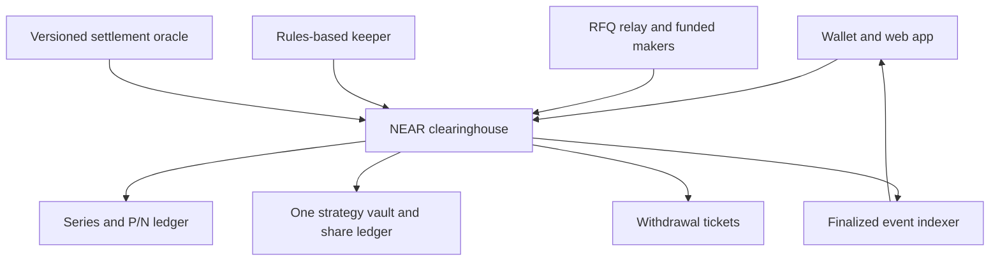

# NEAR options-based index assets: Open Innovation implementation plan

**First deposit and legacy recovery (13 November 2026):** new accounts now review storage plus trading funds in one transaction/approval. Exact two-action wallet validation, amount-bound receipt verification, registration-race guards, schemas, browser form checks and compiled-Wasm success/rollback checks pass. Public first-time browser-wallet acceptance is still pending; existing registrations are unchanged. The retired native-transfer deployment returned **22.186305711682354042994213 test NEAR** to `0xdeepak18.testnet` through confirmed redemptions, withdrawals, storage refunds and surplus transfers. Its operating allocation and remaining owner obligations are preserved; no account/code deletion or active-deployment change occurred. The owner then withdrew 0.07966 NEAR with a verified successful callback; only 0.000002349869425157005740 NEAR free collateral and 0.04096 NEAR storage remain. [Owner withdrawal evidence](research/reports/legacy-owner-withdrawal-confirmed.json). [Recovery receipts](research/reports/legacy-fund-recovery.json), [first-deposit Sandbox evidence](research/reports/first-deposit-sandbox.json). Independent review pending.

**Backend resumed (13 November 2026):** the separate layout-2 core/resolver and ten-market ladder are deployed on public testnet; the 32-test-NEAR funding transfer and all 54 setup operations have confirmed receipts. Both funded makers returned signature-verified P/N offers using retained real Coinbase inputs. Next.js now uses the new deployment. User-approved receipt-based indexing passes same-block reconciliation; FASTNEAR is an additive audit with incomplete full-block coverage. Owner account setup and the 0.1-NEAR deposit are confirmed in retained receipts and the finalized account audit. Read-only RPC failover is activated. Owner P/N buys and sells, withdrawal and split/merge have finalized receipt evidence. New-profile settlement/redemption and subsequent public renewal remain open. Old deployments stay separate. [Evidence and remaining work](research/reports/BACKEND_RESUME_2026-11-13.md). Independent review pending.

**Deferred backend resume checklist (13 November 2026):** [DEFERRED_BACKEND.md](docs/DEFERRED_BACKEND.md) consolidates the live-market ladder, TWAP integration, pricing, indexing, wallet acceptance and release work postponed while frontend work continues. These items remain open; UI completion is not backend acceptance.

**Current version: Open Innovation revision, updated 11 November 2026.** This is the authoritative implementation plan and supersedes the earlier track versions. Scope is end-to-end and dependency-based, without a seven-day constraint.

**New-series settlement direction (11 November, user accepted):** replace the
three-slot profile for future series with immutable expiry/source/selection
terms, authenticated retained expiry evidence, deterministic resolution and
matching maker valuation. The user subsequently selected Deribit's inverse-call
payoff / 30-minute pre-expiry TWAP as the reference design, adapted to NEAR/USD
and native NEAR settlement. A fixed Coinbase trade-history candidate and isolated
resolver are now implemented; new-series activation remains gated. Existing
series retain `native-sampled-v1` terms.
[Venue comparison and acceptance work](research/reports/EXPIRY_SETTLEMENT_COMPARISON.md)
show that conventional expiry settlement can itself use a pre-expiry TWAP.
SPEC records the executable candidate and its bounded verification policy.
[ORC-04 implementation and real evidence](research/reports/ORC04_HISTORICAL_WORKER.md)
now include two real Outlayer historical executions with independent exact
replay, a pinned worker, separate callback resolver and compiled-Wasm lifecycle
tests. A pre-window arithmetic-TWAP valuation candidate, keeper and indexer integration
now pass local checks. Partial-window valuation, live availability limits,
current UI acceptance and public deployment/lifecycle acceptance remain open.
Quotes for the new profile close at the start of the averaging window. Independent
review remains pending; implementation is not release approval.

**Managed indexing direction (11 November):** evaluate SubQuery on OnFinality to
reduce indexer/database operations. [Acceptance requirements](docs/HOSTED_INDEXER.md)
cover native testnet availability, real receipt coverage, same-block parity and
sustained freshness. The user has created `hedgeveil-testnet` on OnFinality.
A native-NEAR SubQuery evidence package now builds and replays the actual 73
transactions / 66 events; it is published to IPFS for deployment. Hosted runner
acceptance is blocked by runner 6.0.2's hard-coded mainnet genesis lookup on
testnet ([startup evidence](research/reports/INF02_HOSTED_STARTUP_FAILURE.md)).
Performance and application cutover remain pending. The retained
local runtime stays active until the hosted replacement passes.

**FASTNEAR discovery direction (11 November, user directed):** consume the hosted
NEAR Data finalized full-block feed alongside the retained reconciler. Durable
cursor/hint storage, receipt-linked discovery, restart/cooldown handling and
explicit discovery health are implemented. This reduces RPC discovery work but
does not outsource the application database/API. Free-feed throttling is observed;
the additive mode preserves journal discovery and every existing receipt,
sequence, custody and freshness check. Sole-source cutover remains gated on
continuous coverage and measured throughput. See [feed operations](services/indexer/README.md#fastnear-full-block-discovery).

**Latest public acceptance (11 November):** eta's three real external reports
finalized and were imported; project accounts redeemed both legs and completed a
native withdrawal. Actual receipt replay reconciles 71 transactions / 63 events.
Owner-wallet P redemption and withdrawal subsequently passed (73 transactions /
66 events reconciled). Owner N purchase on a later series and sustained indexer
freshness remain incomplete. [Evidence and remaining steps](docs/ACCEPTANCE_RUN_2026-11-11.md).

**Selected track:** Open Innovation (`open`). **Product:** a NEAR-native protocol for fully collateralized complementary options claims, a funded market, and a transparent rules-based USD-tracking vault. Native NEAR is the collateral; USD is the first reference unit. Positions, trades, vault holdings, settlement evidence, and accounting are public.

**Required release:** working contracts on NEAR testnet, wallet and web UI, funded demo makers, the complete options lifecycle, external market observations feeding a versioned settlement resolver, risk simulations, recovery tools, and a reproducible public repository. Local development and deterministic tests must run without paid API credentials or mainnet funds. Public release requires a verified external data integration; unavailability blocks release rather than permitting synthetic substitution. Use local services and faucet-funded testnet accounts; free hosted services are conveniences, not correctness dependencies.

**Removed from implementation scope:** confidential notes and balances, ZK circuits/provers, encrypted RFQs, shielded-note recovery infrastructure, private AI, NEAR AI Cloud, TEE attestation, and AI-specific retention or verification workflows. NEAR Intents, Chain Signatures, and cross-chain execution are also excluded from this release. Ordinary wallet security, secure transport, secret management, and software security remain required.

The [official Open Innovation brief](https://github.com/nearai/near-hackathon-prompt-examples/blob/main/tracks/13-open.md) invites experimental approaches to money and ownership. Its inheritance-account prompt is an example, not this product's specification. The published brief does not impose that example's Chain Signatures architecture on all submissions. The contribution here is an implementation and economic evaluation of options-backed index exposure on NEAR, with explicit attribution to the original research.

**Release scope decision (9 November 2026, user approved):** G9 is options-first.
The public testnet release covers storage, deposit, pair creation, transfer,
funded RFQ trading, merge, externally sourced sampled settlement and tested pause/delay handling, both-leg redemption,
withdrawal and restart/recovery. The tracking vault remains disabled on testnet;
its existing Sandbox mechanics and failed economic selection results remain
research evidence. Policy selection, basket subscription and keeper rolls are
prerequisites for a later vault release, not this options release. This changes
release scope, not payoff, custody or withdrawal semantics. Independent review
and actual public-wallet receipts remain required.

**Real-data release decision (9 November 2026, user directed):** No synthetic
settlement observations, fixed fixture maker marks or fabricated market activity
in the public product/demo. Deterministic fixtures and synthetic stress scenarios
remain test/research tools only, explicitly separated from release evidence.
External observation authenticity, coverage under the accepted settlement profile, adapter acceptance
and market-derived maker pricing are now G7/G9 prerequisites, not deferred solely
to production. Missing data causes no quote or delayed settlement, never a fixture
fallback. Faucet-funded testnet collateral is still test currency. The old public
setup is held until these replacements and the revised budget are accepted. See
[the implementation gap inventory](docs/REAL_DATA_READINESS.md).

**Settlement decision (10 November 2026, user approved):** Public testnet uses
`native-sampled-v1`: the floor average of three fresh external on-chain reports
sampled in fixed slots, a 60-second review delay, and a guardian with pause-only
authority. Report timestamps mean source ingestion time, not venue trade time.
Missing samples delay settlement indefinitely; no synthetic or administrator-price
fallback is permitted. This decision supersedes historical-venue replay and
bonded-dispute requirements **for this testnet profile only**. It changes neither
existing series nor production requirements. Fresh-source/code verification,
operational collection, actual public receipts and independent review remain
outstanding. Approval of the design does not establish source acceptance or
remove the deployment hold. See [SPEC](docs/SPEC.md#orc-03-native-sampled-resolver-testnet-design-accepted).

**Status (9 November 2026):** this remains the authoritative target, not a completion claim. Local G1–G6 contract/economic experiments and G7 SDK, indexer and APP-02 browser work now have recorded evidence in [STATUS](docs/STATUS.md), including [35 local browser checks](research/reports/G7_APP.md) and [DEM-01 retained local restart evidence](research/reports/G7_DEMO_RESUME.md). [SEC-01 bounded local verification](research/reports/G8_SECURITY.md) now adds finite interleaving models, bounded symbolic accounting checks and seeded signed-trade/ledger/fault coverage; G8 still requires broader acceptance and independent review. [SEC-02 review preparation](docs/SECURITY_REVIEW.md) now pins a committed local candidate and its source/Wasm/evidence bundle; independent findings and sign-off remain pending. [REL-01 local release rehearsal](research/reports/rel01-local.md) now adds 109 fresh-local-clone runtime checks and a verified source/Wasm/evidence archive. [APP-01 wallet-boundary evidence](research/reports/G7_WALLET_BOUNDARY.md) now adds the testnet SDK profile, durable wallet handoff and 14 real Chromium/Sandbox boundary checks; [NEAR Connect UI](docs/NEAR_CONNECT.md) now adds a separate local testnet wallet desk with pinned Meteor/Intear executors, account selection and durable handoff/recovery. A [navigation follow-up](research/reports/G7_WALLET_ORIGIN_FIX.md) fixes external links being rejected by the local-origin guard. Actual vendor-wallet signing, reconciled testnet indexing and public-testnet execution remain pending. Vault policy selection remains future work. Independent review, a fresh release rehearsal for the updated candidate, published-candidate reproduction and video remain pending; G7/G9 are not complete. Production deployment is a separate, optional workstream with paid operations and independent review requirements; it is not a hackathon completion gate. Local arithmetic or Sandbox checks do not establish production safety.

No implementation plan can guarantee zero bugs or zero losses. This plan specifies the loss mechanisms, separates solvency from tracking performance, and requires evidence before moving between stages.

**1. Research conclusions and decisions**

The proposal separates collateral-backed claims from the strategy that tries to track an index. Its discussion raises material objections: norswap questions arbitrary-index replication; conalloreilly highlights tracking degradation; equivrel raises theta, which Czar102 disputes through a different payoff interpretation. Czar102 also favors testing short maturities and scheduled rolls. JSeam2 emphasizes liquidity. CertifiedCryp proposes redundant settlement observations. Xatarrer and KG describe perpetual/barrier alternatives with different oracle dependencies. mmchougule describes physical settlement and scoped verification. Vitalik’s later clarification ties liquidation avoidance to bounded losses covered by collateral. These are research inputs, not verified performance claims. [Proposal and comments](https://ethresear.ch/t/building-index-tracking-assets-on-top-of-options-instead-of-debt/25036), [Czar102’s detailed response](https://ethresear.ch/t/building-index-tracking-assets-on-top-of-options-instead-of-debt/25036/9).

My engineering decisions following that review:

| Issue | Decision | Evidence required |
|---|---|---|
| Ambiguous denomination | Specify every price as numerator/denominator; derive the payoff independently | Dimensional analysis and golden vectors |
| Tracking under stress | Show capped target exposure and actual executable value | Gap, drawdown, and unavailable-liquidity simulations |
| Theta disagreement | Value the complete position, with explicit numeraire and assumptions | Independent pricing implementations and sensitivity tests |
| Rolling versus reactive trading | Compare scheduled, reactive, and hybrid policies | Out-of-sample net results after spreads and failed fills |
| Thin markets | Build funded RFQs before an AMM | Real competing quotes and maker inventory accounting |
| Oracle redundancy | Separate data providers, signers, and adjudicators | Dependency map and historical-data reproduction |
| Perpetual/barrier alternatives | Keep them as separately specified future products | New payoff specification, oracle model, and review |
| Physical settlement | Keep as a separate on-chain-asset product | Exercise-window, stablecoin, and delivery-risk analysis |
| Verification claims | Prove this implementation’s properties | Traceability from theorem/model to shipped Wasm |

**Current integration findings:**

- Open Innovation (`open`) is the sole planned submission track. A working public repository and public X demonstration identifying the hackathon are required. The listed deadline is **14 November 2026, 23:59 UTC / 15 November 2026, 05:29 IST**. Keep delivery gates independent of that calendar; do not remove safety checks to meet it. [Hackathon requirements](https://nearhackathon.com/)
- NEAR's faucet supplies testnet tokens for development. It may be unavailable or depleted, so fund demo accounts in advance and retain a fully reproducible local Sandbox mode. Test tokens are not claims on real NEAR or USD. [NEAR faucet](https://docs.near.org/getting-started/faucet)
- Authenticated external observations across all three fixed slots are required for public testnet acceptance. Cost, source dependence and authority must be disclosed; production economic security remains a separate gate.
- Pyth Core's documentation reports that NEAR support ended on 26 August 2026. Recheck integration status before a production decision; do not copy an obsolete address. [Pyth NEAR status](https://docs.pyth.network/price-feeds/core/use-real-time-data/pull-integration/near)
- A production source such as OutLayer is a candidate only. A producer signature does not establish price correctness, historical coverage, or free access. An accepted external data source is required for release; Outlayer is not yet accepted for settlement. [NEAR oracle directory](https://docs.near.org/primitives/oracles), [OutLayer documentation](https://price-oracle.outlayer.ai/docs/)

**2. Product boundary and definition of completion**

Use three user roles:

1. **Saver:** buys a portfolio intended to have lower USD volatility than NEAR and sees its remaining NEAR exposure.
2. **Risk taker:** buys the complementary upside claim with a bounded loss equal to the amount paid; no borrowing or margin account is created.
3. **Maker:** funds quotes, holds inventory, and earns spreads while taking inventory and adverse-selection risk.

The first complete release includes:

- Native NEAR deposits and withdrawals, with separately funded storage and operating balances.
- Creation of standardized option series; split, transfer, merge, settlement, and redemption.
- A funded RFQ market for both claims, including direct old-series/new-series exchanges.
- A delayed, challengeable settlement workflow and evidence viewer.
- One transparent USD-tracking strategy vault, transferable shares, and in-kind exits.
- Portfolio, quote, transaction-recovery, liquidity, and risk interfaces.
- Reproducible economics experiments, adversarial contract tests, and monitoring.
- A deterministic local test runner and complete faucet-funded testnet lifecycle with authenticated external market observations. All user-facing balances and trade history are public on-chain.

Do not promise a $1 redemption, principal protection, continuous liquidity, guaranteed yield, or uninterrupted index replication. A vault share is ownership of a changing portfolio. Initial UI normalization to $1 does not create a peg.

Keep leverage borrowing, collateral rehypothecation, collateral staking, arbitrary user-authored payoff functions, CPI/rent feeds, physical settlement, and multichain collateral custody outside this initial security boundary. Each needs a later release with its own acceptance tests.

**3. Financial specification: implement this before contracts**

Use explicit symbols:

- `C`: NEAR deposited for a position.
- `X_M`: USD per NEAR under the series’ observation rule at maturity.
- `K`: USD target per one NEAR-sized pair, fixed at series creation.
- `M`: observation/maturity time; distinct from the later time when the oracle finalizes.
- `P`: capped USD-target claim.
- `N`: complementary upside claim.

For a one-NEAR pair, define the collateral fractions:

```text
p = 1                         if X_M <= K
p = K / X_M                   if X_M > K
n = 1 - p

P payout in NEAR = C × p
N payout in NEAR = C × n
```

With `K > 0`, the first branch also defines the mathematical zero-price limit without division by zero. Operationally, a reported zero requires the oracle’s explicit zero-price policy; an API error or missing observation is never a valid zero.

Independent checks in USD at the observation price:

```text
P value at M = C × min(X_M, K)
N value at M = C × max(X_M - K, 0)
P value + N value = C × X_M
```

Example: deposit one NEAR and set `K = $2`. These are illustrative prices, not current market quotes.

| NEAR price at M | P payout, NEAR | N payout, NEAR | P value at M | N value at M |
|---|---:|---:|---:|---:|
| $8 | 0.25 | 0.75 | $2 | $6 |
| $4 | 0.50 | 0.50 | $2 | $2 |
| $2 | 1.00 | 0.00 | $2 | $0 |
| $1 | 1.00 | 0.00 | $1 | $0 |

This establishes bounded collateral obligations. It also establishes that the saver absorbs a shortfall below the strike. Owning both legs preserves the collateral exposure; it does not produce stability.

Before maturity, the terminal payoff evaluated at today’s spot is **not** a fair option price. As an analytical benchmark with zero collateral dividend, a European model gives `N_USD = Call(X,K,tau)` and `P_USD = X - Call = K exp(-r tau) - Put`. Use that identity to detect incorrect long-put interpretations. Actual prices must come from executable markets; the model is only a diagnostic. Include interest, volatility, jumps, time to expiry, and collateral opportunity cost in economics research.

For a later arbitrary index, define `I_t` as USD per index unit and `R_t = I_t / X_t` as NEAR per index unit. A claim targeting `a` index units per pair can pay `min(1, a R_M)` NEAR, with the complementary leg receiving the remainder. This tracks the target only while the collateral cap is not binding. Implementing `K/x` with an unspecified ticker can invert the intended exposure.

**Settlement-delay exposure:** if `X_M = $4` and `K = $2`, P receives 0.5 NEAR. If finalization happens when NEAR is $2.40, that payout is then worth $1.20. Slow finality does not lock in the USD value until withdrawal. Model this interval and display it.

Financial-spec deliverables:

- Definitions, units, cap behavior, observation policy, fee treatment, and rounding.
- Numerical examples for all branches and inverse-price conversions.
- Independent reference implementation using rational/decimal arithmetic.
- Scenario generator for price paths, liquidity paths, and oracle delays.
- A statement of what is guaranteed by accounting versus assumed about markets.

**4. Architecture and trust boundaries**



Implement the clearinghouse as one Rust/Wasm contract with separate, testable modules for accounting, series, claims, exchange, vault, shares, and withdrawal tickets. Keeping critical balance changes in one receipt makes pair creation, internal trading, rolls, and in-kind vault redemption atomic. It enlarges one contract’s review scope, so keep its functionality narrow and cap series count and batch size.

Use a separate versioned settlement-oracle contract. Backend services can relay messages, index events, and suggest transactions, but cannot alter balances or finalize arbitrary prices. Maker collateral stays in contract escrow. The keeper has no withdrawal or upgrade authority.

**Suggested stack:** Rust with a pinned supported `near-sdk`; a pinned NEP-245 implementation/conformance suite for P/N claims; NEP-141/145/148 for one vault share token; TypeScript SDK and backend; React/Next.js UI; PostgreSQL indexer; Python reference simulator; Rust property testing and NEAR Sandbox integration tests. Pin resolved versions and toolchains in lockfiles after a compatibility spike. Do not copy obsolete package versions from a tutorial.

The core may expose NEP-245 P/N interfaces and one NEP-141 vault-share interface on the same account because their method namespaces differ. Keep their supply, metadata, registration, and balance namespaces distinct. Validate this combination against wallets and indexers before committing. NEP-245’s existence does not guarantee external DEX or wallet support. If compatibility fails, retain the core ledger and add an explicitly backed adapter after separate review. [NEP-245](https://github.com/near/NEPs/blob/master/neps/nep-0245.md), [FT standards](https://docs.near.org/primitives/ft/standard)

**Token callbacks and custody:** ordinary transfers and internal fills are the first release path. If `mt_transfer_call` or `ft_transfer_call` interfaces are exposed, implement and test their full receiver/resolver semantics. Pending receiver calls must not allow returned claims to be minted again or exceed the receiver's remaining balance; share supply must stay consistent if receiver actions burn shares before resolution. Do not advertise standards compliance while stubbing required methods. Registration costs, forced-unregister restrictions, storage refunds, and zero-balance cleanup need explicit tests. Until these interfaces pass, expose the public internal ledger through the SDK and treat token composability as incomplete.

Native NEAR is the recommended collateral to avoid introducing a bridged ETH custodian into the base solvency argument. An ETH-collateral deployment is a later alternative with its own bridge or remote-custody trust model. Remote custody is outside this release.

**5. Contract data model and accounting**

`Series` contains immutable terms:

```text
series_id, version, collateral_kind=NATIVE_NEAR
index_definition_hash, payoff_kind, strike, price_scale
maturity_ns, observation_window, oracle_config_hash
mint_cutoff_ns, finalization_policy, max_supply
state, final_price, p_coefficient, n_coefficient
outstanding_p, outstanding_n, reserved_collateral
```

Other records:

- `Balances`: per-account free collateral, reserved order collateral, P/N balances, vault shares.
- `Quote`: exact legs, maker, optional taker, expiry, nonce, domain, all-or-nothing fill rule, rounding, fees.
- `VaultState`: tracked holdings, share supply, policy version, outstanding roll proposals, risk state.
- `Withdrawal`: ticket ID, owner, destination, amount, state, receipt correlation, attempts.
- `OracleRequest`: immutable series terms, evidence hash, report/proposal, deadlines, disputes, final result.
- `StorageAccount`: paid storage, used bytes, refund eligibility; isolated from collateral.

Every balance change has a canonical event with schema version, operation ID, actor, asset IDs, integer deltas, fees, and resulting state references. Events are public audit data; final contract state is authoritative. Read methods expose series reserves/supplies, account balances, funded-order locks, vault baskets, withdrawal tickets, and current policy/oracle versions. Paginate all lists and bound batch sizes.

Only allow bounded standardized series in v1. A creation fee and explicit supply cap prevent storage spam and unlimited oracle liabilities. Reject duplicate asset IDs in every batch. Never allow a caller-supplied account string to authorize debits from the vault’s reserved inventory.

**Integer arithmetic:** balances use native atomic units; JSON amounts are decimal strings. Use a common fixed scale, for example `Q = 10^24`, and checked U256 intermediates for multiply/divide operations. With validated positive `X > K`, compute `p_q = floor(K Q / X)` and `n_q = Q - p_q`. With `X <= K`, use `p_q = Q`, `n_q = 0`. Prove bounds against maximum accepted prices, balances, and exponents.

Redemption credits `floor(amount × coefficient / Q)` atomic NEAR units. It burns the specified claim amount and reduces that series’ reserve by the credited amount. Round payouts down; round required inputs up. Track residual dust separately. Dust cannot be swept until both claim supplies are zero and no redemption obligation remains. Zero-payout claims must still be burnable. Tests must bound aggregate dust under repeated small redemptions and prove splitting a redemption cannot increase payout.

Series reserves are not user free balances. Moving collateral between those categories must be explicit and conservation-preserving. Fees are funded in addition to collateral or taken from an expressly priced trade; never silently subtract a fee from backing that was promised to claims.

Native account balance includes operational funds and storage stake. Do not use the raw account balance as reserve accounting. Reconcile custody against series reserves, free balances, fee balances, oracle bonds, storage liabilities, and pending withdrawals. Model funds in flight separately so an uncertain withdrawal is neither spendable nor counted twice.

**6. Contract state machines and method contracts**

Series lifecycle:

```text
OPEN -> MATURED_PENDING -> PROPOSED -> FINALIZED -> CLOSED
                              |
                              v
                           DISPUTED -> FINALIZED
                              |
                              v
                       RESOLUTION_DELAYED
```

Maturity is enforced from block time in every relevant method, not by whether a keeper has updated a stored status. Pause is an independent scoped flag, not a rewrite of the economic lifecycle.

| Method | Preconditions | Required effect |
|---|---|---|
| `deposit_collateral()` | Registered account; positive attached collateral | Credit free collateral; account for registration separately |
| `create_series(config)` | Valid future terms, approved oracle version, caps | Create immutable series and deterministic claim IDs |
| `split(series, amount)` | Before mint cutoff; sufficient free collateral | Debit collateral; reserve it; mint equal P/N quantities |
| `merge(series, amount)` | Before finalization; caller owns matching P and N | Burn both; release exactly corresponding collateral internally |
| `fill_quote(quote)` | Valid authorization/domain/nonce/expiry; funded legs | Move all exact legs and fees atomically; consume quote nonce |
| `cancel_quote(nonce)` | Authorized maker | Mark an unused nonce cancelled; prevent future execution |
| `request_resolution(series)` | Maturity observation window ended | Request the predefined historical fact |
| `accept_final_resolution(...)` | Authenticated finalized oracle result; matching config | Store immutable price and complementary coefficients |
| `redeem(series, leg, amount)` | Finalized; sufficient claim balance | Burn claims; credit calculated collateral internally |
| `vault_mint_basket(...)` | Exact proportional basket; user input/min-share limits | Transfer holdings and issue shares atomically |
| `vault_redeem_in_kind(shares, minima)` | User owns shares; no conflicting locked amount | Burn shares and credit proportional holdings |
| `execute_roll(proposal, quotes)` | Policy-compliant, fresh, fully funded quote set | Swap vault holdings atomically; record realized costs |
| `request_withdrawal(amount, receiver)` | Authorized owner; enough free collateral | Debit first; create ticket; initiate transfer |
| `on_withdrawal_result(ticket)` | Private callback; expected pending ticket | Complete or restore balance once from actual result |

Resolution import is asynchronous: the clearinghouse calls its allowlisted oracle contract and accepts the returned final record only through a private callback bound to the original series/request ID. A caller's pasted JSON or an unauthenticated price is never sufficient. Validate the oracle account/version, config hash, finalized status, observation interval, units, price bounds, and duplicate-finalization state. A failed import leaves the series pending and can be retried idempotently. The demo resolver uses this same boundary.

Pair merges remain available while the oracle is pending or disputed: ownership of both complementary legs removes the need for an oracle. After finalization use leg redemptions; do not run the pre-finalization merge calculation against a partially redeemed pool.

For native NEAR deposits, collateral can be credited within the receiving method because the attached transfer and method are part of its execution. For later FT collateral, validate the token predecessor and the transfer/refund semantics before any credit. Do not infer a deposit from a backend transaction hash. [FT receiver security](https://docs.near.org/smart-contracts/security/cross-contract-calls/ft-transfer-call)

**7. NEAR asynchronous failure design**

NEAR callbacks are separate receipts. A failed callback does not roll back a successful earlier transfer, and the callback is not automatically retried. This must be reflected in the protocol design. [NEAR callback failure guidance](https://docs.near.org/smart-contracts/security/cross-contract-calls/callback-failures)

Withdrawal states:

```text
AVAILABLE -> PENDING -> SUCCEEDED
                    -> FAILED_CONFIRMED -> AVAILABLE
                    -> UNKNOWN -> verified recovery
```

- Preallocate ticket storage, debit the balance before scheduling the outgoing transfer, and use a small private callback with measured worst-case gas.
- Store destination and amount before calling out. A callback cannot choose a new recipient.
- Return failed transfers to the same owner’s internal balance once, after a confirmed failure.
- Treat an unobserved or failed callback as `UNKNOWN`. A timeout does not prove that money was not delivered.
- Never resend or re-credit an unknown withdrawal merely because an RPC request failed.
- Version callback payloads; block upgrades with unsettled operations on upgradeable test deployments.
- Test malformed return values, insufficient callback gas, interleaved calls, and failure after external success.

**Recovery is a production gate:** a generic native transfer does not expose an idempotent business receipt that the core can simply query. Before public deposits, implement and review either verified receipt-outcome recovery or an idempotent payout adapter with queryable durable results. If a restricted recovery committee is used instead, disclose its authority to adjudicate outcomes and cap the exposure; it is an added trust assumption. Until that recovery mechanism passes fault injection, the release remains testnet-only. The safe interim behavior is quarantine, not a possible double payment.

Privileged methods and user money movement need correct predecessor checks and the appropriate deposit-capable authorization. Standard function-call keys cannot attach deposits; do not grant a keeper a full-access key merely to bypass this. Keeper accounts call narrowly authorized methods using their own funds, with policy enforced by the contract. [One-yocto authorization guidance](https://docs.near.org/smart-contracts/security/one_yocto)

**8. Settlement oracle: a complete product dependency**

**9 November 2026 — ORC-03 feasibility:** Outlayer has a read-only NEAR/USD
probe, with retained public RPC evidence and exact integer normalization. Both
observed native deployments returned no cached NEAR price. The reviewed upstream
callback path uses ingestion time; it does not establish our historical expiry
window. This is not an accepted settlement integration. Keep the synthetic
resolver for deterministic local tests; hold public setup and its old 81-test-NEAR
budget pending an accepted source/adapter and revised costs. Production and the
vault remain disabled. See [evidence and remaining gates](research/reports/OUTLAYER_FEASIBILITY.md).


**Public deployment increment (10 November 2026):** the user approved the
transfer-only layout and funding. All 18 setup operations have complete successful
finalized receipts. Both contracts and funded maker inventories are deployed.
Public wallet trading/settlement acceptance remains open: the runtime indexer is
currently catching up and blocks risk. The first actual source refresh succeeded
but RPC delays caused a missed slot; `alpha` remains delayed. Both makers merged
their intact P/N pairs back to free collateral using confirmed normal merge
transactions. This does not establish successful settlement. See
[actual deployment evidence](research/reports/ORC03_PUBLIC_DEPLOYMENT.md).

**Free RPC increment (10 November 2026):** FASTNEAR is the current native
primary, with NEAR archival as indexer read fallback after six successful
compatibility reads each. The indexer now paces public reads and respects 429
cooldowns; full receipt/state verification is unchanged. Public reconciliation
and lifecycle acceptance remain pending; selecting a provider is not acceptance.
See [provider evidence](research/reports/testnet-rpc-provider-check.json) and
[runbook](docs/TESTNET_SETUP.md). Independent infrastructure/security review pending.

**Indexer catch-up increment (10 November 2026):** the native local demo now
has a tested journal-discovery profile and Neardata header prefetch. It retains
complete finalized ancestry, actual FINAL receipt trees and all state checks;
journals are hash hints only. Missing external operations fail reconciliation.
Public catch-up acceptance is still pending. See [source decision and tests](research/reports/INDEXER_SOURCE_DECISION.md)
and [current release gates](docs/REAL_DATA_READINESS.md). Independent review pending.

**Public indexer acceptance increment (10 November 2026):** the native runtime
now has a fresh RECONCILED checkpoint: 20 actual transactions, 68 outcomes and 15
canonical events; core and external resolver state match receipt replay. The
selected bounded `canonical-journal` profile verifies canonical receipt blocks
and same-block snapshots, with its RPC-trust/journal-coverage limits documented
in SPEC. Earlier full-ancestry profiles are preserved. See [actual checkpoint](research/reports/native-public-indexer-reconciliation.json).
A real process restart retained all receipt/event counts, balances and resolver
commitment and resumed fresh reconciliation; see [restart evidence](research/reports/native-public-indexer-restart-check.json).
This does not complete wallet trading/settlement/withdrawal acceptance or
independent review; see [remaining gates](docs/REAL_DATA_READINESS.md).

**Wallet funding and beta increment (10 November 2026):** actual owner storage
registration (0.04096 test NEAR) and collateral deposit (0.1) are verified against
complete FINAL receipts and reconciled state. Beta has four confirmed setup
operations and actual Coinbase-derived strike 3.6278 USD; its immutable sampling
window is 07:22:34.923–07:31:34.923 UTC. See [funding evidence](research/reports/native-public-wallet-funding.json)
and [beta setup](research/reports/native-public-beta-setup.json). Intear is the
free active primary after FASTNEAR rate limits; no attempted write was resent.
Public maker cancellations are durably journaled and discovered by the indexer;
90-second testnet quotes allow wallet review while retaining maturity bounds.
Actual user fills and successful settlement/redemption/withdrawal remain pending.
Independent review remains pending; production and vault remain disabled.

**Beta failure follow-up (10 November 2026):** beta missed its first actual
sample and remains delayed. User quotes returned generic maker-unavailable;
no owner trade was submitted, and 0.1 test NEAR remains free. Both makers merged
intact pairs normally; an initially unknown merge was recovered without resend.
The quote/preview gateway now blocks missed samples explicitly. Concurrent
collector reads retain the same freshness bounds and pass compiled-Wasm local
sampling/finalization/redemption/withdrawal tests; the public read-only pass took
3.9 seconds. Successful public sampling and wallet lifecycle remain open. See
[status and evidence](docs/STATUS.md) and [readiness](docs/REAL_DATA_READINESS.md).

**Authenticated callback handoff (10 November 2026):** gamma also missed its
first sample and its intact maker pairs were normally recovered. An actual
bounded refresh then authenticated callback-block code/state in 354 ms, with
report age 1.049 seconds. The collector immediately samples after that verified
handoff, preserving every on-chain rule and the 15-second preflight. Delta is
now deployed with window 08:02:46.796–08:11:46.796 UTC; successful sampling and
owner lifecycle remain pending. A real maker P-claim transfer round trip passed.
See [handoff evidence](research/reports/native-public-refresh-handoff.json),
[delta setup](research/reports/native-public-delta-setup.json) and
[transfer receipts](research/reports/native-public-claim-transfer.json).

**Source-cache correction (10 November 2026):** delta accepted one actual sample,
then the source reused its 300-second stored report with a new response-wrapper
timestamp. The verifier correctly rejected that mismatch. Three fresh reports
cannot reliably fit the previous 180-second slots. The collector now waits on
stored report cache expiry; new series use three 360-second slots (18 minutes),
with unchanged freshness and payout rules. Existing terms remain immutable.
Twenty focused tests and seven compiled setup/reconciliation checks pass. Delta
maker pairs were normally recovered; owner collateral remains 0.1 test NEAR.
See [actual cache evidence](research/reports/native-public-source-cache.json)
and [current status](docs/STATUS.md). Successful public lifecycle remains pending.

**Public source increment (10 November 2026):** an actual owner-wallet request
now has complete finalized receipts and matching source state at its callback
block. The native 48-test-NEAR setup has passed compiled-Wasm restart/inventory/
indexer checks. Meteor blocked its key-adding wallet request; the `native` plan
is held with the original attempted journal preserved. A separate transfer-only
plan uses five locally controlled implicit service accounts, retains the same
48-NEAR budget, and passes nine compiled-Wasm setup/restart/indexer checks. Its
changed account layout and ordinary transfer still require owner review/signature;
public funding and deployment are not complete. See
[refresh/setup evidence](research/reports/ORC03_PUBLIC_REFRESH.md). Historical
feasibility findings below retain their original scope.

**ORC-03 intake increment (9 November 2026):** offline signed-response verification
and immutable archival replay are implemented. The provider documentation example
fails verification; live interoperability and settlement remain unaccepted. This
step uses no paid API. See [evidence](research/reports/ORC03_SIGNED_INTAKE.md).

**Implementation increment (10 November 2026):** market-derived maker pricing now
has actual external-data Sandbox fill evidence. A separate native sampled resolver
candidate passes 24 compiled-Wasm source-fault, import, redemption, withdrawal
and PostgreSQL reconciliation/restart checks. Indexed state discloses authority
accounts and detects missing samples. A separate non-executable 48-test-NEAR
budget draft is held for source and policy acceptance. Its ingestion-time reference and guardian veto are explicit candidate
semantics, not approved historical-venue settlement or bonded arbitration. The user accepted its sampled-price/pause-only design on 10 November; public
source acceptance remains pending. See [implementation evidence](research/reports/REAL_DATA_IMPLEMENTATION.md).

Use two separate price pipelines:

1. **Settlement pipeline:** binding historical observation at M; slow, evidence-backed, challengeable.
2. **Execution/risk pipeline:** current market observations for quote freshness, vault trade guards, and displays; never changes the finalized settlement result.

The strategy may require current price information even when base solvency does not. State that dependency plainly.

At series creation, hash the complete observation specification:

- Asset identity, quote currency, units, and decimal scale.
- Exact UTC observation interval, aggregation and sampling rules.
- Authorized data sources and required independent source count.
- Upstream timestamp policy, maximum missing coverage, and outlier handling.
- Whether USD is directly observed or converted from another quote asset; a USDT pair must not silently be treated as USD.
- Treatment of market disruption, zero prices, feed discontinuation, and later data corrections.
- Proposer rules, bond currency/amount, challenge duration, adjudicators, deadlines, and fallback hierarchy.

**Candidate production research configuration:** a five-minute trailing observation window ending at M; source-by-source time-weighted observations followed by a median across eligible sources; at least three independently operated sources; 24-hour proposal challenge; a distinct arbitration deadline. Use separate short windows for explicitly labelled deterministic testnet fixtures. These values are starting experiments, not production-safe defaults.

Flow:

1. Independent collectors archive timestamped source observations and immutable evidence bundles.
2. A bonded proposer submits the result, series/config hash, observation interval, and evidence hash.
3. Anyone can challenge during the fixed window with conflicting evidence and a bond.
4. An undisputed proposal finalizes only after the deadline and required authentication checks.
5. A disputed proposal is resolved by the precommitted adjudication mechanism; its evidence and signatures are public.
6. Finalization is one-way. Admins cannot replace a finalized price.

For the prototype, use clearly labeled test signers and a simulated adjudicator. For a capped pilot, a disclosed threshold committee can be used only after its independent operators, source dependencies, signer rotation rules, and corruption risk are reviewed. Multiple processes under one operator are not independent oracles. A proposed 3-of-5 report quorum is an engineering test fixture, not a decentralization claim.

For a later production release, if OutLayer is selected as one observation source, validate attestation/key pinning and upstream age semantics. Do not assume that a current signed quote can resolve an old maturity. Build a proof of concept that reproduces an old window after downtime, using evidence acceptable to the contract’s resolution mechanism. Treat historical retention, licensing, and source outages as explicit dependencies. [OutLayer signed data documentation](https://price-oracle.outlayer.ai/docs/)

**Failure hierarchy:** primary evidence -> precommitted independent historical fallback -> precommitted arbitration -> delayed resolution. Never silently settle at the latest price, an arbitrary 50/50 split, or an administrator’s convenient number. If every source/arbitrator fails, single-leg funds may remain locked; display that liveness risk. Pair merges and vault in-kind exits remain available where their own invariants permit.

Monitor and cap **aggregate** exposure across all series that share the same oracle/fallback. An inexpensive proposal bond does not secure a large pool against bribery. Require a documented economic-security budget, funded monitoring, and loss exposure analysis before raising TVL.

**9. Market structure and liquidity bootstrapping**

First implement fully funded RFQs and limit offers in the core. A relay distributes requests; it cannot execute an unauthorized trade or invent maker balances. A maker quote must be both authorized and backed by sufficient escrow at fill time.

Each signed quote binds:

```text
protocol version, network, contract, maker, optional taker
input/output asset IDs and exact integer amounts, all-or-nothing fill
fees, rounding rule, nonce/cancellation epoch, expiry
authorized signing key and signature scheme
```

Use a protocol-specific signing-key registry, registered/revoked through the maker’s NEAR account. Do not assume that an arbitrary NEAR account key is available to verify off-chain signatures inside another contract. Domain-separate protocol RFQs from login signatures, oracle reports, and unrelated application messages. The first release uses all-or-nothing quotes: a successful fill consumes the entire nonce. Multiple outstanding quotes may reference the same maker inventory, so every fill rechecks spendable balances atomically; an RFQ is not a reservation guarantee. On-chain resting offers, if added, explicitly lock their inventory. Partial fills are a later feature requiring cumulative rounding, overfill, and cancellation-race tests.

Bootstrap with two independently running funded makers in testnet. Implement their inventory targets, maximum position size, stale-price cutoff, loss limit, quote TTL, and automatic quote withdrawal. Publish test/demo funding and subsidies separately from organic volume.

Offer three mechanisms:

- Buy/sell a single P or N claim against escrowed NEAR.
- Match P and N demand into a newly collateralized pair, with all funding and fees reconciled atomically.
- Exchange old P directly for new P plus any collateral adjustment, avoiding two sequential market orders.

Use a gradual limit-price schedule or bounded auction for vault rolls. Its minimum output and maximum cost must be fixed by policy before execution. The auction may end unfilled. Do not implement an emergency unconditional sell.

Liquidity economics must answer:

- Why does someone want N at the strikes desired by savers?
- How much inventory and hedge capital do makers need?
- What happens when makers lose money and withdraw?
- What proportion of trading is subsidized?
- At what trade size does the strategy become uneconomic?

Lower strikes can reduce the saver’s tail exposure but also change the risk taker’s leverage and willingness to pay. Do not assume the counterparty exists because the payoff is mathematically valid.

Track executable spread, depth within stated bounds, fill ratio, time-to-fill, concentration, inventory, and rejection reasons. Gate vault capacity by stressed executable depth, not by nominal deposited collateral. Avoid an AMM until informed flow and inventory behavior are measured.

**10. Tracking vault, share issuance, and redemption**

Start with one deterministic strategy and a maximum of four held series. It may keep a small disclosed NEAR cash buffer; that buffer creates USD exposure and belongs in tracking statistics. Each policy version fixes allowed series, maturity bounds, maximum fees, maximum per-roll loss, quote-age requirements, trade-size cap, and keeper permissions.

Vault-share NAV is an estimate for reporting, not a promise. In collateral units:

```text
NAV_est = cash + sum(quantity_i × marked_price_i) - accrued liabilities
NAV_per_share = NAV_est / circulating_shares
```

Distinguish executable bid, executable ask, reference mark, and model estimate. If markets are stale or empty, label NAV uncertain; do not substitute terminal intrinsic value and call it a live price.

**Avoid stale-NAV issuance:**

- The core accepts proportional in-kind baskets to mint shares. Given existing shares S and holdings h_i, a user minting s shares supplies at least `ceil(s h_i / S)` of every holding, with input limits and minimum shares.
- A user starting with NEAR can purchase the required basket through funded RFQs and then mint shares in one bounded core operation, or buy existing shares from a market maker.
- Bootstrap through a predefined seeded basket and explicit initial share scale; test first-depositor and donation manipulation.
- Incoming transfers do not automatically increase managed vault holdings. Only authorized accounting transitions can do that.
- Do not accept arbitrary collateral at a backend-computed NAV in v1.

Dust policy must also cover shares: define minimum practical mint/exit amounts, reject a mint with no useful output, and when the last outstanding shares are burned transfer all remaining managed basket quantities to that holder. Separate accrued fee liabilities before the proportional calculation. Closing an empty vault cannot strand user holdings or let an unsolicited donation seize the next bootstrap. Policy changes affect a new vault version; holders keep exits from the old version.

**In-kind exit is mandatory:** burning s shares returns the pro-rata cash and claim basket, with conservative rounding and user minima. Pending-maturity claims remain claims; the system does not promise immediate cash conversion. Users can retain or trade them independently. Claims remain redeemable through the core even if the strategy service stops.

Collateral-only exits are quote-based conveniences. If the user’s minimum cannot be met, leave their shares intact or use their expressly chosen in-kind exit. Do not sell illiquid assets for early redeemers while leaving only impaired claims for others.

**Roll execution:**

1. Keeper identifies an eligible roll under the immutable policy version.
2. It requests competing old/new-series quotes and records why the trade is proposed.
3. Contract checks allowed legs, current reference freshness, minimum received amounts, fees, notional/exposure limits, and total budget.
4. A funded multi-leg quote set exchanges inventory within one receipt. No asynchronous naked NEAR leg is introduced.
5. Contract records actual quantities, fees, and realized target-unit change.
6. If no acceptable fill exists, record `ROLL_DEFERRED`; retain current holdings, stop unsuitable new inflows, and keep in-kind exit available.

A price-aware vault guard necessarily adds a current-price dependency. Quote competition alone is not protection if every quote comes from the attacker. The keeper can propose; only the contract can authorize the bounded action. Allocation is deterministic and bounded by contract policy.

**11. Economics experiments and acceptance criteria**

Compare at least four policies: buy-and-hold to settlement; scheduled short-expiry rolling; longer-expiry rolling; and a hybrid with a price-distance trigger plus hysteresis/cooldown. All use executable spreads and capacity constraints.

Explore a grid such as `K/X_entry = 0.25, 0.40, 0.60` and maturities of 4, 7, 14, 30, and 60 days. These are research parameters. Use them to select a policy; do not present them as safe recommendations.

Scenarios must include normal markets, high volatility, jumps, a rapid 30–80% fall, slow decline, V-shaped recovery, prolonged outage, 1–14 day settlement delays, no bids, maker concentration, and source disagreement. Historical data supplements synthetic stress; it does not replace it. Prevent look-ahead bias and retain a held-out evaluation period.

Include benchmarks: holding NEAR, an ideal constant-USD reference, and a separately modeled collateralized-debt strategy with its liquidation fees, oracle latency, and gap losses. The ideal USD reference is a measurement baseline, not an available trustless investment. Compare equal initial wealth and disclose collateral/counterparty assumptions; do not make the proposed strategy look better by omitting the alternative's costs or its own maker subsidies.

Report:

- Target-relative return and tracking-error volatility separately.
- Maximum drawdown and probability/severity of a target shortfall.
- Tail expected shortfall and exposure during unresolved settlement.
- Fees, spread, roll price changes, gas, and oracle costs separately.
- Percentage of rolls completed inside the allowed window.
- Worst in-kind and collateral-only exit outcomes at different trade sizes.
- Maker profit/loss, capital use, and subsidy dependence.

For scale, 5 bps of friction per weekly roll costs about `1 - (1 - 0.0005)^52 = 2.57%` annually before other effects. At daily frequency it is about 16.69%. Lower maturity risk can be offset by higher turnover costs. These are arithmetic illustrations, not forecasts.

Example research gates, to freeze before judging results: normal-regime annual friction below a chosen budget such as 2%; at least 95% normal-regime roll completion within the permitted window; no hidden dependence on unlimited maker capital. Failure means adjust the product or capacity and rerun held-out evaluation. Stress losses must be published even if normal-regime gates pass. Never encode the article’s suggested drift range as a guarantee.

**12. Testnet delivery, cost boundary, and demo data**

The release must run without external paid API keys. A fresh developer uses a local database, local maker/keeper processes and Sandbox fixtures for tests. Public testnet requires accepted external data and a NEAR account funded through the faucet. Wallets authorize real testnet transactions; do not simulate success in the UI.

| Dependency | Required development/demo path | Later production obligation |
|---|---|---|
| Contract execution and storage | Local Sandbox; faucet-funded native testnet NEAR | Real gas and storage funding |
| Maker inventory and oracle bonds | Faucet-funded separate demo accounts | Capital at risk and monitored bonds |
| Price observations | Fixtures only in local tests; authenticated external reports across all committed slots for public testnet | Reviewed source independence, licensing, retention and economic security |
| RPC and event indexing | Local node/Sandbox; public testnet RPC with retry and rate limits | Capacity, archival availability, and provider redundancy |
| Web app and services | Local processes/containers | Hosting and operational ownership |
| Public demonstration | Recorded testnet run plus runnable repository; optional free hosting | Hosting availability if a live service is promised |
| Analytics | Local rational model and committed datasets | Continuing data quality and economic evaluation |

This is a design for no mandatory service spend during development, assuming access to a development computer and internet. Free public infrastructure has quotas and availability limits; no unlimited free-service promise is made. Do not enable paid fallbacks automatically. Production audits and sustained production operations are not included in this cost target.

Provide three explicit modes:

1. **Sandbox:** fully deterministic contracts, receipts, clock advancement, oracle faults, and adversarial scenarios. No external account required.
2. **Public testnet:** deployed contracts, real wallet/maker transactions and authenticated external price observations. Disclose test currency, source and settlement authority. Fix maturity and challenge intervals before trading. Testnet block time advances normally; no arbitrary clock changes or synthetic price fallback.
3. **Read-only source diagnostics:** inspect external data before acceptance. An unavailable source does not block local tests, but blocks dependent public quotes/settlement. A reference display feed cannot silently become the settlement oracle.

The retained local fixture oracle exercises proposal/challenge/finalization, with test keys controlling reports and arbitration. It is not the accepted public resolver; the external-data version needs its own specification and evidence. Store the scenario ID, source hash, observation window, and signer configuration in each series. Test both uncontested and disputed outcomes. A synthetic dataset tests state transitions and payoff math; it does not establish independent price discovery or economic oracle security.

The native user workflow is resumable:

```text
Faucet -> user's testnet wallet -> storage registration
-> deposit to clearinghouse -> split or buy claims
-> transfer / funded RFQ trade / merge or hold
-> externally sourced settlement -> claim redemption -> free collateral -> withdrawal
```

Pair creation, funded trades, basket minting, and in-kind redemption are atomic internal transitions. Wallet registration, deposit, purchase, and final external withdrawal are separate actions unless an explicitly tested combined method supports them. After interruption, reconstruct confirmed receipt outcomes and show the actual remaining assets. Never rerun a money-moving action merely because the browser lost its response.

Publish a cost inventory per action: attached collateral, refundable storage deposit, testnet gas consumed, fees, and internal balance changes. Keep operating reserves separate from backing. Demo resets create fresh isolated deployments or series; they must not confiscate another tester's assets or mutate existing series terms.

**13. Frontend and SDK implementation**

Build five primary flows:

1. **Explore:** list standardized series and payoff charts; show strike, maturity, collateral, oracle status, and executable depth.
2. **Save:** describe the tracking strategy; show holdings, expected trade outputs, costs, target shortfall scenarios, and share quantity before signing.
3. **Trade:** show P/N inventory, RFQs, quote expiry, all-or-nothing fills, cancellation, and maximum possible loss for purchased claims.
4. **Portfolio and exit:** show shares plus underlying holdings; offer in-kind exit and available priced exits; distinguish observation value from current executable value.
5. **Transactions and settlement:** display funds location, pending actions, disputes, challenge deadlines, evidence, and withdrawal recovery tickets.

Use wallet connection libraries verified against current NEAR documentation and the chosen network. Start with an explicit wallet flow; add social onboarding only after the basic transaction paths work.

The SDK owns amount parsing, typed units, series IDs, exact serialization, transaction construction, error mapping, and receipt completion tracking. Never pass token amounts through JavaScript floating-point numbers. Displayed rounding must not alter submitted integers.

Required visible states: stale quote, no quote, insufficient gas/storage, cancelled wallet prompt, pending receipt, unknown withdrawal, delayed oracle, disputed price, interrupted deposits, confirmed failed withdrawals, and deferred roll. A transaction hash is not a success state. Network labels must remain visible during every funding action.

A small recovery CLI should support balance queries, pair merges, in-kind exits, and redemptions without the hosted frontend. Package the ABI and exact examples with the release.

**14. Backend, indexer, and operations**

Services: RFQ relay, maker process, observation collector, proposer/watcher, strategy keeper, finalized-event indexer, read API, and monitoring. Keep each role’s credentials separate. The API reads chain-derived state; it is not the balance authority.

Suggested tables: blocks, receipt_outcomes, events, series, positions, quotes, fills, oracle_reports, challenges, vault_holdings, vault_actions, withdrawal_tickets, operation_sessions, and health_checks. Deduplicate events by receipt ID and log index; persist cursors transactionally. Replaying from deployment must reproduce the same derived balances.

Index finalized outcomes, retain transaction-to-receipt links, and support RPC-provider failover. Reconcile every material contract balance and pending operation against indexed state. API restarts and duplicate delivery must not trigger duplicate trades or payouts.

Monitor reserve mismatches, unexpected supply changes, source outages, approaching oracle deadlines, failed callbacks, unknown withdrawals, keeper lateness, thin liquidity, stale quotes, concentration, gas/storage reserves, and indexer lag. A reserve mismatch blocks new risk immediately; preservation of valid exits depends on the specific incident rather than a blanket global freeze.

Provide runbooks for oracle disputes, total source loss, maker disappearance, RPC/indexer outage, compromised keeper, bad frontend deployment, uncertain payouts, and discovered contract vulnerabilities. Each runbook names the permitted pause, evidence to collect, user state, recovery action, and reopening criteria.

**15. Security invariants and verification plan**

| Property | Verification |
|---|---|
| No unbacked pair creation | Every mint consumes exactly corresponding collateral |
| Complementarity | Settlement coefficients sum exactly to fixed-point one |
| Bounded payouts | Remaining claim obligations never exceed the current series reserve; cumulative payouts plus remaining reserve reconcile to deposited collateral net of merges and permitted dust release |
| Isolation | One series cannot spend another series’ collateral or storage funds |
| Conservation | Every internal trade and roll balances all asset flows and fees |
| Authorization | No unauthorized debit, price finalization, key change, or vault trade |
| Single consumption | Quote nonces, claims, and withdrawal results cannot be reused |
| Immutable economics | Strike, observation policy, and final price cannot be rewritten |
| Rounding safety | Fragmentation and repeated operations cannot extract collateral |
| Fair vault entry/exit | Proportional baskets prevent stale-NAV dilution and first-exiter preference |
| Oracle independence of backing | Arbitrary admissible settlement prices redistribute only existing reserves |
| Explicit liveness assumptions | Missing counterparties or oracle results never become invented successful actions |

Verification layers:

1. Unit tests for arithmetic, state transitions, permissions, and serialization.
2. Rational reference-versus-Rust differential tests, including extreme magnitudes.
3. Stateful property tests over randomized split/transfer/trade/merge/finalize/redeem paths.
4. NEAR Sandbox tests using the compiled Wasm, realistic receipts, time advancement, and induced callback faults. Current NEAR docs describe `near-sandbox` with `near-api`; pin a tested combination. [Integration testing](https://docs.near.org/smart-contracts/testing/integration-test)
5. Model checking of oracle and withdrawal state machines, including interleavings and unknown outcomes.
6. Formal proof or bounded symbolic analysis of core reserve conservation and fixed-point bounds, with documented assumptions and explicit coverage limits.
7. End-to-end browser tests of the actual funded demo flows.
8. Independent security review of the exact release commit and deployed Wasm hash, followed by fixes and retesting.

Adversarial cases include wrong-token deposits, wrong network, future/stale timestamps, inverse feeds, invalid exponents, duplicate IDs, forged/replayed signatures, overfills, cancellation races, near-maturity transaction delays, missing storage, unauthorized callbacks, source equivocation, arbitrator timeout, queue spam, donation attacks, malicious recipients, and no bids during a crash.

Coverage percentage is not an acceptance substitute. A mathematical proof over a model does not automatically cover the Rust implementation, dependency code, key management, oracle economics, or market liquidity. Publish the boundaries.

**16. Delivery sequence with hard exit gates**

Roles below are responsibilities; one person may own several. Economic and security review should still get an independent challenge before public money is accepted.

| Stage | Work and artifacts | Depends on | Owner role | Exit gate |
|---|---|---|---|---|
| G0: specification | Product scope, units, payoffs, threat model, immutable terms, ADRs | None | Protocol/economics | All examples and accounting obligations unambiguous |
| G1: feasibility spikes | NEAR runtime/toolchain, token compatibility, demo oracle interface, payout recovery | G0 | Contracts/integrations | Local/testnet dependencies measured; production historical oracle and recovery limits separately recorded |
| G2: economics | Reference model, liquidity model, stress suite, policy comparison | G0 | Quant/protocol | Reproducible held-out results and published failure envelope |
| G3: collateral core | Deposits, series, P/N, merges, mocked settlement, redemption | G0–G1 | Contracts | Conservation, permissions, rounding, and receipt tests pass |
| G4: settlement | Observation archive, proposals, disputes, finality, failure hierarchy | G1, G3 | Oracle/contracts | Committed demo observation reproducible after outage; challenge paths pass; production source gate remains separate |
| G5: market | Funded RFQs, signature registry, maker bots, cancellation, exact fills | G2–G3 | Market/contracts | Competing all-or-nothing quotes and atomic old/new rolls; no unfunded execution |
| G6: strategy vault | Basket issuance, shares, in-kind exit, guarded keeper | G2, G4–G5 | Contracts/quant | No stale-NAV issuance; no-bid and stale-oracle exits work as specified |
| G7: application | SDK, UI, indexer, recovery CLI, labelled Sandbox/testnet modes | G3–G6 | Product/infrastructure | A new wallet completes all user flows and recovers interrupted ones |
| G8: adversarial validation | Fuzzing, models/proofs, load tests, review and fixes | G4–G7 | Security/QA | No unresolved critical/high findings; gas/storage limits demonstrated |
| G9: hackathon release | Testnet deploy, funded maker demo, public accounting, reproducible demo script | G7–G8 appropriate to testnet | Release owner | Fresh clone runs and every README claim is demonstrable |
| G10: capped pilot | Production oracle, payout recovery, custody/key review, monitoring, independent audit | All production gates | Security/operations | Explicit risk acceptance, limits, and incident drills completed |
| G11: expansion | More series, index definitions, liquidity venues, collateral or chain extensions | Pilot evidence | Protocol/product | Separate specification and review per new trust boundary |

G2 and infrastructure prototyping may proceed alongside G3, but the vault policy cannot be finalized before economic results. Unavailable authenticated observations under the accepted sampled-price profile block public testnet release; production retains its historical-source requirements; local fixture tests remain runnable. G9 is the complete hackathon deliverable; G10 and G11 are future deployment/expansion gates. A finished UI does not waive any gate.

**17. Repository and task decomposition**

```text
contracts/
  clearinghouse/src/
    accounting.rs  series.rs  claims.rs  rfq.rs
    vault.rs  shares.rs  withdrawals.rs  permissions.rs
  settlement-oracle/src/
  test-fixtures/
crates/
  payoff-math/  protocol-types/
packages/
  sdk/  shared-schemas/
apps/
  web/  read-api/
services/
  indexer/  maker/  rfq-relay/  keeper/
  observation-collector/  oracle-watcher/
research/
  reference-model/  scenarios/  policy-comparison/  reports/
tests/
  differential/  stateful/  sandbox/  e2e/  failure-injection/
fixtures/
  synthetic-prices/  oracle-disputes/  market-scenarios/
scripts/
  deploy-testnet/  seed-demo/  run-demo/  reconcile-custody/  recover/
verification/
  models/  proofs/  assumptions.md
deploy/
  sandbox/  testnet/  mainnet/
docs/
  SPEC.md  THREAT_MODEL.md  ORACLE.md  ECONOMICS.md
  SECURITY.md  DEPLOYMENTS.md  DEMO.md  COSTS.md  RUNBOOKS.md  ADRs/
```

Convert the stages into these implementation epics:

| Epic | Concrete completion artifact |
|---|---|
| FIN-01 | Typed payoff specification and vectors |
| FIN-02 | Scenario engine and four-policy comparison |
| CORE-01 | Internal custody and storage ledger |
| CORE-02 | Series registry and P/N split/merge |
| CORE-03 | Finalized payouts and rounding accounting |
| CORE-04 | Withdrawal tickets and verified recovery |
| ORC-01 | Historical observation definition and archival collector |
| ORC-02 | Proposal/challenge/finalization state machine |
| ORC-03 | Native sampled-price testnet design accepted; bounded collector implemented; public source/deployment acceptance pending |
| MKT-01 | Quote authorization, funded execution, cancellation |
| MKT-02 | Maker inventory service and direct series rolls |
| VLT-01 | Proportional share issuance and in-kind redemption |
| VLT-02 | Policy-constrained keeper and risk states |
| APP-01 | Typed SDK, wallet, and transaction lifecycle |
| APP-02 | User and maker interfaces with risk displays |
| INF-01 | Replayable indexer, API, metrics, and alerts |
| DEM-01 | No-paid-key local tests, externally sourced public testnet lifecycle, source/authority disclosures and cost report |
| SEC-01 | Differential/property/Sandbox/fault suites |
| SEC-02 | Independent review, proof scope, and remediation |
| REL-01 | Reproducible testnet demo and submission bundle |
| REL-02 | Reviewed capped production deployment and runbooks |

Every ticket should name its invariant, dependencies, failure path, test evidence, and reviewer. Commit the financial spec before generating implementation code. Never let separate UI and contract work invent different units or status names.

**18. Deployment, governance, cost, and production gates**

Use isolated Sandbox and testnet configs; keep future mainnet deployment disabled by default; reject network/contract mismatches in both SDK and services. Record compiler/toolchain versions, dependency locks, source commit, Wasm hash, deployment transaction, account keys, oracle config hash, and initial limits.

For public custody, prefer versioned immutable core deployments. Merely omitting an `upgrade` method is insufficient if the account retains a full-access key capable of replacing code. Verify the actual access-key list and absence of alternate deploy/delete/transfer authority. Testnet may retain upgrade keys for iteration, but label that difference. A new core version requires opt-in migration; do not mutate active series terms.

The guardian may stop new series, new deposits, or automated trading under documented conditions. It cannot set prices, seize collateral, or rewrite strikes. Keep valid merges, final redemptions, and in-kind exits available unless a specifically identified exploit makes that route unsafe. Oracle governance has its own disclosed powers and must not be conflated with the guardian.

Budget separately for maker inventory, actual market losses, oracle data/retention, proposer/arbitrator bonds, contract storage, RPC/archive access, hosting, security review, incident response, and bug bounties. Maker inventory is capital at risk, not just a hosting expense. Storage deposits must fund state growth rather than consume users’ collateral. Query current storage costs instead of embedding an old constant. [NEAR storage model](https://docs.near.org/protocol/storage/storage-staking)

Start with transparent fixed transaction fees, configurable only for future terms where appropriate. Avoid performance fees until valuation and high-water-mark accounting are independently reviewed. Publish whether keeper/oracle expenses are subsidized or charged, with a hard maximum for user-paid costs.

Before public access, obtain jurisdiction-specific advice for derivatives, public distribution, and the proposed marketing claims. The plan makes no assumption about which jurisdiction or legal classification applies.

Production checklist:

- Exact economic contract and unresolved risks documented.
- Independent historical settlement and dispute resolution operational.
- Aggregate oracle exposure bounded and reviewed.
- No unknown-outcome withdrawal can be paid twice; recovery drill completed.
- At least one credible liquidity strategy with measured withdrawal-of-maker stress.
- Independent review complete with critical/high findings resolved.
- Reproducible deployed artifact and audited key permissions.
- Alerts, on-call ownership, recovery CLI, incident communication procedure, and staged caps.
- All depositors can understand the in-kind exit and oracle-lockup risks.

**19. Demonstration and submission package**

**Local evidence (9 November 2026):** [REL-01 rehearsal](research/reports/rel01-local.md)
now records 109 passed checks from a fresh local clone of a temporary working-tree
snapshot, including an actual frontend-offline CLI exit, plus the frozen stress
rerun and a verified source/Wasm/evidence archive. [Usage](docs/RELEASE.md) and the
[unsubmitted draft](docs/SUBMISSION.md) retain the scope limits. This does not
complete the public narrative below: public wallet/testnet receipts and authority
records, independent review, published-candidate reproduction
and video remain pending. Separate keeper/fault/restart fixtures and offline
crash simulations are not one continuous public-wallet demonstration.

Use one reproducible narrative:

1. Connect a fresh testnet wallet and fund its storage/gas.
2. Deposit test NEAR; mint a P/N pair and show reserved collateral.
3. Transfer/sell N to a second account; demonstrate an executable quote.
4. Compare two funded makers and execute an all-or-nothing RFQ.
5. Merge a matching P/N pair and reconcile released collateral.
6. Show the published synthetic crash experiment and distinguish it from live testnet transactions.
7. Demonstrate an unavailable quote and unchanged ownership; keep the vault disabled.
8. Collect three fresh authenticated external reports under the accepted sampled profile, wait the review delay, finalize, import and redeem both sides. The guardian may pause; it cannot supply an arbitrary settlement price.
9. Show a failed withdrawal and a quarantined unknown outcome in deterministic test fixtures.
10. Withdraw redeemed test NEAR to the wallet and reconcile custody, reserves, fees, storage, and pending tickets.
11. Restart the UI/indexer and use the recovery CLI; demonstrate that the contracts and valid exits do not require the hosted frontend.
12. Run the local stress report and distinguish accounting solvency from target-tracking losses, oracle delay, and subsidized maker liquidity.

Package a public repository, locally runnable UI, optional hosted testnet demo, walkthrough video, source/Wasm/deployment references, test commands, seeded scenarios, limitations, architecture, and attribution to the research discussion. Do not label contracts audited or explorer-verified unless that evidence exists. Explain the distinct work you implemented: NEAR accounting, quote execution, settlement workflow, share mechanics, failure recovery, and economic validation.

**Submission track:** `open` (Open Innovation). **Suggested pitch:** “Options-backed index exposure on NEAR: fully collateralized complementary claims, transparent settlement, and a rules-based tracking vault.” Credit the research and distinguish our engineering and economic evaluation from inventing the underlying idea.

Prepare the public X demo post and submission form fields; posting and submitting are separate user actions. This planning task does not authorize sending public messages or deploying funds.

The release is complete when another developer can clone it, reproduce the demo, inspect the reserves, trigger the documented failures, and recover funds through the paths the product actually promises.

**20. First implementation actions**

1. Write and independently review `SPEC.md`, with units and the payoff table above.
2. Build the rational model and fixed-point differential vectors.
3. Prove token-interface compatibility, the demo oracle lifecycle, and safe withdrawal quarantine/recovery behavior. Require authenticated sampled-price settlement for public testnet; retain independent economic-security review as a production gate.
4. Deploy the minimal split/merge/redeem core in Sandbox.
5. Add two funded RFQ makers and measure actual roll execution.
6. Select a tracking policy using net, held-out scenario results.
7. Implement proportional shares and in-kind exits before convenience deposits or UI polish.
8. Package local fixture tests separately; accept external observations and market-derived maker pricing before public testnet deployment and lifecycle verification. No paid fallback is enabled automatically.
9. Complete the release checks below before describing the project as finished.

These actions resolve the highest-cost uncertainties before the full application depends on them.


**Release acceptance checklist**

- A fresh clone can build contracts, start services, and execute the Sandbox scenario without paid API credentials.
- The testnet UI completes storage registration, deposit, pair creation, transfer, funded trading, merge, settlement, both-leg redemption, and withdrawal using actual receipts; vault actions remain disabled.
- Transparent accounting reconciles before and after every lifecycle operation; no user collateral funds operating storage or service expenses implicitly.
- A failed withdrawal restores funds once only; an unknown outcome remains quarantined and visibly unresolved. Production stays blocked until reviewed recovery is available.
- Double redemption, forged quotes, consumed nonces, stale quotes, unauthorized callbacks, wrong-series results, rounding attacks, and cancellation races are rejected in executable tests.
- No-bid, disputed-price, source-loss, settlement-delay, and maker-withdrawal scenarios have explicit outcomes and published risk results.
- Public prices have authenticated external provenance and fixed observation rules; fixture data cannot enter public settlement or quoting. Testnet assets, source limitations, admin authority and maker subsidies are visible in the UI and README.
- Repository layout, documentation, milestone names, submission metadata, and runtime configuration all target Open Innovation and the public-ledger architecture.
- Source attribution, reproducible scenario seeds, dependency locks, deployment hashes, and exact test commands accompany the demo.
- Any unimplemented production dependency is named as such; a working testnet demonstration is not described as production-ready or loss-free.

## Unresolved setup isolation — 11 November 2026

Epsilon registration remains SUBMISSION_UNKNOWN under its original hash
`56zM3T4ok74SsHwV31MKimxgSdG6SfHKNbSXvC9Y4c3Q`. Its window has elapsed.
No core registration, maker inventory or successful epsilon lifecycle is claimed.
The intent and hash remain retained; no resend, refund or replacement of its terms.

INF-01 now distinguishes an explicit matching UNKNOWN_TRANSACTION response from
every identity-verified provider from outages/mismatches. Such discovery hints
remain unresolved and are retried; they produce no events or success records.
Exact same-block sequence, custody and resolver-state reconciliation still gates
risk. Missing executed transactions must still fail reconciliation. The health
response lists unresolved hints. This change needs focused and compiled acceptance.

The bounded next independent series is zeta, with fresh immutable terms and
three 360-second slots. Epsilon remains isolated; this is not its resubmission.
Existing funded maker inventory is reused only through normal contract operations.
Dependencies: INF-01, ORC-03, MKT-03, APP-02, REL-01. Invariant: unresolved attempts
never fabricate balance changes; failed reconciliation blocks risk. Evidence and
public lifecycle results will be recorded as observed. Independent review pending.

Validation: 24 focused transport/discovery/setup-bound tests passed. The compiled
Sandbox regression then passed 19 checks, including exact full-scan agreement,
unknown-hint retention, restart, and rejection of an omitted real financial
operation. Evidence: `research/reports/indexer-unknown-hint-none-sandbox.json`.
The first regression exposed that waiting for FINAL on an absent hash can time
out instead of returning UNKNOWN_TRANSACTION; discovery now requests NONE and
still requires returned receipt trees to be FINAL. The first failed report remains
retained separately. Current public source code matches its pin; owner free
collateral is 0.1 test NEAR and each maker has 4 test NEAR free before zeta setup.
No owner trade, settlement or withdrawal completion is inferred.

The retained broadcast classes for epsilon and zeta are `NotEnoughBalanceError`,
not evidence of execution. Both remain unresolved under their original hashes.
Current administrator balance was 0.3401062703031869 test NEAR. A bounded actual
transfer of 2 test NEAR from resolver operating surplus to the administrator
confirmed as `HaiPagpGeBtZo1Nsm4GxevjKD3CRovuU73EnUKUv2ChB`; the resolver retains
over 6 NEAR and core/user/maker collateral was untouched. Evidence:
`research/reports/native-operating-rebalance.json`. No additional owner funding
was requested. Setup now requires at least 0.5 test NEAR administrator operating
balance before fresh series materialization. Eta is the next bounded independent
series; zeta and epsilon are not resent or reset. The service runtime was restarted
with the tested unknown-hint isolation and cache-aware collector. Actual public
reconciliation and eta acceptance are still to be recorded.

## Live eta and maker clock alignment — 11 November 2026

Eta's four setup operations now have complete confirmed receipts in
`research/reports/native-public-eta-setup.json`. Window: 03:13:04.230–03:31:04.230
UTC, then 60 seconds review. The public indexer recovered with unresolved epsilon
and zeta hints retained; `native-public-unknown-isolation.json` independently
replays 49 actual transactions / 193 outcomes / 39 events at that checkpoint.

The first eta quote probe returned MARKET_DATA_UNAVAILABLE. Direct reproduction
identified MODEL_SOURCE: a fresh exchange tick can precede its inclusion in
finalized chain time. The maker now retains that observed tick and makes bounded
finalized-head reads until chain time catches up; otherwise no quote. Consumption
clock validation also accepts ticks arriving during transport without widening
the 60-second age limit or allowing future completion-time data. 18 pricing/expiry
checks pass. Actual public fill and sampled settlement remain pending. Dependencies:
MKT-03, APP-02, INF-01, ORC-03. Independent markets/security review remains pending.

The market-clock fix passed eight actual-market compiled Sandbox checks, including
P/N purchases, P sale and durable cancellation; evidence:
`research/reports/mkt03-clock-alignment-sandbox.json`. Both public eta makers now
returned actual funded signed offers with Coinbase snapshot provenance, recorded
in `research/reports/native-public-eta-clock-quote.json`. No owner fill is inferred
from a quote. Owner purchase signatures were requested through the live desk.
Root rational/vector tests, locked workspace tests, format/Clippy and 14 schema
checks pass. The HTTP quote-gate regression passes with loopback permissions;
its first sandboxed invocation hit a Node native assertion, not a passing test.
Active series now sort before historical delayed series in the UI.

The current live run and remaining acceptance gates are maintained in [11 November acceptance](docs/ACCEPTANCE_RUN_2026-11-11.md). Hosting is deferred by user direction until backend/end-to-end acceptance finishes.

## Retail homepage preview — 11 November 2026

APP-02 now includes a plain-language homepage with an off-white/black/lime
visual direction, interactive introduction, risk/exit FAQs and working links
to the existing testnet desk. No transaction or financial behavior changed.
[Implementation and browser evidence](research/reports/APP02_HOMEPAGE.md).
User design acceptance and independent review remain pending; other app pages
are not redesigned by this work.

Homepage revision: removed decorative arrows, the two highlighted hero labels,
the real-money/wallet-connection FAQs and the FAQ eyebrow per user feedback.
Remaining risk and exit explanations are retained. Visual acceptance remains pending.

Homepage content expansion: added the problem, interactive position/exit
explanations and a sourced Deribit inverse-options comparison. An attributed
10-word excerpt from the user-linked Vitalik post was verified through X's
public oEmbed endpoint; it links to the original and is not presented as an
endorsement. No example prices or simulated returns were added. Chromium
checks pass at 375/768/1280/1440 px, including keyboard action selection and
no page overflow. Financial behavior is unchanged; independent review pending.

Homepage comparison now includes Derive alongside Deribit and Hedgeveil, using
current official product, margin and settlement documentation. Four-column
layout checked at 375/768/1440 px; independent review remains pending.

Homepage comparison condensed to Yes/No and short labels per user feedback;
necessary purchase-risk and payout qualifications remain below the table.

Homepage comparison now emphasizes payout backing, seller liquidation, portfolio
margin, order-book availability, settlement, currency, puts and release status.
Short cells retained; seller/buyer scope and capital trade-offs explained below.

Homepage copy: removed testnet/test-token labels and the availability comparison
row at user request. This is a presentation change only; deployment network,
wallet network indicators, transaction safeguards and release status are unchanged.

Homepage refinement: removed the comparison notes/source-links block and dangling
footnote markers at user request. Research sources remain in APP02_HOMEPAGE.md;
the backing row now explicitly describes a requirement. No financial behavior changed.

Homepage FAQ now addresses perps vs options, spot limit orders, fragmented
liquidity, project-operated makers/no quotes, oracle outages, pricing and residual
risks. Seven keyboard-accessible disclosure rows checked at 375/768/1440 px.
No financial behavior changed; independent product review remains pending.

FAQ content corrected to Hedgeveil-specific questions: paired positions, capped
exposure, dollar reference vs NEAR payout, locked backing, expiring offers,
series price rules and claim/withdrawal separation. Reference-inspired generic
questions replaced; existing disclosure layout retained.

Hero redesigned to the user’s centered dark reference: two-tone headline, pill
actions and interactive payoff/backing panels. No fabricated prices or balances.
Both normalized curves verified against shared payoff math (762 points), with
responsive/keyboard checks at 375/768/1440 px. Rest of page retains light styling.

Hero correction: restored the existing light palette and flat styling; the
reference informs centered composition only. Payoff interactions unchanged.

Approved homepage integration (11 November 2026): the wallet runtime now serves
this homepage at `/` and `/home`, with the trading desk at `/app`. Existing root
trade bookmarks redirect to the desk; legacy wallet-return queries still load
receipt recovery, and new wallet returns target `/app`. Sandbox root routing and
origin guards remain intact. User visual direction accepted; independent review
remains pending. Evidence: 53 origin/model checks passed, plus Chromium against
the retained local runtime on port 8794 confirmed homepage → desk and legacy
portfolio navigation with no script errors or horizontal overflow. No financial
behavior changed. See `research/reports/APP02_HOMEPAGE.md`.

## APP-02 Next.js homepage — 12 November 2026

The approved light, centered homepage now has a real Next.js App Router / React /
TypeScript implementation in `apps/frontend`, served locally at port 3000. It
uses reusable JSX components and React state for the interactive selectors,
with the original design tokens and copy. Existing wallet/trading pages remain
in the retained desk at port 8794; links navigate there without a proxy or new
signing boundary. This supersedes the earlier implication that HTML integration
completed the React frontend. Trading/portfolio migration remains planned.

Dependencies: APP-02, approved homepage, existing wallet desk. Invariant: no
changes to financial rules, transaction recovery, origin guards or live data;
no credentials loaded into the new frontend. Failure path: missing backend
means trading is unavailable, never replaced with simulated results; malformed
public desk URLs fail configuration validation. Evidence: optimized Next.js
build, strict TypeScript, formatting and eight automated checks passed, including
375/768/1440 px hydration/keyboard/layout, no-JS FAQs, route behavior and 762
payoff points compared with shared exact arithmetic. Desktop/mobile captures
inspected. User design accepted; independent product/QA/security reviewer pending.
See `apps/frontend/README.md` and `research/reports/APP02_NEXT_FRONTEND.md`.

APP-02 visual follow-up (12 November): centered hero app CTA now uses the closing
section's lime token; the secondary CTA uses a blackish-green forest token.
Dependency: Next.js homepage. Invariant: destinations and interactions unchanged.
Hover/focus states retained; build passed. Independent visual review pending.


## APP-02 React application pages — 12 November 2026

Markets, Trade, Portfolio, Funds, Activity, Liquidity and disabled-vault pages are
implemented in `apps/frontend` with the approved light/lime/forest theme. Homepage
links now open `/markets`. This supersedes the homepage-only migration scope above.
The existing backend and journal remain running, reached through an allowlisted,
origin-checked loopback bridge. The browser uses the existing exact SDK wallet
boundary and pinned Meteor/Intear executors; it holds no service signing keys.

Dependencies: APP-01, APP-02 homepage, INF-01, DEM-01, existing maker/oracle runtime.
Invariant: unchanged financial behavior, exact quantities, durable handoff and
receipt-based completion; no fabricated market data or success. Failure path:
missing service/market data disables the affected action, stale checks block new
risk, uncertain signing remains recoverable without resend. Vault stays disabled.
Evidence: optimized build, TypeScript/format checks, 21 bridge/SDK checks and 15
homepage/workspace browser checks passed, including all seven routes at three
viewport sizes against actual retained backend data. See
[workspace evidence](research/reports/APP02_NEXT_WORKSPACE.md).

Fresh wallet-signing acceptance in React, connected-account visual acceptance,
new-series RFQ checks and public hosting remain pending. All five currently
retained series are past expiry; the UI does not manufacture active markets.
Reviewer: independent product/QA/security review pending; no G9 completion claim.


## APP-02 frontend self-review — 12 November 2026

Applied seven relevant frontend skills and reviewed the code plus actual browser
renders. Improved mobile navigation, compact page hierarchy, readable numbers
with exact-value disclosure/copy, keyboard/modal behavior and unavailable-trade
guidance. Offer transport errors are distinct from no liquidity; stale request
results are discarded. Approved homepage styling and financial behavior persist.

Dependencies: APP-02 React workspace, SDK, retained backend/indexer/makers.
Invariant: exact signing units and receipt-based completion, no fabricated data.
Failure path: unavailable/stale data blocks new risk, wallet uncertainty never
authorizes resend. Evidence: build/TypeScript/format, 23 deterministic checks,
16 browser checks and responsive screenshot inspection; [self-review](research/reports/APP02_FRONTEND_REVIEW.md).
Reviewer: implementation-agent self-review completed; independent review pending.
Live new-interface signing, connected-account visuals, fresh open-market RFQs and
public deployment remain pending. Backend health was paused and retained series
expired during review; this does not establish readiness for new trades.


APP-02 refinement (12 November): removed the two-column Upside / Capped value
explainer below the Markets table, as requested, and its unused styles.
Dependency: React Markets page. Invariant: market data and trading behavior
unchanged. Failure handling remains unchanged. Evidence: optimized build and
TypeScript passed. Reviewer: agent self-check; independent review pending.


## APP-02 retail flow — 12 November 2026

Priorities 1–4 implemented: open/history defaults, human market names, three-item
primary navigation, real freshness-checked Coinbase spot, USD/NEAR scenario chart,
quote cost/loss/bounds/breakeven/countdown, direct claim reviews, simpler funding
and receipt history. Explicit intent choices persist in the URL. USD values are
indicative; settlement and exact signing remain unchanged. Registration/deposit
remain two disclosed approvals; unresolved withdrawals block repeats.

Dependencies: APP-02 workspace, SDK, real backend/makers and public spot endpoint.
Invariant: no fixture live prices, changed financial behavior or optimistic
transaction success. Failure: stale spot removes estimates; missing markets,
health checks and unresolved outcomes continue to block affected actions.
Evidence: build/TypeScript/format; 30 deterministic checks (2,400 scenario reference
comparisons), 17 actual-service browser checks and responsive screenshot review.
See [implementation and gates](research/reports/APP02_RETAIL_FLOW.md). Reviewer: implementation-agent self-review;
independent review pending.

Priority 5 automatic selection/rolling remains gated, as requested, on execution
proof. It additionally depends on ORC-04 matching maker/collector/indexer/public
lifecycle acceptance and bounded atomic cross-series quote support. No new series,
wallet signatures or rollout approval were fabricated. Connected-wallet visual
and signing acceptance, automatic receipt recovery for a new actual attempt,
public hosting and G9 completion remain pending.


### APP-02 trade layout refinement — 13 November 2026

Implemented chart beside trade ticket, real market selection strip, optional
“Help me choose”, selected-offer cost/chart synchronization, prominent purchase
cost/loss/breakeven and mobile selection → cost → chart → review order. Sell
remains accessible from Portfolio. Dependencies: existing APP-02/SDK/backend;
live acceptance needs open liquidity and the existing settlement gates.
Invariant: exact signing/payoff/custody unchanged. Expired or mismatched offers
lose their cost estimate; unavailable markets/health still block execution.
Evidence: build/TypeScript, 18 browser checks, 9 amount/market checks and three-size
visual inspection. [Details and limitations](research/reports/APP02_RETAIL_FLOW.md#trade-layout-refinement--13-november-2026).
Implementation-agent self-review only; independent review and live wallet/quote
execution acceptance remain pending. No fresh markets or receipts fabricated.


### APP-02 compact markets / MKT-05 ladder — 13 November 2026

Compact grid, inline selectors, corner status and wallet-independent read-only
model/final-payout rows implemented. No-open state shows labelled historical
numbers; it does not activate historical trading. Model estimates are distinct
from signed offers. [Evidence and blockers](research/reports/APP02_COMPACT_MARKETS.md).
User selected daily + Friday 08:00 UTC and five 90–110% spot levels. A deterministic
seeded planner exists but submits no actions. The current contract has **8 lifetime
series slots**, so ten simultaneous markets plus replenishment require a new
compatible storage/version/migration design. ORC-04/MKT-04 pricing and public
lifecycle acceptance also remain open; automatic provisioning is not implemented.
Dependencies: APP-02/SDK/INF-01/public prices, ORC-04/MKT-04 and versioned scalable
core for activation. Invariant: historical terms, custody and exact signing remain
unchanged. Failure: stale/unavailable data, insufficient capacity, unknown receipts
or unaccepted profile blocks affected actions. Evidence: build/types/format,
18 browser-suite and 12 deterministic checks; four-width visual inspection.
Reviewer: implementation-agent self-review; independent review pending.


### APP-02 wallet UI — 13 November 2026

Implemented a themed wallet picker with local logos, pending/retry states and a
compact connected-account dialog (switch/copy/explorer/funds/activity/disconnect).
Dependencies: APP-02 provider, pinned NEAR Connect wallets and SDK. Invariant:
validated accounts only; signing, custody and receipt recovery unchanged. Failure:
connection errors return to the picker; clipboard failures provide manual copying.
Build/types/format, 16 wallet boundary tests and three targeted browser tests passed;
picker visually reviewed at 375/768/1440px. Live account-menu acceptance and
independent review remain pending. [Evidence](research/reports/APP02_WALLET_UI.md).


### APP-02 Cult terminal — 13 November 2026

Implemented themed Cult UI tabs/buttons/mobile drawer, persistent real series
rail, USD/NEAR scenarios, signed-offer economics, sampled settlement evidence,
finalized-payout exposure, position actions, separate balances and unresolved
receipt visibility. This supersedes the earlier Trade selector/model-mark layout;
models are not executable prices. No financial terms or signing authority changed.
Dependencies: APP-02 SDK/NEAR Connect, INF-01, spot service and real evidence.
Invariant: bigint financial math, core-finalization payout lock and receipt-based
completion. Failure: stale spot hides derived estimates; outdated account checks,
closed markets, expired quotes and missing evidence block affected actions.
Build/types/format, 17 deterministic checks, 19 browser checks and 16 wallet
boundary tests passed; visual evidence and
remaining live acceptance are recorded in [the report](research/reports/APP02_CULT_TERMINAL.md). No open series
or successful new wallet transactions are fabricated. Reviewer: implementation-agent
self-review; independent review pending. Ladder capacity, ORC-04/MKT-04 public
lifecycle, hosting and G9 completion remain separate open gates.


APP-02 graph interaction refinement (13 November 2026): removed the separate
scenario slider. The payoff graph supports pointer hover, touch selection, arrow
keys and Home/End, with a crosshair and synchronized price/payout readout.
Dependency: existing ScenarioChart and exact payoff helpers. Invariant: financial
math remains bigint; hypothetical selection never changes a quote or signs an
action. Pointer positions clamp to the plotted range; unavailable spot retains
the labelled strike-based illustration. Build/types/format, two targeted browser
checks and actual mobile touch inspection passed. Reviewer: implementation-agent
self-review; independent review pending.


APP-02 settled-series corrections (13 November 2026): actual final price and
per-unit P/N payouts, read-only finalized chart with correct quantity/axis labels,
final-price historical ratios, slot-relative evidence timing, visible missing
slots, series backing and matched-pair merge context implemented. Closed ticket
controls/fields use explicit gate reasons; default quantity is one. Dependencies:
existing stored evidence, account reads and SDK. Invariant: no recomputation from
rounded reports, no changed payout/signing semantics. Failure: missing source or
account data remains unavailable; unfinished series do not imply finality.
Build/types/format and real-data browser checks recorded in APP02_CULT_TERMINAL.
Reviewer: implementation-agent self-review; independent review pending.
MKT-05 activation remains blocked by the eight-slot fixed layout and old-profile
allowlist, plus TWAP public acceptance/funded inventory. No open markets fabricated.


APP-02 exit/supply follow-up (13 November 2026): delayed series now put the
matched-pair merge panel first, with a working wallet-connect path and an exact
SDK merge review once holdings are known. Closed Buy/Sell controls are disabled.
The quote area uses one gate message and unavailable-value dashes. Cumulative
minted, merged and per-leg redeemed units explain unequal outstanding supply;
redemption is derived as total_split - total_merged - outstanding for each leg,
with missing/inconsistent counters unavailable. Key chart ticks are exact strike
and final price with separate label positions. All three missed slots read
"Window elapsed · no reports". Dependencies: retained series/account evidence
and SDK. Invariant: no new payout or custody behavior; no wallet send on inspect
or connect. Failure: insufficient/unavailable matched holdings block merge;
finalized series do not offer it. Build/types/format and targeted browser/data
checks recorded in APP02_CULT_TERMINAL. Reviewer: implementation-agent self-review;
independent and connected-wallet merge acceptance pending. MKT-05 activation
remains incomplete; this follow-up makes no live-market acceptance claim.

### APP-02 chart inspection and compact footer — 2026-11-13

Graph hover/tap/keyboard inspection now shows the selected price, NEAR/USD payout
and P&L when a cost is available. Finalized-series inspection is explicitly
hypothetical; the actual settled result remains fixed. A shared compact footer
replaces the homepage tagline and workspace footer, using existing documentation,
FAQ, pricing, NEAR and GitHub destinations in the existing theme.
Dependencies: exact payoff helpers, retained settlement and spot/cost evidence.
Invariant: no financial behavior, wallet submission or settlement-state changes.
Failure: absent cost leaves P&L unavailable; stale spot cannot supply USD entry
cost. Evidence: production build, typecheck and formatting passed; two focused
workspace browser tests passed, plus touch inspection at 390px with no horizontal
overflow. Desktop footer measured 49px; desktop/mobile visuals self-reviewed.
Reviewer: implementation-agent self-review; independent review pending.
This UI update does not complete the MKT-05 live ladder activation.

### APP-02 footer placement correction — 2026-11-13

Moved the shared footer outside the content frame, with a full-width divider and
an inset link row (82%, capped at 1280px). Removed the trailing blank scroll area:
chart screen-reader instructions now have a positioned containing block inside
the scroll panel. Dependencies: existing shell and shared footer. Invariant:
content/actions and keyboard instructions are preserved. Failure path: mobile
links wrap without horizontal overflow. Evidence: build/type compilation and
format check passed; full-page desktop (1512px), mobile (390px), and homepage
browser checks put footer bottom within 1px of viewport bottom at end of scroll.
Desktop footer 53px; mobile 89px. Full-page screenshots self-reviewed.
Reviewer: implementation-agent; independent review pending.

### APP-02 settlement clarity and merge visibility — 2026-11-13

Backing now reads "NEAR backing remaining" with six display decimals and exact
atomic units retained; outstanding claims remain separately labelled in units.
The final-price gridline/tick is solid and drawn above the fill; strike caption
uses the same exact price as its tick. Delayed rows omit redundant final-price
pending text. Finalized markets lead with the payout chart; settlement reports,
coefficients and supply remain available in an initially collapsed disclosure.
The existing delayed-series primary merge action was verified on real alpha
state (wallet-connect opens without a transaction). Mobile now labels its drawer
entry "Merge matching pairs". Finalized eta correctly does not offer merge.
Dependencies: exact display helpers, recorded core/oracle data, existing SDK.
Invariant: no change to settlement, holdings or signing; hypothetical inspection
cannot change the fixed payout. Failure: unavailable or unmatched holdings still
block merge; missing live offers stay unavailable. Evidence: production build
and type compilation; 10 amount/terminal tests and 2 focused browser tests pass;
desktop alpha/eta visuals inspected, mobile merge-to-wallet route checked.
Reviewer: implementation-agent self-review; independent review and connected
wallet merge acceptance remain pending.

MKT-05 remains unimplemented beyond the read-only planner: current core has eight
lifetime slots and a constructor-bound sampled oracle version; five slots are in
use. The ten-market rolling ladder requires a compatible new deployment/storage
layout and TWAP maker, collector/indexer and public receipt acceptance. No new
series, funded offers, chain actions or acceptance evidence were fabricated.

### APP-02 guided tour and contextual help — 13 November 2026

Implemented an optional six-step trade tour, launched with Start here and
replayable as Quick tour. It highlights the current controls, supports Back,
Next, Skip, Escape and focus restoration; dismissal is a nonessential local
preference. The tour acknowledges zero open markets and never clicks a wallet,
requests an offer or submits an action. Existing theme retained.

Installed Base UI Popover powers reusable information buttons with hover,
keyboard activation, touch, Escape/Close and viewport collision handling.
Quantity, set price, chart semantics, matched pairs, backing, trading balance,
quote reserves and quote execution/cost definitions now use contextual help.
Cost/loss values, price provenance, pending states and execution blockers remain
visible; underlying financial calculations and signing are unchanged.

Dependencies: APP-02, existing Base UI/Cult stack, current SDK/provider state.
Invariant: explanatory UI cannot fabricate markets or authorize transactions.
Failure: missing live markets remains explicit; unavailable storage does not
block the tour; unavailable amounts and gates keep their existing behavior.
Evidence: production build/type compilation, formatting, two guidance browser
checks and two existing focused workspace checks passed. Tests exercise six
steps/back/replay/dismissal, real no-open state, focus, hover/keyboard/touch,
mobile fit and zero tour POSTs. Desktop/mobile screenshots self-reviewed.
Reviewer: implementation-agent; independent review and new-user usability
acceptance remain pending. Backend work remains in DEFERRED_BACKEND.md.

### APP-02 header and wording cleanup — 13 November 2026

Removed the header network label/status dot and the inline indicative/source/age
subtitle. Source, observation age and display-only meaning remain in the price
info popover; stale prices still become unavailable. Removed middle-dot text
separators across frontend components/display labels, using plain punctuation
and clearer wording. Wallet account IDs, network configuration and signing are
unchanged. Dependencies: APP-02/spot/help. Invariant: data provenance and execution
guards remain available. Failure: stale/offline spot stays explicit and hides
spot-derived estimates. Evidence: build/types passed; tour/help, settlement and
real-source/stale-price browser checks passed; 1440px/390px headers inspected
with no dot separators or horizontal overflow. Reviewer: implementation-agent
self-review; independent review pending.

### APP-02 automatic anchored onboarding — 13 November 2026

Replaced the fixed-corner/manual tour with a first-visit tour using the installed
Base UI Popover. Each step anchors beside its wallet, market list, position,
chart, ticket or account-panel target and scrolls that target into view. Removed
the launch button. Completion, Skip and Escape persist a versioned browser
preference; unavailable local storage falls back to dismissal for this page
session. Startup waits for workspace data and avoids an already-open dialog.
Dependencies: APP-02 workspace and Base UI. Invariant: onboarding never submits
wallet/financial actions or substitutes live data; closed-market explanations
remain truthful. Failure path: unavailable data defers onboarding; blocked
storage cannot break the workspace. Evidence: production build/type compilation
and formatting passed; three guidance checks cover automatic startup, six-step
desktop/mobile placement, Back, completion/Skip/Escape persistence, focus,
help interactions and zero tour POSTs. Two focused settlement/stale-price
workspace checks passed. Desktop/mobile screenshots self-reviewed. Reviewer:
implementation-agent self-review; independent/new-user review remains pending.
Backend completion remains tracked separately in docs/DEFERRED_BACKEND.md.

### APP-02 payout explanation cleanup — 13 November 2026

Replaced the shared “Settlement terms” raw series JSON/resolver dump with
“How payouts work”: end date, profile-specific final-price method, configured
source, NEAR payouts, claiming and missing-evidence delays. Dependencies:
APP-02 and existing series metadata. Invariant: existing settlement rules and
execution remain unchanged. Unknown profiles/source metadata show unavailable
information rather than invented terms. Evidence: production build/types and
formatting passed; real eta checked at 390px/1440px with no JSON in the disclosure
and no horizontal overflow; mobile disclosure visually inspected. Reviewer:
implementation-agent self-review; independent review pending.

### APP-02 compact settlement hierarchy — 13 November 2026

Settled trade views now lead with final reference price and the fixed payout for
selected quantity, followed by a 180px reference chart. Removed duplicate result
headings, midpoint gridline, far-end x tick and stacked settlement/terms disclosures.
Samples (default), Backing and Terms use the existing Cult/Base UI tabs. Evidence
metadata and payout explanations use info popovers. Backing has one remaining
NEAR reserve and a three-column minted/redeemed/outstanding table; merged pairs
remain visible so supply still reconciles. Unknown evidence remains unavailable;
delayed markets retain missing-sample blockers and merge actions. Existing terms,
exact bigint payouts, original source data and execution gates are unchanged.
Dependencies: APP-02, existing series/indexer metadata and Cult/Base UI. Invariant:
hypothetical hover cannot change the finalized outcome; no invented observations
or live markets. Failure path: missing reports and stale snapshots remain explicit.
Evidence: production build/types, format check and five focused browser checks
passed (tabs/keyboard, fixed payoff and hover, delayed merge/mobile drawer, stale
spot, tour and help). Real eta reviewed at 390/768/1440px; evidence panels have no
internal scrolling. Final outcome block measured 289px desktop/291px mobile plus
180px chart within it. Reviewer: implementation-agent self-review; independent
review remains pending. Deferred backend/release gates remain open.

### APP-02 remove redundant trade header — 13 November 2026

Removed the visible trade title row and full-width degraded-status strip on
/trade. More detail now lives in the NEAR markets header; the open count is
beside Open now. Trading status and refresh are available from the ticket info
button, including reconciliation, snapshot age, discovery lag and unavailable
spot. Unresolved-operation badges, unavailable spot display and action-level
execution gates remain visible. Other workspace pages retain their status strip.
Dependencies: APP-02 shell, market list and ticket. Invariant: presentation does
not enable stale/unreconciled execution or alter wallet actions. Failure path:
price estimates remain hidden on stale data and affected actions stay blocked.
Evidence: production build/typecheck, desktop/mobile visual checks and four
focused browser checks passed (status, settlement/mobile controls and first-visit
tour). No horizontal overflow at 390/1440px. Reviewer: implementation-agent
self-review; independent review pending.

### APP-02 full-width workspace and draggable dividers — 13 November 2026

Removed inherited shell/header/frame width caps. The navbar divider spans the
viewport; workspace outer gutters are 12px desktop and 8px mobile. Following
the user's correction, draggable shared edges replace the earlier button-based
collapse/expand controls. Desktop vertical dividers resize Markets, the chart
and the trade ticket; the horizontal divider adjusts the split above the account
panel. Double-click resets a divider; keyboard arrow keys resize it, with
Home/End bounds and accessible separator values. Mobile retains the stacked
layout and trade drawer without drag handles.

Dependencies: APP-02 terminal, responsive styles and account dock. Invariant:
resizing preserves selected series, leg, quantity and execution gates, and never
submits transactions. Failure path: viewport resizing clamps panel widths to
keep the chart usable; unavailable data/offers still block affected actions.
Evidence: production build/typecheck, format check and git diff check passed.
Five focused browser checks passed, covering actual pointer drags, account-panel
height, keyboard/reset behavior, viewport clamping, retained trade state,
first-visit onboarding and information controls. Layout checked at 390, 1440
and 2400px with no horizontal overflow or transaction POSTs; desktop/mobile
screenshots self-reviewed. Reviewer: implementation-agent self-review;
independent review pending. No backend/release gate completion claimed.

### APP-02 light and dark themes — 13 November 2026

Added a keyboard-accessible sun/moon switch to homepage and workspace headers.
Light remains the default; the dark palette uses forest-tinted surfaces, soft
white/sage text and lime actions. Shared tokens cover charts, navigation,
forms, wallet dialogs, tooltips, drawers and the footer. The choice persists
across navigation/reloads and synchronizes open tabs. An early nonce-authorized
script applies the saved theme before paint under the workspace CSP; blocked
storage does not prevent switching for the current page.

Dependencies: APP-02 shared layout, palette and existing CSP nonce. Invariant:
theme changes preserve selection, quantities, wallet state and execution gates;
they do not submit transactions. Failure path: unavailable storage falls back
to light on reload without breaking the page. Evidence: production build/types,
format and diff checks passed. Five theme browser checks cover 375/768/1440px,
keyboard operation, saved preferences, cross-tab sync, storage denial, CSP,
wallet dialogs, overflow and zero transaction POSTs. Five existing homepage
and draggable-workspace checks also passed. Dark desktop/mobile screenshots
self-reviewed; primary, muted, action and error text contrast exceed AA.
Reviewer: implementation-agent self-review; independent review pending.
Deferred backend/release gates remain open.

### APP-02 edge-to-edge trading workspace — 13 November 2026

Removed the trade page's outer horizontal/top gutters and bottom frame padding.
Panels now meet the navbar and viewport edges; the account dock fills down to
the footer. Desktop sizing measures the actual header/content offset and footer
height instead of reserving a fixed empty area. Dragging the horizontal divider
reallocates space between the upper workspace and account dock. Small screens
retain the scrollable stacked layout; short desktop windows preserve minimum
usable panel sizes and can scroll.

Dependencies: APP-02 draggable dividers and shared shell. Invariant: layout
changes preserve trade selection/quantity and do not submit transactions or
change execution gates. Failure path: minimum widths/heights and scrolling keep
controls reachable. Evidence: production build/types, formatting and diff checks
passed; focused browser coverage at 390/1440/2400px verifies zero outer gutters,
navbar/panel contact, account/footer contact before and after dragging, keyboard
resizing, retained trade state, no overflow and no transaction POSTs. Desktop
and mobile screenshots self-reviewed. Reviewer: implementation-agent self-review;
independent review pending. Backend/release gates are unchanged.

### APP-02 direct Trade entry — 13 November 2026

Homepage app CTAs now open /trade. The redundant /markets page redirects to
/trade, and its separate mobile navigation entry is removed. Portfolio/vault
entry links also target Trade; series selection and history remain in its rail.
The default HEDGEVEIL_DESK_URL is /trade; legacy /markets configuration maps to
/trade without changing user settings. Dependencies: APP-02 trade workspace
and homepage routing. Invariant: navigation never submits a trade or changes
execution gates. Failure path: existing URL validation and trading data gates
remain active; old bookmarks resolve through a 307 redirect. Evidence: build/
typecheck, eight homepage checks, live redirect verification and diff check
passed. Reviewer: implementation-agent self-review; independent review pending.

### APP-02 Funds navigation — 13 November 2026

Workspace navigation is now Trade, Portfolio and Funds on desktop and mobile.
Removed the redundant Manage funds link at the bottom of the trade ticket and
updated onboarding to point to navigation. Activity remains in the account dock;
its details/recovery route and unresolved-operation links remain accessible.
Dependencies: APP-02 shell, Funds and account dock. Invariant: this navigation
change does not alter deposits, withdrawals, receipt recovery or execution gates.
Failure path: existing wallet/funding gates remain enforced. Evidence: production
build/typecheck, diff check and real-browser checks at 390/1440px passed for Funds
navigation, retained Activity tab and no horizontal overflow. Reviewer:
implementation-agent self-review; independent review pending.

### APP-02 funding panel heights — 13 November 2026

The Funds page now stretches its side-by-side Add funds and Withdraw panels to
the same grid-row height, scoped through funds-panels. Mobile single-column
rows retain natural content height. Dependency: APP-02 Funds grid. Invariant:
no form, balance or transaction behavior changes. Failure path: expanded storage
or recipient details grow the row without fixed-height clipping. Evidence:
production build/typecheck, format and diff checks passed; CSS self-reviewed.
Connected-wallet visual acceptance and independent review remain pending.

### APP-02 centered wallet prompts — 13 November 2026

Disconnected Funds and Portfolio pages now center a contextual Connect wallet
prompt in the available page area; the shared Activity gate uses the same
layout. Positions uses a compact centered prompt inside the account panel.
Buttons open the existing provider picker and preserve busy/service checks.
Dependencies: APP-02 wallet provider, shared gate and account dock. Invariant:
opening the picker does not submit a transaction or fabricate account data.
Failure path: unavailable service/busy state disables connection; connecting
status remains visible. Evidence: production build/types, format/diff checks,
real-browser checks at 390/1440px for all three requested surfaces, picker open/
Escape/focus return, centering, overflow and zero POSTs passed. Screenshots
self-reviewed; independent review pending.

### APP-02 Activity table and homepage tweet — 13 November 2026

Activity now has a navigation entry and a compact Coss UI table with action,
exact formatted amount, receipt state, explorer link and a Details dialog.
Submitted transactions, unresolved actions and unsubmitted drafts have separate
filters; the account-dock shortcut remains. Existing receipt polling/recovery
and withdrawal-ticket controls are retained. UNKNOWN remains quarantined with
an explicit do-not-resend message. Recovery checks receipts only; draft resume
returns to review and does not submit automatically.

The homepage uses Cult UI's tweet-grid layout with real react-tweet syndication
data for Vitalik's specified post. Upstream placeholder content was replaced,
not shipped. The fixed-ID server endpoint validates the author/ID, coalesces
requests, caches successful reads for five minutes and bounds requests to eight
seconds. Unavailable data shows an original-post link, without fabricated text
or engagement. CSP permits avatar images from pbs.twimg.com; no X script/frame
permission was added. Both components use existing light/dark design tokens;
upstream MIT notices and source attribution are retained.

Dependencies: APP-02 journal/provider and modal, Coss Table/Base UI, Cult grid,
react-tweet 3.3.1 and class-variance-authority 0.7.1. Invariant: financial behavior,
receipt completion and transaction authorization are unchanged; no wallet or
receipt success is simulated in the product. Failure paths: disconnected wallet
shows the existing gate, empty activity is explicit, unknown operations stay
quarantined, unavailable tweet data falls back to its original link.
Evidence: production webpack build/types, diff check, and
`node tests/e2e/next-activity-live.mjs` passed. The read-only browser check used
four real journal records (two submitted, two drafts) in an isolated table
harness; checked filtering, modal Escape/focus return, 375/768/1440px overflow,
light/dark screenshots, real post rendering, unavailable-post fallback, invalid
post-ID rejection, and no page errors. The actual disconnected Activity route
was also checked. No wallet transaction was signed by these checks. Reviewer:
implementation-agent visual self-review; independent review pending. Existing
backend release gates remain open.

### Backend renewal, ten-user tests and live quote recovery — 13 November 2026

The expiry runtime now schedules bounded, journaled ladder renewal on startup,
every 60 seconds and after settlement. Maintenance drains maker requests, shares
the settlement ownership lock and resumes the persisted cohort after interruption.
Only project-maker inventory is recycled; user holdings and historical terms stay
unchanged. The confirmed 2-test-NEAR top-up is recorded in
`research/reports/renewal-funding-confirmed.json`; it is a finite operating budget.

The owner’s “No funded offer” report exposed RPC timeouts/rate pressure, not an
invalid 0.05 quantity. Maker reads now use identity-checked read-only RPC failover
and share successful snapshots for at most two seconds. Display sessions share
common same-block reads; wallet previews and handoff still obtain fresh verified
state. Empty ticket lists are skipped only when the on-chain retained count is
zero. Maker queues remain bounded/serialized; signatures and nonce persistence
remain request-specific. UI reasons distinguish unavailable market data, busy
makers, provider failures and actual inventory limits. TWAP series stop appearing
as open when their observation window begins.

Dependencies: CORE layout 2, ORC-04 immutable windows, MKT-04 market inputs,
INF same-block reconciliation and APP-02 receipt journals. Invariant: no fixture
prices in public operation, no stale-on-error fallback, no changed freshness
threshold, no broadcast failover/retry, no timeout-based UNKNOWN release.
Failure: exhausted funds/capacity, missing data or unresolved receipts blocks the
affected action. Queue overload returns a retryable availability reason, not a
fabricated quote or a claim that the user must lower quantity.

Evidence: `renewal-sandbox.json` passes interrupted renewal/resume, preserved terms
and duplicate prevention; `ten-users-sandbox.json` passes ten distinct accounts’
funding, both-leg fills, transfers, merges, redemption and withdrawal callbacks
with exact event reconciliation (94 transactions). These are local Sandbox tests,
not ten funded public users. `backend-renewal-maker-regression.json` passes G5
(29 checks, 97 transactions). `backend-public-concurrency.json` records ten real
concurrent sessions for one existing public account: every request received both
makers’ signed offers in 7.8 seconds; canonical reconciliation remained healthy.
The earlier failed burst is retained separately. Focused cache/API/failover,
indexer, frontend gate/cutoff, schema, reference/vector and locked Rust/Clippy
checks passed. Reports are under `research/reports/`.

Remaining: owner wallet P/N fills, live acceptance-series source callback/import
and redemption, actual subsequent public cohort renewal, wider lifecycle load
observations, public-origin wallet acceptance and release review. A separate real
30-minute acceptance series is registered and funded; its creation is not proof
of settlement. Production and vault remain disabled. Reviewer: implementation
agent checks; independent reviewer unassigned/pending.

Follow-up validation: frontend production Webpack build/typecheck and diff check
passed. The five-minute `backend-public-health-observation.json` contains 61/61
healthy canonical reconciliation samples, with maximum observed age 48.785 seconds
under the unchanged 60-second gate. RPC failures did occur and read fallback
recovered them; this does not claim an error-free provider or long-term uptime.
The live frontend returned HTTP 200 and the reconciler remained risk-allowed.


### APP-02 / INF-01 system status page — 13 November 2026

Implemented `/status` and a live Status indicator in the shared platform/homepage
footer. Eleven service rows cover the web application, API, receipt reconciliation,
RPC reads, contracts, FASTNEAR audit, two makers, Coinbase spot, Outlayer settlement
and market renewal. Diagnostics use real retained observations, not synthetic
probes or new quote requests. RPC/contract status is derived from reconciliation;
keeper health is not a guarantee that a future external request will succeed.

Dependencies: APP-02 frontend/bridge/spot reader, INF-01 reconciliation and live
maker/keeper/renewal telemetry. Invariant: status is read-only, exposes only
allowlisted fields, never authorizes execution and never claims unmeasured uptime.
Failure path: stale/missing observations become unknown; failed backend requests
replace previous healthy results. Idle makers without a recent offer result are
unverified. FASTNEAR audit lag is distinguished from canonical reconciliation.

Evidence: production frontend build/typecheck passed; eight focused status,
preview-RPC and expiry-runtime tests passed. `tests/e2e/status-live.mjs` passed
against the running application: 11 rows, light/dark themes, 375/768/1440px layouts
without horizontal overflow, footer navigation, keyboard refresh, failure/recovery,
zero browser errors and zero POST requests. History contains up to 30 measured
checks in server memory, collected on request and reset on restart; no 30-day
uptime percentage is claimed. No contract or financial behavior changed. Existing
backend acceptance tasks remain open. Reviewer: implementation-agent checks;
independent review pending.


### APP-02 compact positions table — 13 November 2026

Replaced stacked position cards with the existing Coss Table in the trade dock
and Portfolio: position/set price, expiry, status, units, payout, matched pairs,
optional exposure and inline Sell/Merge/Claim actions. Settlement details remain
expandable inside the payout cell. Existing review requests, exact quantities,
stale-spot handling and wallet/empty/error states are preserved. Narrow screens
scroll the table internally instead of overflowing the page.

Dependencies: APP-02 account state, Coss table and existing action reviews.
Invariant: presentation does not create quotes, authorize signatures or change
payoff calculations. Failure path: unavailable data retains its existing gate;
merge/claim stay disabled until their existing conditions pass.
Evidence: production build/typecheck passed. Read-only browser review used the
actual owner account balance; one 0.05 Upside row rendered with the correct sell
deep link and disabled merge/claim, both themes and 375/768/1440px widths passed.
No wallet was impersonated or transaction submitted. Independent review pending.

Owner transaction `4tQKiNzMtgRr8qn56hmd8YY26NBqWm58juceGft5cYa3` was verified
through public RPC as FINAL/SuccessValue with a QUOTE_FILLED ledger event crediting
0.05 N units for `l5b6afa68eaa43bd71237ea5f` to `0xdeepak18.testnet` on the current
`ef5328f9` core. This verifies that purchase only; it does not close remaining
both-leg, settlement, renewal or release acceptance work.


### Owner sell acceptance — 13 November 2026

Verified `VmKTQNe9xzfsLxewh1f1XYjBpRUAgRu3kg8JuVBvF8B` via public RPC:
FINAL, successful receipt outcomes and QUOTE_FILLED on the current `ef5328f9`
core. Owner `0xdeepak18.testnet` sold 0.05 N units of
`l5b6afa68eaa43bd71237ea5f`; the ledger credited exactly
0.0008124095356277152425 NEAR to free collateral. A subsequent live state read
shows P=0, N=0 and free collateral 0.0998997409324711111675 NEAR.
Evidence: `research/reports/owner-sell-confirmed.json`. The existing N buy and
this sell establish the owner's N round trip; other-leg and settlement acceptance
remain separate. Dependencies: funded RFQ, wallet signature, finalized receipt,
canonical ledger. Invariant: only confirmed receipt deltas establish completion;
UNKNOWN would remain quarantined without resend. Reviewer: implementation-agent
verification; independent review pending. No transaction submitted by the agent.


### Owner current-deployment withdrawal — 13 November 2026

`HU858PeWXoYWc59yuWybr1YahsUS9LQVNB2pXRsnuq1y` is FINAL with successful
transfer and callback outcomes. The `ef5328f9` core emitted WITHDRAWAL_REQUESTED
and WITHDRAWAL_SUCCEEDED for 0.02 NEAR to `0xdeepak18.testnet`. Retained ticket 0
is SUCCEEDED, not pending/UNKNOWN; no balance restoration occurred. Subsequent
live state shows free collateral 0.0798997409324711111675 NEAR and no positions.
Evidence: `research/reports/owner-withdrawal-current-confirmed.json`.
Dependencies: current core withdrawal callback, external wallet and finalized RPC
receipts. Invariant: transfer plus callback completion is verified; timeout never
permits resend/refund. Failure path: UNKNOWN remains quarantined. Reviewer:
implementation-agent verification; independent review pending. This closes this
owner's tested deposit/buy-N/sell-N/withdraw round trip, not both-leg settlement
or complete release acceptance. No transaction was submitted by the agent.


### APP-02 interaction feedback follow-up — 13 November 2026

Implemented Activity intro/banner removal, aligned market header, ticket-local
exposure/Buy/Sell controls, persistent empty chart for zero quantity and processing
loaders. Wallet actions remain on the initiating page; receipt-derived Base UI
toasts provide transaction links and UNKNOWN recovery without automatic resend.
Dependencies/invariants/failure paths and complete evidence are recorded in
`docs/STATUS.md` under “APP-02 follow-up: transaction feedback and trade controls”.
Validation: production build/typecheck, 19 targeted unit tests, and read-only
responsive/browser toast checks passed. External-wallet re-signing was not part
of this UI check; independent review and backend release acceptance remain pending.


APP-02 layout follow-up (13 November 2026): desktop account dock ends at the
payoff column; trade ticket extends to footer. Drag resizing and mobile drawer
verified; build/typecheck pass. Dependencies, invariant, failure behavior and
evidence recorded in `docs/STATUS.md` (panel extent follow-up). Independent review
pending; no change to backend acceptance status.


APP-02 payoff density (13 November 2026): larger graph, smaller currency controls
and compact outcome details implemented. Build and read-only desktop/mobile checks
pass; dependencies/invariant/evidence in `docs/STATUS.md`. Independent review pending.

Owner pair acceptance (13 November 2026): real 0.01 NEAR split verified; matching P/N and reserve agree. Merge confirmed FINAL in `Fy8fhSoYEmPhx2L4gBsFRoUK4uHCTcUDY6jdHiBbpt5T`; the 0.01 NEAR round trip is verified, both owner claims are zero and original free collateral is restored. Independent review remains pending. Evidence and invariants: `docs/STATUS.md`, “Owner pair round-trip acceptance”.

APP-02 hashless quote recovery (13 November 2026): owner RFQ resolved as expired without fill from finalized unused-nonce evidence. Strict same-epoch/code checks preserve UNKNOWN on missing proof; no automatic resend. See `docs/STATUS.md` and `research/reports/owner-expired-quote-recovery.json`. Wallet-prompt cause and independent review remain pending.


Owner P purchase verified (13 November 2026): 0.01 Capped value at K $3.536; FINAL receipt and exact balance reconciliation in `research/reports/owner-capped-buy-confirmed.json`. Both P/N purchases now have owner-wallet evidence. P sell and new-profile settlement/redemption remain pending; independent review pending. See STATUS, “Owner Capped value purchase”.


### Capped value sale and combined trade review — 13 November 2026

Owner sale `2L3z6FvM6yqNTaeuC4rYL52kaYxxNpffmba7tiMTp8tX` is FINAL with successful receipts: 0.01 P sold from `l5b6afa68eaa43bd71237ea5f`, net trading credit 0.0097738867012440226665 NEAR, finalized free balance 0.079735591721855544332 NEAR, P/N holdings both zero. Evidence: `research/reports/owner-capped-sell-confirmed.json`. Both owner P and N buy/sell round trips now have receipt evidence; new-profile settlement/redemption and subsequent public renewal remain pending.

APP-02 now combines offer discovery and preview behind **Review trade**. It fetches fresh exact-size offers, selects the lowest fee-inclusive buy cost or highest net sell proceeds, and opens the existing exact-action review. Wallet approval stays explicit. One automatic retry is limited to quote discovery for busy/maintenance responses; no prepare, sign or send is retried. Account/selection changes discard late responses. Loading locks duplicate requests. Queue saturation and inventory maintenance have distinct messages.

The expiry scheduler previously paused makers before renewal discovered an existing unresolved signer operation. It now skips maintenance/renewal when the settlement sweep already reports HALTED_SIGNER or interrupted execution. The unresolved transaction stays quarantined; recovery checks continue and renewal can resume after resolution. This removes an avoidable quote interruption, not all possible queue/RPC failures. After restart both live makers returned real P offers for 0.01 units; no transaction was submitted during that check.

Dependencies: current funded makers, finalized account state, server preview/signature checks, immutable operation journals and server-derived quote time. Invariant: only a fresh matching offer reaches exact review; discovery never authorizes a fill, and unresolved signer state never permits renewal. Failure paths: no offer shows a specific gate; expired/malformed/mismatched offers cannot be selected; sustained busy fails after one retry; missing receipt evidence stays unresolved.

Validation: 21 focused trade-review, terminal-data, expiry-runtime and renewal tests pass; Next.js production build passes. The actual Trade component in an isolated fixture harness passes single-click review, best-price selection, bounded retry, stale-response rejection and loading checks. Read-only live browser checks pass controls, zero-quantity chart, Activity, receipt-toast transitions and six responsive/theme views. Fixture offers were confined to the isolated test route; live quote checks used actual makers. Reviewer: implementation-agent verification; independent review pending. Existing release/settlement acceptance blockers remain open.
