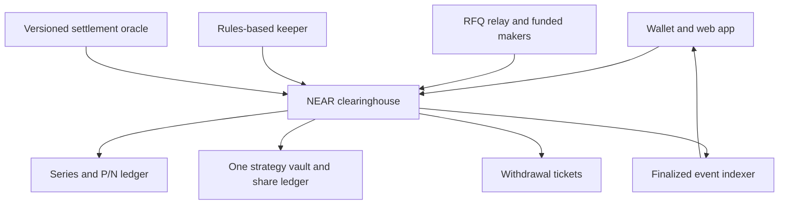

# NEAR options-based index assets: Open Innovation implementation plan

**Current version: Open Innovation revision, 7 November 2026.** This is the authoritative implementation plan and supersedes the earlier track versions. Scope is end-to-end and dependency-based, without a seven-day constraint.

**Selected track:** Open Innovation (`open`). **Product:** a NEAR-native protocol for fully collateralized complementary options claims, a funded market, and a transparent rules-based USD-tracking vault. Native NEAR is the collateral; USD is the first reference unit. Positions, trades, vault holdings, settlement evidence, and accounting are public.

**Required release:** working contracts on NEAR testnet, wallet and web UI, funded demo makers, deterministic strategy execution, an explicitly labelled demo oracle, risk simulations, recovery tools, and a reproducible public repository. Development and the core demonstration must run without paid API credentials or mainnet funds. Use local services and faucet-funded testnet accounts; free hosted services are conveniences, not correctness dependencies.

**Removed from implementation scope:** confidential notes and balances, ZK circuits/provers, encrypted RFQs, shielded-note recovery infrastructure, private AI, NEAR AI Cloud, TEE attestation, and AI-specific retention or verification workflows. NEAR Intents, Chain Signatures, and cross-chain execution are also excluded from this release. Ordinary wallet security, secure transport, secret management, and software security remain required.

The [official Open Innovation brief](https://github.com/nearai/near-hackathon-prompt-examples/blob/main/tracks/13-open.md) invites experimental approaches to money and ownership. Its inheritance-account prompt is an example, not this product's specification. The published brief does not impose that example's Chain Signatures architecture on all submissions. The contribution here is an implementation and economic evaluation of options-backed index exposure on NEAR, with explicit attribution to the original research.

**Status:** this is a planning deliverable. Contracts, markets, and the application have not been built or validated. Any prior payoff arithmetic checks are not evidence of deployed-contract safety. Production deployment is a separate, optional workstream with paid operations and independent review requirements; it is not a hackathon completion gate.

No implementation plan can guarantee zero bugs or zero losses. This plan specifies the loss mechanisms, separates solvency from tracking performance, and requires evidence before moving between stages.

**1. Research conclusions and decisions**

The proposal separates collateral-backed claims from the strategy that tries to track an index. Its discussion raises material objections: norswap questions arbitrary-index replication; conalloreilly highlights tracking degradation; equivrel raises theta, which Czar102 disputes through a different payoff interpretation. Czar102 also favors testing short maturities and scheduled rolls. JSeam2 emphasizes liquidity. CertifiedCryp proposes redundant settlement observations. Xatarrer and KG describe perpetual/barrier alternatives with different oracle dependencies. mmchougule describes physical settlement and scoped verification. Vitalik’s later clarification ties liquidation avoidance to bounded losses covered by collateral. These are research inputs, not verified performance claims. [Proposal and comments](https://ethresear.ch/t/building-index-tracking-assets-on-top-of-options-instead-of-debt/25036), [Czar102’s detailed response](https://ethresear.ch/t/building-index-tracking-assets-on-top-of-options-instead-of-debt/25036/9).

My engineering decisions following that review:

| Issue | Decision | Evidence required |
|---|---|---|
| Ambiguous denomination | Specify every price as numerator/denominator; derive the payoff independently | Dimensional analysis and golden vectors |
| Tracking under stress | Show capped target exposure and actual executable value | Gap, drawdown, and unavailable-liquidity simulations |
| Theta disagreement | Value the complete position, with explicit numeraire and assumptions | Independent pricing implementations and sensitivity tests |
| Rolling versus reactive trading | Compare scheduled, reactive, and hybrid policies | Out-of-sample net results after spreads and failed fills |
| Thin markets | Build funded RFQs before an AMM | Real competing quotes and maker inventory accounting |
| Oracle redundancy | Separate data providers, signers, and adjudicators | Dependency map and historical-data reproduction |
| Perpetual/barrier alternatives | Keep them as separately specified future products | New payoff specification, oracle model, and review |
| Physical settlement | Keep as a separate on-chain-asset product | Exercise-window, stablecoin, and delivery-risk analysis |
| Verification claims | Prove this implementation’s properties | Traceability from theorem/model to shipped Wasm |

**Current integration findings:**

- Open Innovation (`open`) is the sole planned submission track. A working public repository and public X demonstration identifying the hackathon are required. The listed deadline is **14 November 2026, 23:59 UTC / 15 November 2026, 05:29 IST**. Keep delivery gates independent of that calendar; do not remove safety checks to meet it. [Hackathon requirements](https://nearhackathon.com/)
- NEAR's faucet supplies testnet tokens for development. It may be unavailable or depleted, so fund demo accounts in advance and retain a fully reproducible local Sandbox mode. Test tokens are not claims on real NEAR or USD. [NEAR faucet](https://docs.near.org/getting-started/faucet)
- Oracle authenticity, historical availability, cost, and economic independence remain production dependencies. The testnet acceptance path uses committed synthetic data and disclosed test signers, not a paid feed.
- Pyth Core's documentation reports that NEAR support ended on 26 August 2026. Recheck integration status before a production decision; do not copy an obsolete address. [Pyth NEAR status](https://docs.pyth.network/price-feeds/core/use-real-time-data/pull-integration/near)
- A production source such as OutLayer is a candidate only. A producer signature does not establish price correctness, historical coverage, or free access. No external oracle vendor is required for the hackathon release. [NEAR oracle directory](https://docs.near.org/primitives/oracles), [OutLayer documentation](https://price-oracle.outlayer.ai/docs/)

**2. Product boundary and definition of completion**

Use three user roles:

1. **Saver:** buys a portfolio intended to have lower USD volatility than NEAR and sees its remaining NEAR exposure.
2. **Risk taker:** buys the complementary upside claim with a bounded loss equal to the amount paid; no borrowing or margin account is created.
3. **Maker:** funds quotes, holds inventory, and earns spreads while taking inventory and adverse-selection risk.

The first complete release includes:

- Native NEAR deposits and withdrawals, with separately funded storage and operating balances.
- Creation of standardized option series; split, transfer, merge, settlement, and redemption.
- A funded RFQ market for both claims, including direct old-series/new-series exchanges.
- A delayed, challengeable settlement workflow and evidence viewer.
- One transparent USD-tracking strategy vault, transferable shares, and in-kind exits.
- Portfolio, quote, transaction-recovery, liquidity, and risk interfaces.
- Reproducible economics experiments, adversarial contract tests, and monitoring.
- A local scenario runner and complete faucet-funded testnet lifecycle with clearly labelled synthetic oracle data. All user-facing balances and trade history are public on-chain.

Do not promise a $1 redemption, principal protection, continuous liquidity, guaranteed yield, or uninterrupted index replication. A vault share is ownership of a changing portfolio. Initial UI normalization to $1 does not create a peg.

Keep leverage borrowing, collateral rehypothecation, collateral staking, arbitrary user-authored payoff functions, CPI/rent feeds, physical settlement, and multichain collateral custody outside this initial security boundary. Each needs a later release with its own acceptance tests.

**3. Financial specification: implement this before contracts**

Use explicit symbols:

- `C`: NEAR deposited for a position.
- `X_M`: USD per NEAR under the series’ observation rule at maturity.
- `K`: USD target per one NEAR-sized pair, fixed at series creation.
- `M`: observation/maturity time; distinct from the later time when the oracle finalizes.
- `P`: capped USD-target claim.
- `N`: complementary upside claim.

For a one-NEAR pair, define the collateral fractions:

```text
p = 1                         if X_M <= K
p = K / X_M                   if X_M > K
n = 1 - p

P payout in NEAR = C × p
N payout in NEAR = C × n
```

With `K > 0`, the first branch also defines the mathematical zero-price limit without division by zero. Operationally, a reported zero requires the oracle’s explicit zero-price policy; an API error or missing observation is never a valid zero.

Independent checks in USD at the observation price:

```text
P value at M = C × min(X_M, K)
N value at M = C × max(X_M - K, 0)
P value + N value = C × X_M
```

Example: deposit one NEAR and set `K = $2`. These are illustrative prices, not current market quotes.

| NEAR price at M | P payout, NEAR | N payout, NEAR | P value at M | N value at M |
|---|---:|---:|---:|---:|
| $8 | 0.25 | 0.75 | $2 | $6 |
| $4 | 0.50 | 0.50 | $2 | $2 |
| $2 | 1.00 | 0.00 | $2 | $0 |
| $1 | 1.00 | 0.00 | $1 | $0 |

This establishes bounded collateral obligations. It also establishes that the saver absorbs a shortfall below the strike. Owning both legs preserves the collateral exposure; it does not produce stability.

Before maturity, the terminal payoff evaluated at today’s spot is **not** a fair option price. As an analytical benchmark with zero collateral dividend, a European model gives `N_USD = Call(X,K,tau)` and `P_USD = X - Call = K exp(-r tau) - Put`. Use that identity to detect incorrect long-put interpretations. Actual prices must come from executable markets; the model is only a diagnostic. Include interest, volatility, jumps, time to expiry, and collateral opportunity cost in economics research.

For a later arbitrary index, define `I_t` as USD per index unit and `R_t = I_t / X_t` as NEAR per index unit. A claim targeting `a` index units per pair can pay `min(1, a R_M)` NEAR, with the complementary leg receiving the remainder. This tracks the target only while the collateral cap is not binding. Implementing `K/x` with an unspecified ticker can invert the intended exposure.

**Settlement-delay exposure:** if `X_M = $4` and `K = $2`, P receives 0.5 NEAR. If finalization happens when NEAR is $2.40, that payout is then worth $1.20. Slow finality does not lock in the USD value until withdrawal. Model this interval and display it.

Financial-spec deliverables:

- Definitions, units, cap behavior, observation policy, fee treatment, and rounding.
- Numerical examples for all branches and inverse-price conversions.
- Independent reference implementation using rational/decimal arithmetic.
- Scenario generator for price paths, liquidity paths, and oracle delays.
- A statement of what is guaranteed by accounting versus assumed about markets.

**4. Architecture and trust boundaries**



Implement the clearinghouse as one Rust/Wasm contract with separate, testable modules for accounting, series, claims, exchange, vault, shares, and withdrawal tickets. Keeping critical balance changes in one receipt makes pair creation, internal trading, rolls, and in-kind vault redemption atomic. It enlarges one contract’s review scope, so keep its functionality narrow and cap series count and batch size.

Use a separate versioned settlement-oracle contract. Backend services can relay messages, index events, and suggest transactions, but cannot alter balances or finalize arbitrary prices. Maker collateral stays in contract escrow. The keeper has no withdrawal or upgrade authority.

**Suggested stack:** Rust with a pinned supported `near-sdk`; a pinned NEP-245 implementation/conformance suite for P/N claims; NEP-141/145/148 for one vault share token; TypeScript SDK and backend; React/Next.js UI; PostgreSQL indexer; Python reference simulator; Rust property testing and NEAR Sandbox integration tests. Pin resolved versions and toolchains in lockfiles after a compatibility spike. Do not copy obsolete package versions from a tutorial.

The core may expose NEP-245 P/N interfaces and one NEP-141 vault-share interface on the same account because their method namespaces differ. Keep their supply, metadata, registration, and balance namespaces distinct. Validate this combination against wallets and indexers before committing. NEP-245’s existence does not guarantee external DEX or wallet support. If compatibility fails, retain the core ledger and add an explicitly backed adapter after separate review. [NEP-245](https://github.com/near/NEPs/blob/master/neps/nep-0245.md), [FT standards](https://docs.near.org/primitives/ft/standard)

**Token callbacks and custody:** ordinary transfers and internal fills are the first release path. If `mt_transfer_call` or `ft_transfer_call` interfaces are exposed, implement and test their full receiver/resolver semantics. Pending receiver calls must not allow returned claims to be minted again or exceed the receiver's remaining balance; share supply must stay consistent if receiver actions burn shares before resolution. Do not advertise standards compliance while stubbing required methods. Registration costs, forced-unregister restrictions, storage refunds, and zero-balance cleanup need explicit tests. Until these interfaces pass, expose the public internal ledger through the SDK and treat token composability as incomplete.

Native NEAR is the recommended collateral to avoid introducing a bridged ETH custodian into the base solvency argument. An ETH-collateral deployment is a later alternative with its own bridge or remote-custody trust model. Remote custody is outside this release.

**5. Contract data model and accounting**

`Series` contains immutable terms:

```text
series_id, version, collateral_kind=NATIVE_NEAR
index_definition_hash, payoff_kind, strike, price_scale
maturity_ns, observation_window, oracle_config_hash
mint_cutoff_ns, finalization_policy, max_supply
state, final_price, p_coefficient, n_coefficient
outstanding_p, outstanding_n, reserved_collateral
```

Other records:

- `Balances`: per-account free collateral, reserved order collateral, P/N balances, vault shares.
- `Quote`: exact legs, maker, optional taker, expiry, nonce, domain, all-or-nothing fill rule, rounding, fees.
- `VaultState`: tracked holdings, share supply, policy version, outstanding roll proposals, risk state.
- `Withdrawal`: ticket ID, owner, destination, amount, state, receipt correlation, attempts.
- `OracleRequest`: immutable series terms, evidence hash, report/proposal, deadlines, disputes, final result.
- `StorageAccount`: paid storage, used bytes, refund eligibility; isolated from collateral.

Every balance change has a canonical event with schema version, operation ID, actor, asset IDs, integer deltas, fees, and resulting state references. Events are public audit data; final contract state is authoritative. Read methods expose series reserves/supplies, account balances, funded-order locks, vault baskets, withdrawal tickets, and current policy/oracle versions. Paginate all lists and bound batch sizes.

Only allow bounded standardized series in v1. A creation fee and explicit supply cap prevent storage spam and unlimited oracle liabilities. Reject duplicate asset IDs in every batch. Never allow a caller-supplied account string to authorize debits from the vault’s reserved inventory.

**Integer arithmetic:** balances use native atomic units; JSON amounts are decimal strings. Use a common fixed scale, for example `Q = 10^24`, and checked U256 intermediates for multiply/divide operations. With validated positive `X > K`, compute `p_q = floor(K Q / X)` and `n_q = Q - p_q`. With `X <= K`, use `p_q = Q`, `n_q = 0`. Prove bounds against maximum accepted prices, balances, and exponents.

Redemption credits `floor(amount × coefficient / Q)` atomic NEAR units. It burns the specified claim amount and reduces that series’ reserve by the credited amount. Round payouts down; round required inputs up. Track residual dust separately. Dust cannot be swept until both claim supplies are zero and no redemption obligation remains. Zero-payout claims must still be burnable. Tests must bound aggregate dust under repeated small redemptions and prove splitting a redemption cannot increase payout.

Series reserves are not user free balances. Moving collateral between those categories must be explicit and conservation-preserving. Fees are funded in addition to collateral or taken from an expressly priced trade; never silently subtract a fee from backing that was promised to claims.

Native account balance includes operational funds and storage stake. Do not use the raw account balance as reserve accounting. Reconcile custody against series reserves, free balances, fee balances, oracle bonds, storage liabilities, and pending withdrawals. Model funds in flight separately so an uncertain withdrawal is neither spendable nor counted twice.

**6. Contract state machines and method contracts**

Series lifecycle:

```text
OPEN -> MATURED_PENDING -> PROPOSED -> FINALIZED -> CLOSED
                              |
                              v
                           DISPUTED -> FINALIZED
                              |
                              v
                       RESOLUTION_DELAYED
```

Maturity is enforced from block time in every relevant method, not by whether a keeper has updated a stored status. Pause is an independent scoped flag, not a rewrite of the economic lifecycle.

| Method | Preconditions | Required effect |
|---|---|---|
| `deposit_collateral()` | Registered account; positive attached collateral | Credit free collateral; account for registration separately |
| `create_series(config)` | Valid future terms, approved oracle version, caps | Create immutable series and deterministic claim IDs |
| `split(series, amount)` | Before mint cutoff; sufficient free collateral | Debit collateral; reserve it; mint equal P/N quantities |
| `merge(series, amount)` | Before finalization; caller owns matching P and N | Burn both; release exactly corresponding collateral internally |
| `fill_quote(quote)` | Valid authorization/domain/nonce/expiry; funded legs | Move all exact legs and fees atomically; consume quote nonce |
| `cancel_quote(nonce)` | Authorized maker | Mark an unused nonce cancelled; prevent future execution |
| `request_resolution(series)` | Maturity observation window ended | Request the predefined historical fact |
| `accept_final_resolution(...)` | Authenticated finalized oracle result; matching config | Store immutable price and complementary coefficients |
| `redeem(series, leg, amount)` | Finalized; sufficient claim balance | Burn claims; credit calculated collateral internally |
| `vault_mint_basket(...)` | Exact proportional basket; user input/min-share limits | Transfer holdings and issue shares atomically |
| `vault_redeem_in_kind(shares, minima)` | User owns shares; no conflicting locked amount | Burn shares and credit proportional holdings |
| `execute_roll(proposal, quotes)` | Policy-compliant, fresh, fully funded quote set | Swap vault holdings atomically; record realized costs |
| `request_withdrawal(amount, receiver)` | Authorized owner; enough free collateral | Debit first; create ticket; initiate transfer |
| `on_withdrawal_result(ticket)` | Private callback; expected pending ticket | Complete or restore balance once from actual result |

Resolution import is asynchronous: the clearinghouse calls its allowlisted oracle contract and accepts the returned final record only through a private callback bound to the original series/request ID. A caller's pasted JSON or an unauthenticated price is never sufficient. Validate the oracle account/version, config hash, finalized status, observation interval, units, price bounds, and duplicate-finalization state. A failed import leaves the series pending and can be retried idempotently. The demo resolver uses this same boundary.

Pair merges remain available while the oracle is pending or disputed: ownership of both complementary legs removes the need for an oracle. After finalization use leg redemptions; do not run the pre-finalization merge calculation against a partially redeemed pool.

For native NEAR deposits, collateral can be credited within the receiving method because the attached transfer and method are part of its execution. For later FT collateral, validate the token predecessor and the transfer/refund semantics before any credit. Do not infer a deposit from a backend transaction hash. [FT receiver security](https://docs.near.org/smart-contracts/security/cross-contract-calls/ft-transfer-call)

**7. NEAR asynchronous failure design**

NEAR callbacks are separate receipts. A failed callback does not roll back a successful earlier transfer, and the callback is not automatically retried. This must be reflected in the protocol design. [NEAR callback failure guidance](https://docs.near.org/smart-contracts/security/cross-contract-calls/callback-failures)

Withdrawal states:

```text
AVAILABLE -> PENDING -> SUCCEEDED
                    -> FAILED_CONFIRMED -> AVAILABLE
                    -> UNKNOWN -> verified recovery
```

- Preallocate ticket storage, debit the balance before scheduling the outgoing transfer, and use a small private callback with measured worst-case gas.
- Store destination and amount before calling out. A callback cannot choose a new recipient.
- Return failed transfers to the same owner’s internal balance once, after a confirmed failure.
- Treat an unobserved or failed callback as `UNKNOWN`. A timeout does not prove that money was not delivered.
- Never resend or re-credit an unknown withdrawal merely because an RPC request failed.
- Version callback payloads; block upgrades with unsettled operations on upgradeable test deployments.
- Test malformed return values, insufficient callback gas, interleaved calls, and failure after external success.

**Recovery is a production gate:** a generic native transfer does not expose an idempotent business receipt that the core can simply query. Before public deposits, implement and review either verified receipt-outcome recovery or an idempotent payout adapter with queryable durable results. If a restricted recovery committee is used instead, disclose its authority to adjudicate outcomes and cap the exposure; it is an added trust assumption. Until that recovery mechanism passes fault injection, the release remains testnet-only. The safe interim behavior is quarantine, not a possible double payment.

Privileged methods and user money movement need correct predecessor checks and the appropriate deposit-capable authorization. Standard function-call keys cannot attach deposits; do not grant a keeper a full-access key merely to bypass this. Keeper accounts call narrowly authorized methods using their own funds, with policy enforced by the contract. [One-yocto authorization guidance](https://docs.near.org/smart-contracts/security/one_yocto)

**8. Settlement oracle: a complete product dependency**

Use two separate price pipelines:

1. **Settlement pipeline:** binding historical observation at M; slow, evidence-backed, challengeable.
2. **Execution/risk pipeline:** current market observations for quote freshness, vault trade guards, and displays; never changes the finalized settlement result.

The strategy may require current price information even when base solvency does not. State that dependency plainly.

At series creation, hash the complete observation specification:

- Asset identity, quote currency, units, and decimal scale.
- Exact UTC observation interval, aggregation and sampling rules.
- Authorized data sources and required independent source count.
- Upstream timestamp policy, maximum missing coverage, and outlier handling.
- Whether USD is directly observed or converted from another quote asset; a USDT pair must not silently be treated as USD.
- Treatment of market disruption, zero prices, feed discontinuation, and later data corrections.
- Proposer rules, bond currency/amount, challenge duration, adjudicators, deadlines, and fallback hierarchy.

**Candidate production research configuration:** a five-minute trailing observation window ending at M; source-by-source time-weighted observations followed by a median across eligible sources; at least three independently operated sources; 24-hour proposal challenge; a distinct arbitration deadline. Use separate short windows for explicitly labelled deterministic testnet fixtures. These values are starting experiments, not production-safe defaults.

Flow:

1. Independent collectors archive timestamped source observations and immutable evidence bundles.
2. A bonded proposer submits the result, series/config hash, observation interval, and evidence hash.
3. Anyone can challenge during the fixed window with conflicting evidence and a bond.
4. An undisputed proposal finalizes only after the deadline and required authentication checks.
5. A disputed proposal is resolved by the precommitted adjudication mechanism; its evidence and signatures are public.
6. Finalization is one-way. Admins cannot replace a finalized price.

For the prototype, use clearly labeled test signers and a simulated adjudicator. For a capped pilot, a disclosed threshold committee can be used only after its independent operators, source dependencies, signer rotation rules, and corruption risk are reviewed. Multiple processes under one operator are not independent oracles. A proposed 3-of-5 report quorum is an engineering test fixture, not a decentralization claim.

For a later production release, if OutLayer is selected as one observation source, validate attestation/key pinning and upstream age semantics. Do not assume that a current signed quote can resolve an old maturity. Build a proof of concept that reproduces an old window after downtime, using evidence acceptable to the contract’s resolution mechanism. Treat historical retention, licensing, and source outages as explicit dependencies. [OutLayer signed data documentation](https://price-oracle.outlayer.ai/docs/)

**Failure hierarchy:** primary evidence -> precommitted independent historical fallback -> precommitted arbitration -> delayed resolution. Never silently settle at the latest price, an arbitrary 50/50 split, or an administrator’s convenient number. If every source/arbitrator fails, single-leg funds may remain locked; display that liveness risk. Pair merges and vault in-kind exits remain available where their own invariants permit.

Monitor and cap **aggregate** exposure across all series that share the same oracle/fallback. An inexpensive proposal bond does not secure a large pool against bribery. Require a documented economic-security budget, funded monitoring, and loss exposure analysis before raising TVL.

**9. Market structure and liquidity bootstrapping**

First implement fully funded RFQs and limit offers in the core. A relay distributes requests; it cannot execute an unauthorized trade or invent maker balances. A maker quote must be both authorized and backed by sufficient escrow at fill time.

Each signed quote binds:

```text
protocol version, network, contract, maker, optional taker
input/output asset IDs and exact integer amounts, all-or-nothing fill
fees, rounding rule, nonce/cancellation epoch, expiry
authorized signing key and signature scheme
```

Use a protocol-specific signing-key registry, registered/revoked through the maker’s NEAR account. Do not assume that an arbitrary NEAR account key is available to verify off-chain signatures inside another contract. Domain-separate protocol RFQs from login signatures, oracle reports, and unrelated application messages. The first release uses all-or-nothing quotes: a successful fill consumes the entire nonce. Multiple outstanding quotes may reference the same maker inventory, so every fill rechecks spendable balances atomically; an RFQ is not a reservation guarantee. On-chain resting offers, if added, explicitly lock their inventory. Partial fills are a later feature requiring cumulative rounding, overfill, and cancellation-race tests.

Bootstrap with two independently running funded makers in testnet. Implement their inventory targets, maximum position size, stale-price cutoff, loss limit, quote TTL, and automatic quote withdrawal. Publish test/demo funding and subsidies separately from organic volume.

Offer three mechanisms:

- Buy/sell a single P or N claim against escrowed NEAR.
- Match P and N demand into a newly collateralized pair, with all funding and fees reconciled atomically.
- Exchange old P directly for new P plus any collateral adjustment, avoiding two sequential market orders.

Use a gradual limit-price schedule or bounded auction for vault rolls. Its minimum output and maximum cost must be fixed by policy before execution. The auction may end unfilled. Do not implement an emergency unconditional sell.

Liquidity economics must answer:

- Why does someone want N at the strikes desired by savers?
- How much inventory and hedge capital do makers need?
- What happens when makers lose money and withdraw?
- What proportion of trading is subsidized?
- At what trade size does the strategy become uneconomic?

Lower strikes can reduce the saver’s tail exposure but also change the risk taker’s leverage and willingness to pay. Do not assume the counterparty exists because the payoff is mathematically valid.

Track executable spread, depth within stated bounds, fill ratio, time-to-fill, concentration, inventory, and rejection reasons. Gate vault capacity by stressed executable depth, not by nominal deposited collateral. Avoid an AMM until informed flow and inventory behavior are measured.

**10. Tracking vault, share issuance, and redemption**

Start with one deterministic strategy and a maximum of four held series. It may keep a small disclosed NEAR cash buffer; that buffer creates USD exposure and belongs in tracking statistics. Each policy version fixes allowed series, maturity bounds, maximum fees, maximum per-roll loss, quote-age requirements, trade-size cap, and keeper permissions.

Vault-share NAV is an estimate for reporting, not a promise. In collateral units:

```text
NAV_est = cash + sum(quantity_i × marked_price_i) - accrued liabilities
NAV_per_share = NAV_est / circulating_shares
```

Distinguish executable bid, executable ask, reference mark, and model estimate. If markets are stale or empty, label NAV uncertain; do not substitute terminal intrinsic value and call it a live price.

**Avoid stale-NAV issuance:**

- The core accepts proportional in-kind baskets to mint shares. Given existing shares S and holdings h_i, a user minting s shares supplies at least `ceil(s h_i / S)` of every holding, with input limits and minimum shares.
- A user starting with NEAR can purchase the required basket through funded RFQs and then mint shares in one bounded core operation, or buy existing shares from a market maker.
- Bootstrap through a predefined seeded basket and explicit initial share scale; test first-depositor and donation manipulation.
- Incoming transfers do not automatically increase managed vault holdings. Only authorized accounting transitions can do that.
- Do not accept arbitrary collateral at a backend-computed NAV in v1.

Dust policy must also cover shares: define minimum practical mint/exit amounts, reject a mint with no useful output, and when the last outstanding shares are burned transfer all remaining managed basket quantities to that holder. Separate accrued fee liabilities before the proportional calculation. Closing an empty vault cannot strand user holdings or let an unsolicited donation seize the next bootstrap. Policy changes affect a new vault version; holders keep exits from the old version.

**In-kind exit is mandatory:** burning s shares returns the pro-rata cash and claim basket, with conservative rounding and user minima. Pending-maturity claims remain claims; the system does not promise immediate cash conversion. Users can retain or trade them independently. Claims remain redeemable through the core even if the strategy service stops.

Collateral-only exits are quote-based conveniences. If the user’s minimum cannot be met, leave their shares intact or use their expressly chosen in-kind exit. Do not sell illiquid assets for early redeemers while leaving only impaired claims for others.

**Roll execution:**

1. Keeper identifies an eligible roll under the immutable policy version.
2. It requests competing old/new-series quotes and records why the trade is proposed.
3. Contract checks allowed legs, current reference freshness, minimum received amounts, fees, notional/exposure limits, and total budget.
4. A funded multi-leg quote set exchanges inventory within one receipt. No asynchronous naked NEAR leg is introduced.
5. Contract records actual quantities, fees, and realized target-unit change.
6. If no acceptable fill exists, record `ROLL_DEFERRED`; retain current holdings, stop unsuitable new inflows, and keep in-kind exit available.

A price-aware vault guard necessarily adds a current-price dependency. Quote competition alone is not protection if every quote comes from the attacker. The keeper can propose; only the contract can authorize the bounded action. Allocation is deterministic and bounded by contract policy.

**11. Economics experiments and acceptance criteria**

Compare at least four policies: buy-and-hold to settlement; scheduled short-expiry rolling; longer-expiry rolling; and a hybrid with a price-distance trigger plus hysteresis/cooldown. All use executable spreads and capacity constraints.

Explore a grid such as `K/X_entry = 0.25, 0.40, 0.60` and maturities of 4, 7, 14, 30, and 60 days. These are research parameters. Use them to select a policy; do not present them as safe recommendations.

Scenarios must include normal markets, high volatility, jumps, a rapid 30–80% fall, slow decline, V-shaped recovery, prolonged outage, 1–14 day settlement delays, no bids, maker concentration, and source disagreement. Historical data supplements synthetic stress; it does not replace it. Prevent look-ahead bias and retain a held-out evaluation period.

Include benchmarks: holding NEAR, an ideal constant-USD reference, and a separately modeled collateralized-debt strategy with its liquidation fees, oracle latency, and gap losses. The ideal USD reference is a measurement baseline, not an available trustless investment. Compare equal initial wealth and disclose collateral/counterparty assumptions; do not make the proposed strategy look better by omitting the alternative's costs or its own maker subsidies.

Report:

- Target-relative return and tracking-error volatility separately.
- Maximum drawdown and probability/severity of a target shortfall.
- Tail expected shortfall and exposure during unresolved settlement.
- Fees, spread, roll price changes, gas, and oracle costs separately.
- Percentage of rolls completed inside the allowed window.
- Worst in-kind and collateral-only exit outcomes at different trade sizes.
- Maker profit/loss, capital use, and subsidy dependence.

For scale, 5 bps of friction per weekly roll costs about `1 - (1 - 0.0005)^52 = 2.57%` annually before other effects. At daily frequency it is about 16.69%. Lower maturity risk can be offset by higher turnover costs. These are arithmetic illustrations, not forecasts.

Example research gates, to freeze before judging results: normal-regime annual friction below a chosen budget such as 2%; at least 95% normal-regime roll completion within the permitted window; no hidden dependence on unlimited maker capital. Failure means adjust the product or capacity and rerun held-out evaluation. Stress losses must be published even if normal-regime gates pass. Never encode the article’s suggested drift range as a guarantee.

**12. Testnet delivery, cost boundary, and demo data**

The release must run without external paid API keys. A fresh developer uses a local database, local maker/keeper processes, the bundled scenario dataset, Sandbox, and a NEAR testnet account funded through the faucet. Wallets authorize real testnet transactions; do not simulate success in the UI.

| Dependency | Required development/demo path | Later production obligation |
|---|---|---|
| Contract execution and storage | Local Sandbox; faucet-funded native testnet NEAR | Real gas and storage funding |
| Maker inventory and oracle bonds | Faucet-funded separate demo accounts | Capital at risk and monitored bonds |
| Price observations | Versioned synthetic fixtures with published seeds and hashes | Licensed/reproducible historical sources and independent resolution |
| RPC and event indexing | Local node/Sandbox; public testnet RPC with retry and rate limits | Capacity, archival availability, and provider redundancy |
| Web app and services | Local processes/containers | Hosting and operational ownership |
| Public demonstration | Recorded testnet run plus runnable repository; optional free hosting | Hosting availability if a live service is promised |
| Analytics | Local rational model and committed datasets | Continuing data quality and economic evaluation |

This is a design for no mandatory service spend during development, assuming access to a development computer and internet. Free public infrastructure has quotas and availability limits; no unlimited free-service promise is made. Do not enable paid fallbacks automatically. Production audits and sustained production operations are not included in this cost target.

Provide three explicit modes:

1. **Sandbox:** fully deterministic contracts, receipts, clock advancement, oracle faults, and adversarial scenarios. No external account required.
2. **Testnet demo:** deployed contracts and real wallet/maker transactions, with a conspicuous `DEMO ORACLE — SYNTHETIC PRICES` label. Use short, precommitted maturity and challenge intervals. Testnet block time advances normally; do not expose arbitrary clock changes in the clearinghouse.
3. **Optional live-data observation:** read public market data under its access terms for comparison. An unavailable endpoint does not block the first two modes. A reference display feed cannot silently become the settlement oracle.

The demo oracle uses the same proposal/challenge/finalization interface as the planned production resolver, but disclosed test keys control reports and arbitration. Store the scenario ID, source hash, observation window, and signer configuration in each series. Test both uncontested and disputed outcomes. A synthetic dataset tests state transitions and payoff math; it does not establish independent price discovery or economic oracle security.

The native user workflow is resumable:

```text
Faucet -> user's testnet wallet -> storage registration
-> deposit to clearinghouse -> split or buy claims
-> optional basket-based vault subscription -> roll or hold
-> in-kind exit / claim redemption -> free collateral -> withdrawal
```

Pair creation, funded trades, basket minting, and in-kind redemption are atomic internal transitions. Wallet registration, deposit, purchase, and final external withdrawal are separate actions unless an explicitly tested combined method supports them. After interruption, reconstruct confirmed receipt outcomes and show the actual remaining assets. Never rerun a money-moving action merely because the browser lost its response.

Publish a cost inventory per action: attached collateral, refundable storage deposit, testnet gas consumed, fees, and internal balance changes. Keep operating reserves separate from backing. Demo resets create fresh isolated deployments or series; they must not confiscate another tester's assets or mutate existing series terms.

**13. Frontend and SDK implementation**

Build five primary flows:

1. **Explore:** list standardized series and payoff charts; show strike, maturity, collateral, oracle status, and executable depth.
2. **Save:** describe the tracking strategy; show holdings, expected trade outputs, costs, target shortfall scenarios, and share quantity before signing.
3. **Trade:** show P/N inventory, RFQs, quote expiry, all-or-nothing fills, cancellation, and maximum possible loss for purchased claims.
4. **Portfolio and exit:** show shares plus underlying holdings; offer in-kind exit and available priced exits; distinguish observation value from current executable value.
5. **Transactions and settlement:** display funds location, pending actions, disputes, challenge deadlines, evidence, and withdrawal recovery tickets.

Use wallet connection libraries verified against current NEAR documentation and the chosen network. Start with an explicit wallet flow; add social onboarding only after the basic transaction paths work.

The SDK owns amount parsing, typed units, series IDs, exact serialization, transaction construction, error mapping, and receipt completion tracking. Never pass token amounts through JavaScript floating-point numbers. Displayed rounding must not alter submitted integers.

Required visible states: stale quote, no quote, insufficient gas/storage, cancelled wallet prompt, pending receipt, unknown withdrawal, delayed oracle, disputed price, interrupted deposits, confirmed failed withdrawals, and deferred roll. A transaction hash is not a success state. Network labels must remain visible during every funding action.

A small recovery CLI should support balance queries, pair merges, in-kind exits, and redemptions without the hosted frontend. Package the ABI and exact examples with the release.

**14. Backend, indexer, and operations**

Services: RFQ relay, maker process, observation collector, proposer/watcher, strategy keeper, finalized-event indexer, read API, and monitoring. Keep each role’s credentials separate. The API reads chain-derived state; it is not the balance authority.

Suggested tables: blocks, receipt_outcomes, events, series, positions, quotes, fills, oracle_reports, challenges, vault_holdings, vault_actions, withdrawal_tickets, operation_sessions, and health_checks. Deduplicate events by receipt ID and log index; persist cursors transactionally. Replaying from deployment must reproduce the same derived balances.

Index finalized outcomes, retain transaction-to-receipt links, and support RPC-provider failover. Reconcile every material contract balance and pending operation against indexed state. API restarts and duplicate delivery must not trigger duplicate trades or payouts.

Monitor reserve mismatches, unexpected supply changes, source outages, approaching oracle deadlines, failed callbacks, unknown withdrawals, keeper lateness, thin liquidity, stale quotes, concentration, gas/storage reserves, and indexer lag. A reserve mismatch blocks new risk immediately; preservation of valid exits depends on the specific incident rather than a blanket global freeze.

Provide runbooks for oracle disputes, total source loss, maker disappearance, RPC/indexer outage, compromised keeper, bad frontend deployment, uncertain payouts, and discovered contract vulnerabilities. Each runbook names the permitted pause, evidence to collect, user state, recovery action, and reopening criteria.

**15. Security invariants and verification plan**

| Property | Verification |
|---|---|
| No unbacked pair creation | Every mint consumes exactly corresponding collateral |
| Complementarity | Settlement coefficients sum exactly to fixed-point one |
| Bounded payouts | Remaining claim obligations never exceed the current series reserve; cumulative payouts plus remaining reserve reconcile to deposited collateral net of merges and permitted dust release |
| Isolation | One series cannot spend another series’ collateral or storage funds |
| Conservation | Every internal trade and roll balances all asset flows and fees |
| Authorization | No unauthorized debit, price finalization, key change, or vault trade |
| Single consumption | Quote nonces, claims, and withdrawal results cannot be reused |
| Immutable economics | Strike, observation policy, and final price cannot be rewritten |
| Rounding safety | Fragmentation and repeated operations cannot extract collateral |
| Fair vault entry/exit | Proportional baskets prevent stale-NAV dilution and first-exiter preference |
| Oracle independence of backing | Arbitrary admissible settlement prices redistribute only existing reserves |
| Explicit liveness assumptions | Missing counterparties or oracle results never become invented successful actions |

Verification layers:

1. Unit tests for arithmetic, state transitions, permissions, and serialization.
2. Rational reference-versus-Rust differential tests, including extreme magnitudes.
3. Stateful property tests over randomized split/transfer/trade/merge/finalize/redeem paths.
4. NEAR Sandbox tests using the compiled Wasm, realistic receipts, time advancement, and induced callback faults. Current NEAR docs describe `near-sandbox` with `near-api`; pin a tested combination. [Integration testing](https://docs.near.org/smart-contracts/testing/integration-test)
5. Model checking of oracle and withdrawal state machines, including interleavings and unknown outcomes.
6. Formal proof or bounded symbolic analysis of core reserve conservation and fixed-point bounds, with documented assumptions and explicit coverage limits.
7. End-to-end browser tests of the actual funded demo flows.
8. Independent security review of the exact release commit and deployed Wasm hash, followed by fixes and retesting.

Adversarial cases include wrong-token deposits, wrong network, future/stale timestamps, inverse feeds, invalid exponents, duplicate IDs, forged/replayed signatures, overfills, cancellation races, near-maturity transaction delays, missing storage, unauthorized callbacks, source equivocation, arbitrator timeout, queue spam, donation attacks, malicious recipients, and no bids during a crash.

Coverage percentage is not an acceptance substitute. A mathematical proof over a model does not automatically cover the Rust implementation, dependency code, key management, oracle economics, or market liquidity. Publish the boundaries.

**16. Delivery sequence with hard exit gates**

Roles below are responsibilities; one person may own several. Economic and security review should still get an independent challenge before public money is accepted.

| Stage | Work and artifacts | Depends on | Owner role | Exit gate |
|---|---|---|---|---|
| G0: specification | Product scope, units, payoffs, threat model, immutable terms, ADRs | None | Protocol/economics | All examples and accounting obligations unambiguous |
| G1: feasibility spikes | NEAR runtime/toolchain, token compatibility, demo oracle interface, payout recovery | G0 | Contracts/integrations | Local/testnet dependencies measured; production historical oracle and recovery limits separately recorded |
| G2: economics | Reference model, liquidity model, stress suite, policy comparison | G0 | Quant/protocol | Reproducible held-out results and published failure envelope |
| G3: collateral core | Deposits, series, P/N, merges, mocked settlement, redemption | G0–G1 | Contracts | Conservation, permissions, rounding, and receipt tests pass |
| G4: settlement | Observation archive, proposals, disputes, finality, failure hierarchy | G1, G3 | Oracle/contracts | Committed demo observation reproducible after outage; challenge paths pass; production source gate remains separate |
| G5: market | Funded RFQs, signature registry, maker bots, cancellation, exact fills | G2–G3 | Market/contracts | Competing all-or-nothing quotes and atomic old/new rolls; no unfunded execution |
| G6: strategy vault | Basket issuance, shares, in-kind exit, guarded keeper | G2, G4–G5 | Contracts/quant | No stale-NAV issuance; no-bid and stale-oracle exits work as specified |
| G7: application | SDK, UI, indexer, recovery CLI, labelled Sandbox/testnet modes | G3–G6 | Product/infrastructure | A new wallet completes all user flows and recovers interrupted ones |
| G8: adversarial validation | Fuzzing, models/proofs, load tests, review and fixes | G4–G7 | Security/QA | No unresolved critical/high findings; gas/storage limits demonstrated |
| G9: hackathon release | Testnet deploy, funded maker demo, public accounting, reproducible demo script | G7–G8 appropriate to testnet | Release owner | Fresh clone runs and every README claim is demonstrable |
| G10: capped pilot | Production oracle, payout recovery, custody/key review, monitoring, independent audit | All production gates | Security/operations | Explicit risk acceptance, limits, and incident drills completed |
| G11: expansion | More series, index definitions, liquidity venues, collateral or chain extensions | Pilot evidence | Protocol/product | Separate specification and review per new trust boundary |

G2 and infrastructure prototyping may proceed alongside G3, but the vault policy cannot be finalized before economic results. An unavailable independent historical oracle blocks production settlement, not the labelled synthetic-data testnet release. G9 is the complete hackathon deliverable; G10 and G11 are future deployment/expansion gates. A finished UI does not waive any gate.

**17. Repository and task decomposition**

```text
contracts/
  clearinghouse/src/
    accounting.rs  series.rs  claims.rs  rfq.rs
    vault.rs  shares.rs  withdrawals.rs  permissions.rs
  settlement-oracle/src/
  test-fixtures/
crates/
  payoff-math/  protocol-types/
packages/
  sdk/  shared-schemas/
apps/
  web/  read-api/
services/
  indexer/  maker/  rfq-relay/  keeper/
  observation-collector/  oracle-watcher/
research/
  reference-model/  scenarios/  policy-comparison/  reports/
tests/
  differential/  stateful/  sandbox/  e2e/  failure-injection/
fixtures/
  synthetic-prices/  oracle-disputes/  market-scenarios/
scripts/
  deploy-testnet/  seed-demo/  run-demo/  reconcile-custody/  recover/
verification/
  models/  proofs/  assumptions.md
deploy/
  sandbox/  testnet/  mainnet/
docs/
  SPEC.md  THREAT_MODEL.md  ORACLE.md  ECONOMICS.md
  SECURITY.md  DEPLOYMENTS.md  DEMO.md  COSTS.md  RUNBOOKS.md  ADRs/
```

Convert the stages into these implementation epics:

| Epic | Concrete completion artifact |
|---|---|
| FIN-01 | Typed payoff specification and vectors |
| FIN-02 | Scenario engine and four-policy comparison |
| CORE-01 | Internal custody and storage ledger |
| CORE-02 | Series registry and P/N split/merge |
| CORE-03 | Finalized payouts and rounding accounting |
| CORE-04 | Withdrawal tickets and verified recovery |
| ORC-01 | Historical observation definition and archival collector |
| ORC-02 | Proposal/challenge/finalization state machine |
| MKT-01 | Quote authorization, funded execution, cancellation |
| MKT-02 | Maker inventory service and direct series rolls |
| VLT-01 | Proportional share issuance and in-kind redemption |
| VLT-02 | Policy-constrained keeper and risk states |
| APP-01 | Typed SDK, wallet, and transaction lifecycle |
| APP-02 | User and maker interfaces with risk displays |
| INF-01 | Replayable indexer, API, metrics, and alerts |
| DEM-01 | No-paid-key local setup, faucet-funded testnet scenarios, synthetic-oracle labels, cost report |
| SEC-01 | Differential/property/Sandbox/fault suites |
| SEC-02 | Independent review, proof scope, and remediation |
| REL-01 | Reproducible testnet demo and submission bundle |
| REL-02 | Reviewed capped production deployment and runbooks |

Every ticket should name its invariant, dependencies, failure path, test evidence, and reviewer. Commit the financial spec before generating implementation code. Never let separate UI and contract work invent different units or status names.

**18. Deployment, governance, cost, and production gates**

Use isolated Sandbox and testnet configs; keep future mainnet deployment disabled by default; reject network/contract mismatches in both SDK and services. Record compiler/toolchain versions, dependency locks, source commit, Wasm hash, deployment transaction, account keys, oracle config hash, and initial limits.

For public custody, prefer versioned immutable core deployments. Merely omitting an `upgrade` method is insufficient if the account retains a full-access key capable of replacing code. Verify the actual access-key list and absence of alternate deploy/delete/transfer authority. Testnet may retain upgrade keys for iteration, but label that difference. A new core version requires opt-in migration; do not mutate active series terms.

The guardian may stop new series, new deposits, or automated trading under documented conditions. It cannot set prices, seize collateral, or rewrite strikes. Keep valid merges, final redemptions, and in-kind exits available unless a specifically identified exploit makes that route unsafe. Oracle governance has its own disclosed powers and must not be conflated with the guardian.

Budget separately for maker inventory, actual market losses, oracle data/retention, proposer/arbitrator bonds, contract storage, RPC/archive access, hosting, security review, incident response, and bug bounties. Maker inventory is capital at risk, not just a hosting expense. Storage deposits must fund state growth rather than consume users’ collateral. Query current storage costs instead of embedding an old constant. [NEAR storage model](https://docs.near.org/protocol/storage/storage-staking)

Start with transparent fixed transaction fees, configurable only for future terms where appropriate. Avoid performance fees until valuation and high-water-mark accounting are independently reviewed. Publish whether keeper/oracle expenses are subsidized or charged, with a hard maximum for user-paid costs.

Before public access, obtain jurisdiction-specific advice for derivatives, public distribution, and the proposed marketing claims. The plan makes no assumption about which jurisdiction or legal classification applies.

Production checklist:

- Exact economic contract and unresolved risks documented.
- Independent historical settlement and dispute resolution operational.
- Aggregate oracle exposure bounded and reviewed.
- No unknown-outcome withdrawal can be paid twice; recovery drill completed.
- At least one credible liquidity strategy with measured withdrawal-of-maker stress.
- Independent review complete with critical/high findings resolved.
- Reproducible deployed artifact and audited key permissions.
- Alerts, on-call ownership, recovery CLI, incident communication procedure, and staged caps.
- All depositors can understand the in-kind exit and oracle-lockup risks.

**19. Demonstration and submission package**

Use one reproducible narrative:

1. Connect a fresh testnet wallet and fund its storage/gas.
2. Deposit test NEAR; mint a P/N pair and show reserved collateral.
3. Transfer/sell N to a second account; demonstrate an executable quote.
4. Acquire a P basket and mint tracking-vault shares.
5. Execute a bounded roll into another standardized series.
6. Inject a price crash in a clearly labeled scenario: show tracking loss and continued collateral accounting.
7. Inject no liquidity: the roll is deferred, and the user exits in kind.
8. Submit a historical observation, challenge it, finalize, and redeem both sides.
9. Show a failed withdrawal and a quarantined unknown outcome in deterministic test fixtures.
10. Withdraw redeemed test NEAR to the wallet and reconcile custody, reserves, fees, storage, and pending tickets.
11. Restart the UI/indexer and use the recovery CLI; demonstrate that the contracts and valid exits do not require the hosted frontend.
12. Run the local stress report and distinguish accounting solvency from target-tracking losses, oracle delay, and subsidized maker liquidity.

Package a public repository, locally runnable UI, optional hosted testnet demo, walkthrough video, source/Wasm/deployment references, test commands, seeded scenarios, limitations, architecture, and attribution to the research discussion. Do not label contracts audited or explorer-verified unless that evidence exists. Explain the distinct work you implemented: NEAR accounting, quote execution, settlement workflow, share mechanics, failure recovery, and economic validation.

**Submission track:** `open` (Open Innovation). **Suggested pitch:** “Options-backed index exposure on NEAR: fully collateralized complementary claims, transparent settlement, and a rules-based tracking vault.” Credit the research and distinguish our engineering and economic evaluation from inventing the underlying idea.

Prepare the public X demo post and submission form fields; posting and submitting are separate user actions. This planning task does not authorize sending public messages or deploying funds.

The release is complete when another developer can clone it, reproduce the demo, inspect the reserves, trigger the documented failures, and recover funds through the paths the product actually promises.

**20. First implementation actions**

1. Write and independently review `SPEC.md`, with units and the payoff table above.
2. Build the rational model and fixed-point differential vectors.
3. Prove token-interface compatibility, the demo oracle lifecycle, and safe withdrawal quarantine/recovery behavior. Record independent historical settlement as a separate production gate.
4. Deploy the minimal split/merge/redeem core in Sandbox.
5. Add two funded RFQ makers and measure actual roll execution.
6. Select a tracking policy using net, held-out scenario results.
7. Implement proportional shares and in-kind exits before convenience deposits or UI polish.
8. Package the local services and synthetic dataset, deploy to testnet, and verify the complete demo without paid API credentials.
9. Complete the release checks below before describing the project as finished.

These actions resolve the highest-cost uncertainties before the full application depends on them.


**Release acceptance checklist**

- A fresh clone can build contracts, start services, and execute the Sandbox scenario without paid API credentials.
- The testnet UI completes deposit, pair creation, funded trading, basket mint, bounded roll, in-kind exit, settlement, redemption, and withdrawal using actual receipts.
- Transparent accounting reconciles before and after every lifecycle operation; no user collateral funds operating storage or service expenses implicitly.
- A failed withdrawal restores funds once only; an unknown outcome remains quarantined and visibly unresolved. Production stays blocked until reviewed recovery is available.
- Double redemption, forged quotes, consumed nonces, stale quotes, unauthorized callbacks, wrong-series results, rounding attacks, and cancellation races are rejected in executable tests.
- No-bid, disputed-price, source-loss, settlement-delay, and maker-withdrawal scenarios have explicit outcomes and published risk results.
- Demo oracle control, synthetic prices, testnet assets, admin keys, and maker subsidies are visible in the UI and README.
- Repository layout, documentation, milestone names, submission metadata, and runtime configuration all target Open Innovation and the public-ledger architecture.
- Source attribution, reproducible scenario seeds, dependency locks, deployment hashes, and exact test commands accompany the demo.
- Any unimplemented production dependency is named as such; a working testnet demonstration is not described as production-ready or loss-free.
