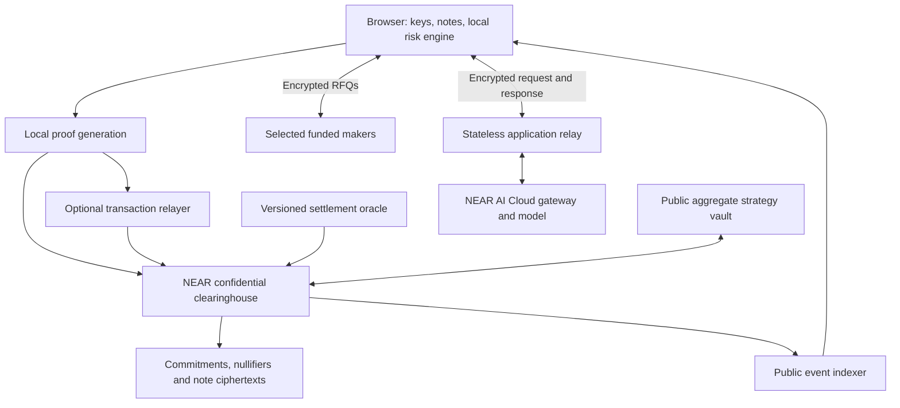

# Private options and index tracking on NEAR: implementation blueprint

**Current version: Privacy track revision, 7 November 2026.** This is the authoritative plan and supersedes the previous Unstoppable DeFi / Intents version. Scope remains end-to-end, without a seven-day constraint. The financial construction and discussion learnings are retained; architecture, data handling, contracts, verification, milestones, and demonstration are revised for privacy.

**Selected track:** Privacy & Private AI (`privacy`). **Product:** a NEAR-native, fully collateralized options protocol with confidential P/N ownership and transfers, private hedge planning through attested NEAR AI Cloud inference, and deterministic index-tracking strategies. A shared tracking vault is included with explicitly narrower privacy at its public accounting boundary.

**Required:** confidential-note contracts, funded encrypted RFQs, public historical-price settlement, local note recovery, NEAR AI Cloud completion and evidence verification, client-side encryption, fictional samples, and a NEAR testnet demonstration. **Not required:** NEAR Intents, cross-chain onboarding, or Chain Signatures. Those may be separately evaluated after this release.

Use the official [near-ai-cloud agent skill](https://github.com/near/agent-skills/blob/main/skills/near-ai-cloud/SKILL.md) and the current provider documentation. Where examples or the skill lag the live verification contract, follow the current documentation and pin a reviewed implementation. The track's expense-auditor prompt is an example; our private input is a financial exposure/expense profile used to plan an options hedge.

**Status:** this document is updated; the protocol, proof circuits, and live AI verification have not been implemented or validated. Recommendations and illustrative parameter choices below are not audited guarantees. The previously checked payoff arithmetic does not establish circuit soundness, private execution, or contract safety.

No plan can promise zero bugs or losses. Every production claim below has an evidence gate. The privacy release is incomplete if only the AI inputs are private while P/N balances remain ordinary public token balances.

**1. Research conclusions and decisions**

The proposal separates collateral-backed claims from the strategy that tries to track an index. Its discussion raises material objections: norswap questions arbitrary-index replication; conalloreilly highlights tracking degradation; equivrel raises theta, which Czar102 disputes through a different payoff interpretation. Czar102 also favors testing short maturities and scheduled rolls. JSeam2 emphasizes liquidity. CertifiedCryp proposes redundant settlement observations. Xatarrer and KG describe perpetual/barrier alternatives with different oracle dependencies. mmchougule describes physical settlement and scoped verification. Vitalik’s later clarification ties liquidation avoidance to bounded losses covered by collateral. These are research inputs, not verified performance claims. [Proposal and comments](https://ethresear.ch/t/building-index-tracking-assets-on-top-of-options-instead-of-debt/25036), [Czar102’s detailed response](https://ethresear.ch/t/building-index-tracking-assets-on-top-of-options-instead-of-debt/25036/9).

My engineering decisions following that review:

| Issue | Decision | Evidence required |
|---|---|---|
| Ambiguous denomination | Specify every price as numerator/denominator; derive the payoff independently | Dimensional analysis and golden vectors |
| Tracking under stress | Show capped target exposure and actual executable value | Gap, drawdown, and unavailable-liquidity simulations |
| Theta disagreement | Value the complete position, with explicit numeraire and assumptions | Independent pricing implementations and sensitivity tests |
| Rolling versus reactive trading | Compare scheduled, reactive, and hybrid policies | Out-of-sample net results after spreads and failed fills |
| Thin markets | Build funded RFQs before an AMM | Real competing quotes and maker inventory accounting |
| Oracle redundancy | Separate data providers, signers, and adjudicators | Dependency map and historical-data reproduction |
| Perpetual/barrier alternatives | Keep them as separately specified future products | New payoff specification, oracle model, and review |
| Physical settlement | Keep as a separate on-chain-asset product | Exercise-window, stablecoin, and delivery-risk analysis |
| Verification claims | Prove this implementation’s properties | Traceability from theorem/model to shipped Wasm |

**Current integration findings:**

- The selected track explicitly includes private finance. Submission still needs a working public repository and public X demo identifying the hackathon and tagging `@NEARProtocol` and `#NEARHackathon`. The listed deadline is **15 November 2026, 05:29 IST**; the plan is dependency-based, not compressed against it. Track fit is our interpretation of the published scope, not an organizer acceptance guarantee. [Hackathon](https://nearhackathon.com/)
- NEAR testnet and its faucet support development of the on-chain protocol. NEAR AI Cloud is a separate API service requiring configured inference access/credits; there is no requirement to move real funds for this demonstration. [NEAR faucet](https://docs.near.org/getting-started/faucet), [AI quickstart](https://docs.near.ai/cloud/quickstart)
- Select a currently available **Confidential TEE** model compatible with the required evidence and encryption path. The catalog also contains third-party TEE and Incognito routes; an Incognito upstream model is outside the TEE privacy boundary. Do not rely solely on an OpenAI-compatible URL or a model name from an old example. [Model tiers](https://docs.near.ai/cloud/models)
- Gateway evidence, model evidence, response binding, and transport binding are separate checks. Missing evidence must not become a successful privacy badge. [Verification](https://docs.near.ai/cloud/verification)
- Pyth Core's documentation says NEAR support ended on 26 August 2026. Verify a supported historical settlement integration rather than copying an old address. [Pyth NEAR status](https://docs.pyth.network/price-feeds/core/use-real-time-data/pull-integration/near)
- OutLayer remains an oracle candidate, not a validated historical-resolution integration. An authentic observation is not necessarily economically correct. [NEAR oracle directory](https://docs.near.org/primitives/oracles), [OutLayer](https://price-oracle.outlayer.ai/docs/)

**2. Product scope and exact privacy guarantees**

Users remain savers seeking lower target-currency volatility, risk takers buying the complementary claim, and makers quoting funded inventory. The saver can privately provide expenses, portfolio exposures, horizon, and risk constraints to an AI interface; deterministic code computes and checks candidate trades.

| Information | Intended treatment | Explicit limitation |
|---|---|---|
| Financial documents, preferences, AI outputs | Client-encrypted; processed only through the accepted model path; decrypted locally | User device, accepted TEE/key holders, and submitted content remain trust boundaries |
| Spend/view keys and note openings | Created and retained on the client; encrypted user-controlled backup | Lost keys may make notes unrecoverable; app operator has no recovery backdoor |
| P/N ownership and internal transfer quantities | Hidden within commitments and zero-knowledge transitions | Must survive a calldata/state/log audit; traffic and small anonymity sets still leak |
| Option series terms and oracle outcomes | Public | V1 does not promise hidden strikes, maturities, selected series, or action type |
| RFQ limit price and order quantity | Encrypted to selected makers | Invited makers learn the request; counterparties learn their executed trade |
| Deposits and withdrawals | Public amount, account, and timing | Boundary correlation can reveal likely ownership; no complete anonymity claim |
| Shared vault | Public policy, aggregate holdings, supply, and accounting changes; privately held share notes | Individual subscriptions/redemptions and small batches may reveal amounts and linkage |
| Network metadata | Minimized; relayer available | An RPC/relay can observe IP, time, size, and submission patterns |

The complete release includes confidential collateral/P/N/share notes; split/merge/transfer/trade/redemption proofs; public delayed settlement; encrypted RFQs with two funded demo makers; locally managed tracking and a shared vault; verified private AI planning; recovery tools; fictional scenarios; and attack tests.

P/N amount confidentiality applies to internal note transactions. It does not apply to public deposits/withdrawals, disclosed maker negotiations, or transactions crossing the shared vault's public accounting boundary. Set these labels directly in the UI.

Use native NEAR collateral and a USD reference initially. Exclude borrowing, rehypothecation, collateral staking, arbitrary payoff scripts, CPI/rent oracles, physical settlement, and multichain custody from this security boundary. Do not promise a dollar peg, principal protection, guaranteed yield, anonymous funding, or continuous liquidity.

The design uses proofs for ledger validity and TEEs for AI privacy. NEAR AI Cloud is not being assumed to host a custom exchange, arbitrary Rust matching code, a ledger prover, or custody keys. A later TEE matcher is a separate infrastructure and attestation project.

**3. Financial specification: implement this before contracts**

Use explicit symbols:

- `C`: NEAR deposited for a position.
- `X_M`: USD per NEAR under the series’ observation rule at maturity.
- `K`: USD target per one NEAR-sized pair, fixed at series creation.
- `M`: observation/maturity time; distinct from the later time when the oracle finalizes.
- `P`: capped USD-target claim.
- `N`: complementary upside claim.

For a one-NEAR pair, define the collateral fractions:

```text
p = 1                         if X_M <= K
p = K / X_M                   if X_M > K
n = 1 - p

P payout in NEAR = C × p
N payout in NEAR = C × n
```

With `K > 0`, the first branch also defines the mathematical zero-price limit without division by zero. Operationally, a reported zero requires the oracle’s explicit zero-price policy; an API error or missing observation is never a valid zero.

Independent checks in USD at the observation price:

```text
P value at M = C × min(X_M, K)
N value at M = C × max(X_M - K, 0)
P value + N value = C × X_M
```

Example: deposit one NEAR and set `K = $2`. These are illustrative prices, not current market quotes.

| NEAR price at M | P payout, NEAR | N payout, NEAR | P value at M | N value at M |
|---|---:|---:|---:|---:|
| $8 | 0.25 | 0.75 | $2 | $6 |
| $4 | 0.50 | 0.50 | $2 | $2 |
| $2 | 1.00 | 0.00 | $2 | $0 |
| $1 | 1.00 | 0.00 | $1 | $0 |

This establishes bounded collateral obligations. It also establishes that the saver absorbs a shortfall below the strike. Owning both legs preserves the collateral exposure; it does not produce stability.

Before maturity, the terminal payoff evaluated at today’s spot is **not** a fair option price. As an analytical benchmark with zero collateral dividend, a European model gives `N_USD = Call(X,K,tau)` and `P_USD = X - Call = K exp(-r tau) - Put`. Use that identity to detect incorrect long-put interpretations. Actual prices must come from executable markets; the model is only a diagnostic. Include interest, volatility, jumps, time to expiry, and collateral opportunity cost in economics research.

For a later arbitrary index, define `I_t` as USD per index unit and `R_t = I_t / X_t` as NEAR per index unit. A claim targeting `a` index units per pair can pay `min(1, a R_M)` NEAR, with the complementary leg receiving the remainder. This tracks the target only while the collateral cap is not binding. Implementing `K/x` with an unspecified ticker can invert the intended exposure.

**Settlement-delay exposure:** if `X_M = $4` and `K = $2`, P receives 0.5 NEAR. If finalization happens when NEAR is $2.40, that payout is then worth $1.20. Slow finality does not lock in the USD value until withdrawal. Model this interval and display it.

Financial-spec deliverables:

- Definitions, units, cap behavior, observation policy, fee treatment, and rounding.
- Numerical examples for all branches and inverse-price conversions.
- Independent reference implementation using rational/decimal arithmetic.
- Scenario generator for price paths, liquidity paths, and oracle delays.
- A statement of what is guaranteed by accounting versus assumed about markets.

For privacy, these same equations become circuit constraints. Secret values must be range-checked integers, not unconstrained finite-field values. The reference implementation, Rust arithmetic, circuit witness generator, and verifier test vectors must agree on every branch and rounding decision.

**4. Architecture and cryptography feasibility gate**



Implement one narrow Rust/Wasm clearinghouse with confidential note transitions, proof verification, custody, vault accounting, and withdrawal tickets. Perform proof verification and the corresponding nullifier/root/custody updates in one receipt. The oracle remains separate and versioned. An indexer or relayer never authorizes spending.

Private P/N claims are note assets, not ordinary public NEP-245 balances. The initial share token is also represented by notes. Optional public token adapters are later, explicit declassification boundaries with their own backing and tests. There is no public `balance_of(user)` for private holdings; balances are reconstructed locally.

Suggested stack: pinned `near-sdk` and Rust/Wasm; TypeScript SDK and React UI; client prover in a worker; Python rational economics model; PostgreSQL containing public chain data only; reviewed cryptographic primitives and circuit libraries. Choose library versions after a reproducible compatibility spike.

**First cryptography candidate:** benchmark a Groth16/BN254 circuit and a NEAR-compatible verifier, evaluating native host primitives where available. This is a candidate, not a confirmed deployment choice. Compare an alternative if setup assumptions, verifier compatibility, or client performance are unacceptable. Do not assume an EVM verifier or Solidity artifact runs on NEAR.

Feasibility evidence must include:

1. A real generated proof accepted by the deployed testnet Wasm and altered proofs rejected.
2. Canonical field/point encoding, subgroup/curve checks, and rejection of unsupported inputs.
3. Worst-case gas, proof/public-input size, state growth, and local proving time/RAM measured on named devices.
4. The largest planned join/split and vault transition tested, with bounded input/output counts.
5. A reviewed commitment hash, nullifier construction, key derivation, and correct encrypted-output binding.
6. Explicit setup assumptions. Any circuit-specific trusted setup requires reviewed parameters, ceremony/provenance records, and a public verifier-key hash. Test-only parameters cannot pass the production gate.

Freeze numerical resource budgets before accepting results, using measured chain limits and a stated target device. If this gate fails, revise the proof design; do not silently label a plaintext ledger confidential.

**5. Confidential data model and collateral accounting**

An illustrative note plaintext is:

```text
protocol_version, network_domain, pool_id
asset_kind: COLLATERAL | P | N | VAULT_SHARE
series_or_vault_id, integer_amount
recipient_spend_public_key, unique_note_secret, commitment_blinding
```

Commit to the complete canonical note encoding with reviewed domain-separated primitives. Spending proves knowledge of the corresponding spend secret and note membership. Derive a deterministic nullifier from the authorized spend secret and unique note identity; the circuit must enforce that binding. A caller cannot choose a different nullifier to reuse a note.

**Public contract state:** series terms, observation/finalization policy, final coefficients, accepted verifier versions/keys, note-tree roots, spent nullifiers, encrypted output notes, public vault aggregates, storage/fee accounts, custody aggregates, and withdrawal tickets. **Client state:** note openings, spend/view keys, Merkle witnesses, local decrypted history, financial profiles, and planning outputs.

Use a global note tree with a bounded recent-root policy. A proof against an accepted historical root is valid only if every input nullifier remains unspent. Test concurrent fills and root expiry. Bind each proof to network, pool, verifier version, operation, current relevant series/vault state, all outputs, and any public transfer/fee. Historical note roots must never permit stale vault accounting or settlement coefficients.

**Do not publish per-user balances, input openings, spent leaf indices, or exact per-series reserve/supply deltas for private operations.** A public reserve change equal to a secret trade size would defeat amount confidentiality. Series terms can remain public; internal quantities must not be copied into events.

Replace the previous account-ledger solvency argument with an inductive note-system argument:

- A public deposit creates at most the deposited amount of collateral notes.
- Splitting consumes collateral amount c and creates equal P/N quantities c for one series.
- Trading/transferring preserves each asset's total quantity, allowing only specified fees.
- Merging matching P/N consumes both and recreates the corresponding collateral quantity.
- Finalized redemption converts a leg into collateral using its fixed coefficient and conservative rounding.
- Withdrawal consumes collateral and reserves exactly the public payout once.

For every consistent assignment of eventual series outcomes, pending payouts plus free-collateral-note obligations plus remaining claim payouts must be covered by custody. No lending or discretionary mint path is allowed. Actual hidden supplies are not enumerable by the operator; conservation follows from valid transitions and circuit soundness, not an API balance report.

Use a public total custody/TVL cap for the first release. Do not reuse public per-series issuance counters that would reveal hidden amounts. Bound shared-oracle exposure conservatively by the entire relevant pool until a reviewed confidential quota scheme exists. The pool is physically shared; a proof-verifier bug can affect the pool, so cryptographic correctness is a custody boundary.

**Arithmetic:** collateral amounts are atomic NEAR units, serialized as strings. Use checked wide intermediates in host code. With Q = 10^24, finalize p_q = Q when X <= K, otherwise floor(K Q / X); n_q = Q - p_q. For redemption, prove `amount * coefficient = output * Q + remainder` with `0 <= remainder < Q`, plus limb/range constraints preventing field wraparound. Required inputs round up; payouts round down.

Residual dust stays in the pool. Since a confidential ledger cannot cheaply demonstrate that every claimant has exited, v1 has no administrator dust sweep. Unsolicited native transfers are surplus and cannot generate new notes automatically. Fees and storage are separately funded and cannot consume backing. Match custody movements, storage reserve, fee accrual, and pending payouts without double-counting funds in flight.

Output commitments must bind recipient ownership and recoverable encrypted note data. A trade must not be able to pay a maker with an undecryptable output. Prove correct encryption or use a separately reviewed recipient-acknowledgment protocol binding exact ciphertext and note commitment; the selected mechanism is a mandatory feasibility artifact.

**6. Proof transitions and contract interfaces**

Series states remain `OPEN -> MATURED_PENDING -> PROPOSED -> FINALIZED -> CLOSED`, with `DISPUTED` and `RESOLUTION_DELAYED` branches. Maturity checks use current chain time. Closed status must not strand outstanding private claims; retain the final result and verifier support for unspent notes.

The implementation API below is a contract specification, not existing code:

| Method | Required authorization/effect |
|---|---|
| `deposit(commitment, ciphertext, deposit_proof)` | Bind the attached public collateral to a correctly formed output note and ciphertext |
| `create_series(config)` | Validate immutable terms, supported payoff, bounded creation/storage, and oracle version |
| `transact(proof, public_inputs, outputs)` | Verify an approved transition; reject duplicate/spent nullifiers; append outputs atomically |
| `request_resolution(series)` | Request only the committed historical fact after the observation window |
| `accept_final_resolution(result)` | Authenticate oracle result/config; finalize immutable complementary coefficients |
| `vault_join_or_exit(proof, public_delta)` | Enforce current public vault state, exact basket math, note consumption/issuance and disclosed delta |
| `execute_vault_roll(quotes, authorization)` | Enforce public deterministic vault policy and funded exchange; update exact aggregates |
| `withdraw(proof, amount, recipient, recovery_commitment)` | Consume authorized collateral notes; bind public recipient/amount; create payout ticket |
| `on_withdrawal_result(ticket)` | Private bounded callback; record actual success or confirmed failure once |
| `recover_failed_withdrawal(ticket, recovery_proof)` | Only confirmed failure; create replacement collateral note once for the original recovery authority |
| `get_public_state()/get_events(cursor)` | Return public roots, nullifiers, series, ciphertexts and status; no private-balance lookup |

Proof transition families:

1. **Transfer/join/split notes:** preserve asset quantities and enforce spend authorization.
2. **Create P/N pair:** consume collateral and produce equal same-series claims before cutoff.
3. **Merge pair:** consume equal same-series P/N and produce collateral before finalization, even during an oracle dispute.
4. **Lock order/fill/cancel:** enforce the fixed order predicate, expiry, recipient constraints, and single consumption.
5. **Redeem:** bind public finalization version and leg coefficient; consume the original claim and create collateral/change notes.
6. **Vault join/exit:** apply public aggregate deltas and enforce proportional input/output quantities.
7. **Withdraw/recover:** bind external payout and mutually exclusive success/recovery branches.

Every proof fixes all economic outputs, fee recipient, allowed relayer fee, expiry, and ciphertext hashes before submission. A relayer may withhold a transaction but cannot change its payees or amounts. Proof submission from a different account must not change ownership. Direct submission is a functional fallback but exposes the submitting NEAR account.

Use fixed maximum arities and uniform ciphertext layouts where practical. Hide neither operation type nor series identity by assumption; publish the actual public-input schema and leakage analysis. Dummy/zero notes require domain separation and tests so they cannot mint value or collide with real notes.

Private view methods or obfuscated token symbols do not provide confidentiality on a public chain. Confidentiality depends on what is actually written to storage, calldata, receipts, and logs.

**7. Asynchronous withdrawals and private-note recovery**

NEAR callbacks are separate receipts; callback failure does not reverse a successful earlier transfer or automatically retry the callback. [NEAR callback failures](https://docs.near.org/smart-contracts/security/cross-contract-calls/callback-failures)

```text
Unspent collateral note -> consumed + PENDING payout ticket
PENDING -> SUCCEEDED
PENDING -> FAILED_CONFIRMED -> one replacement collateral note
PENDING -> UNKNOWN -> verified outcome recovery
```

Consume the note/nullifier before scheduling payment. Bind the public destination, amount, and private recovery authority in the original proof. Preallocate ticket storage and use a small private callback with measured worst-case gas. A confirmed failed payout can create one replacement note through an authenticated recovery proof; never unspend the old nullifier. A successful payout cannot create a replacement note.

A timeout is not evidence of failure. If a callback cannot establish the result, quarantine the ticket. Do not resend, mint a refund note, or mark a deposit lost from an RPC timeout. Bind recovery to the actual receipt outcome through a reviewed verification mechanism. An idempotent payout adapter is acceptable only if its durable outcome can actually be verified and its own final transfer uncertainty is solved.

Verified outcome recovery is a production gate. A committee adjudicating outcomes is a separate disclosed trust assumption, not equivalent to a proof. Until recovery passes success-then-callback-failure and failure-then-retry tests, keep the build testnet-only.

**Local note recovery is also required:**

- Generate spend/view secrets on the user's device; never send spend keys or proving witnesses to a hosted prover or AI endpoint.
- Encrypt a user-controlled recovery backup and verify recovery on a second clean device before the demo.
- Keep recipient ciphertexts in public chain data or a separately available encrypted archive; v1 favors on-chain ciphertexts with bounded sizes and funded storage.
- Rescan commitments/ciphertexts, decrypt locally, derive nullifiers locally, and query spent status to reconstruct the wallet.
- Preserve old verifier/prover artifacts and note schemas needed to spend historical notes.
- Explain that recovery requires the user's keys. The operator cannot reset a password to restore unknown spend secrets.

User notes are persistent financial state. The app's no-retention rule applies to server-held financial documents and AI payloads, not to the user's own encrypted backup or public chain records.

**8. Settlement oracle: a complete product dependency**

Use two separate price pipelines:

1. **Settlement pipeline:** binding historical observation at M; slow, evidence-backed, challengeable.
2. **Execution/risk pipeline:** current market observations for quote freshness, vault trade guards, and displays; never changes the finalized settlement result.

The strategy may require current price information even when base solvency does not. State that dependency plainly.

At series creation, hash the complete observation specification:

- Asset identity, quote currency, units, and decimal scale.
- Exact UTC observation interval, aggregation and sampling rules.
- Authorized data sources and required independent source count.
- Upstream timestamp policy, maximum missing coverage, and outlier handling.
- Whether USD is directly observed or converted from another quote asset; a USDT pair must not silently be treated as USD.
- Treatment of market disruption, zero prices, feed discontinuation, and later data corrections.
- Proposer rules, bond currency/amount, challenge duration, adjudicators, deadlines, and fallback hierarchy.

**Proposed testnet configuration:** a five-minute trailing observation window ending at M; source-by-source time-weighted observations followed by a median across eligible sources; at least three independently operated sources; 24-hour proposal challenge; a distinct arbitration deadline. Shortened windows belong only to deterministic demo fixtures. These values are starting experiments, not production-safe defaults.

Flow:

1. Independent collectors archive timestamped source observations and immutable evidence bundles.
2. A bonded proposer submits the result, series/config hash, observation interval, and evidence hash.
3. Anyone can challenge during the fixed window with conflicting evidence and a bond.
4. An undisputed proposal finalizes only after the deadline and required authentication checks.
5. A disputed proposal is resolved by the precommitted adjudication mechanism; its evidence and signatures are public.
6. Finalization is one-way. Admins cannot replace a finalized price.

For the prototype, use clearly labeled test signers and a simulated adjudicator. For a capped pilot, a disclosed threshold committee can be used only after its independent operators, source dependencies, signer rotation rules, and corruption risk are reviewed. Multiple processes under one operator are not independent oracles. A proposed 3-of-5 report quorum is an engineering test fixture, not a decentralization claim.

If OutLayer is selected as one observation source, validate attestation/key pinning and upstream age semantics. Do not assume that a current signed quote can resolve an old maturity. Build a proof of concept that reproduces an old window after downtime, using evidence acceptable to the contract’s resolution mechanism. Treat historical retention, licensing, and source outages as explicit dependencies. [OutLayer signed data documentation](https://price-oracle.outlayer.ai/docs/)

**Failure hierarchy:** primary evidence -> precommitted independent historical fallback -> precommitted arbitration -> delayed resolution. Never silently settle at the latest price, an arbitrary 50/50 split, or an administrator’s convenient number. If every source/arbitrator fails, single-leg funds may remain locked; display that liveness risk. Pair merges and vault in-kind exits remain available where their own invariants permit.

Cap **aggregate** exposure across all series that share the same oracle/fallback. Since per-series note supplies are confidential, use a conservative public whole-pool custody cap in v1 rather than claiming precise observable per-series exposure. An inexpensive proposal bond does not secure a large pool against bribery. Require a documented economic-security budget, funded monitoring, and loss exposure analysis before raising TVL.

AI responses and TEE attestations never replace the historical settlement oracle. Proof verification establishes compliance with the finalized price; it does not establish that the price was true.

**9. Encrypted RFQs and funded private trading**

Use a fixed-format encrypted RFQ sent to selected makers over authenticated channels. The relay sees ciphertext and routing metadata; invited makers see the quoted series, amount, and limits. Use fresh communication identities where possible, and do not attach a public funding account to a request unnecessarily. These are scoped confidentiality protections, not anonymous trading guarantees.

A quote binds protocol/network/pool, series and legs, amounts, allowed recipient spend keys, fees, expiry, a unique order secret, and authorized maker key. Domain-separate quote signatures from AI evidence, wallet login, and oracle reports.

**Funded order notes:** a maker locks input notes into a fixed order predicate. A fill can consume that lock only if the taker supplies the required payment and outputs satisfy the agreed recipients/amounts. Cancellation consumes the same lock through an authorized cancel branch; a simultaneous fill and cancel cannot both succeed because of nullifier uniqueness. The client verifies the lock's existence and unspent state before accepting a quote. Never share a maker's unrestricted spend key to generate a joint proof.

Freeze a non-programmable order predicate and audit its circuit. For v1 use all-or-nothing fills with bounded TTLs; partial fills require separately proved remainder orders and are later scope. Both sides' value movement happens in one accepted proof transition; if any input is already spent, the whole fill fails without consuming the other side.

Support single P/N trades, matched demand funding new pairs, and direct old-P/new-P rolls with collateral adjustment. Preserve exact asset conservation and recipient ciphertext recoverability. A server-computed price is not spending authority.

Run two independent funded demo makers with inventory bounds, stale-price rejection, quote TTL, loss limits, and automatic quote withdrawal. Maker order records are their own private trading data; the hosted application relay stores no plaintext RFQs and does not claim that counterparties forget accepted trades. A maker can withhold or censor but cannot steal through the settlement path.

Use bounded gradual offers for rolls, with a hard minimum output and a cost ceiling. An auction can end unfilled. Keep existing notes if it fails; never introduce an unconditional emergency sale.

Measure executable spread/depth, completion rate, adverse selection, maker capital, and subsidy dependence using fictional or expressly consented data. A public analytics dashboard must not reconstruct private fills from an internal plaintext order database. Liquidity must still be demonstrated; cryptography does not create demand for N.

**10. Index tracking: local portfolios and the shared vault**

Provide two explicitly labeled tracking modes.

**Private portfolio mode:** the user holds P notes and collateral notes locally. A deterministic local engine evaluates scheduled and threshold-triggered rolls against available funded RFQs. The browser builds the spending proof; the user approves each action. A server keeper has no user spend key. Unattended execution requires a separately reviewed bounded delegation design and is not implied by the first release. AI can help extract constraints and explain scenarios, but cannot change settlement, sign trades, or authorize allocations.

**Shared vault mode:** one rules-based vault holds public aggregate inventory across at most four series and issues confidential ownership notes for its shares. Its policy, holdings, aggregate supply, NAV estimates, and rolls are public. This intentionally narrows privacy: joining or exiting exposes public accounting deltas, and a single participant can be inferred. Do not call these flows amount-private. Users wanting the strongest offered internal-transfer confidentiality can keep individual P/N notes instead.

Vault public accounting and confidential share transitions must update atomically. A join proof consumes the correct P/collateral notes, increases public inventory, and creates a share note. An exit proof consumes shares, decreases inventory, and creates proportional user notes. A vault roll is public treasury execution with deterministic constraints; it must not acquire arbitrary spending authority over private user notes.

```text
NAV_est = cash + sum(quantity_i * marked_price_i) - accrued_liabilities
NAV_per_share = NAV_est / total_share_supply
```

Display executable bids/asks separately from model estimates. Stale quotes make NAV uncertain. Do not substitute terminal intrinsic value for a live price.

For minting s shares against existing supply S and holdings h_i, require at least ceil(s*h_i/S) of each holding. Initial issuance uses a predefined seeded basket and share scale. Prove floor/ceiling operations with range-checked integers and test first-depositor/donation manipulation. Do not issue shares for an arbitrary collateral deposit at a backend-computed NAV.

In-kind exit is mandatory: return proportional collateral and P/N notes, including unresolved claims, with user minima and conservative rounding. Cash-only exits require executable quotes. If unavailable, shares stay intact until the user chooses an in-kind exit; no early-redeemer privilege over the remaining pool.

The vault keeper proposes public rolls under immutable policy constraints: approved series, fresh references, bounded fees, minimum outputs, max trade size, and target-exposure limits. No acceptable fill produces `ROLL_DEFERRED`; retain holdings and allow valid in-kind exits. Keep AI outside the financial authority boundary.

Batching may reduce direct linkage but cannot guarantee anonymity, especially with one participant. Any later confidential aggregate vault needs a separate data-availability, proof-update, and emergency-exit specification; this plan does not assume a hidden global state that only an operator can update.

**11. Economics experiments and acceptance criteria**

Compare at least four policies: buy-and-hold to settlement; scheduled short-expiry rolling; longer-expiry rolling; and a hybrid with a price-distance trigger plus hysteresis/cooldown. All use executable spreads and capacity constraints.

Explore a grid such as `K/X_entry = 0.25, 0.40, 0.60` and maturities of 4, 7, 14, 30, and 60 days. These are research parameters. Use them to select a policy; do not present them as safe recommendations.

Scenarios must include normal markets, high volatility, jumps, a rapid 30–80% fall, slow decline, V-shaped recovery, prolonged outage, 1–14 day settlement delays, no bids, maker concentration, and source disagreement. Historical data supplements synthetic stress; it does not replace it. Prevent look-ahead bias and retain a held-out evaluation period.

Include benchmarks: holding NEAR, an ideal constant-USD reference, and a separately modeled collateralized-debt strategy with its liquidation fees, oracle latency, and gap losses. The ideal USD reference is a measurement baseline, not an available trustless investment. Compare equal initial wealth and disclose collateral/counterparty assumptions; do not make the proposed strategy look better by omitting the alternative's costs or its own maker subsidies.

Report:

- Target-relative return and tracking-error volatility separately.
- Maximum drawdown and probability/severity of a target shortfall.
- Tail expected shortfall and exposure during unresolved settlement.
- Fees, spread, roll price changes, proof-generation latency/cost, relayer fees, gas, and oracle costs separately.
- Percentage of rolls completed inside the allowed window.
- Worst in-kind and collateral-only exit outcomes at different trade sizes.
- Maker profit/loss, capital use, and subsidy dependence.

For scale, 5 bps of friction per weekly roll costs about `1 - (1 - 0.0005)^52 = 2.57%` annually before other effects. At daily frequency it is about 16.69%. Lower maturity risk can be offset by higher turnover costs. These are arithmetic illustrations, not forecasts.

Example research gates, to freeze before judging results: normal-regime annual friction below a chosen budget such as 2%; at least 95% normal-regime roll completion within the permitted window; no hidden dependence on unlimited maker capital. Failure means adjust the product or capacity and rerun held-out evaluation. Stress losses must be published even if normal-regime gates pass. Never encode the article’s suggested drift range as a guarantee.

For proof-backed execution, replay quote expiration during proving, stale roots, cancelled orders, and interrupted local proving. A mathematically attractive roll that cannot be proved and included before its quote expires is an execution failure, not a completed hedge.

**12. NEAR AI Cloud: private planning and evidence verification**

**First AI milestone:** a minimal script using a fictional exposure profile, one completion, and real attestation/response verification. Capture actual output before building the UI. A fabricated sample log or a downloaded attestation JSON is not a passing result. Missing credentials may block live inference while the contract and fixture work proceeds; never mark mocked evidence verified.

Read `NEAR_AI_CLOUD_API_KEY` from an ignored local `.env` for the script and an environment secret for deployment. Commit only `.env.example`; never print the key. The UI calls an application relay that forwards client-encrypted inputs while holding the provider credential server-side. Separate billing abuse controls from sensitive payload handling.

Use `https://cloud-api.near.ai/v1`, discover current models, select a compatible Confidential TEE route, and fix its canonical model ID. Require the chosen route to support the intended encryption/evidence policy; reject silent fallbacks. [Quickstart](https://docs.near.ai/cloud/quickstart), [Model tiers](https://docs.near.ai/cloud/models)

**Preflight evidence:** generate a fresh client-side 32-byte random nonce; verify gateway evidence and every returned NEAR model candidate with the current hardware-verification procedure. Validate signed nonce/key bindings, quote trust/TCB policy, measurement/event-log/configuration checks, and applicable GPU evidence. Apply an explicit accepted-measurement policy. An echoed nonce without verified quote binding is insufficient. Retain accepted reports client-side for this request. [Gateway verification](https://docs.near.ai/cloud/verification/cloud-api/gateway-attestation), [Model verification](https://docs.near.ai/cloud/verification/cloud-api/model-attestations)

**Encryption:** obtain the model encryption key only from accepted evidence and follow the documented E2EE protocol; pin the model/key route. Encrypt all sensitive supported fields, not only the visible message text. Sensitive tool arguments, metadata, or identifiers cannot be sent as plaintext side channels. If compatible verified encryption is unavailable, refuse sensitive inputs rather than silently use plaintext. The relay sees ciphertext and minimal operational metadata. [E2EE guide](https://docs.near.ai/cloud/guides/e2ee-chat-completions)

**Response verification:** preserve exact request/response bytes until verification completes. Check the available signature using the explicitly selected algorithm and correct preflight signer; distinguish `provider_tee` from `gateway`. Missing, ambiguous, changed-byte, or unsupported signatures are unverified after bounded retries. Never infer a missing signature kind from string shape. Matching model keys do not prove that the completion came from the exact same instance as the attested report. [Response-signature rules](https://docs.near.ai/cloud/verification/cloud-api/response-signatures)

The panel reports separate statuses: nonce/hardware policy, accepted measurements, encryption-key binding, gateway response binding, model response binding, and endpoint binding if implemented. Use pass/fail/unavailable, identify verification time and policy version, and state the exact assurance. A gateway-only result cannot earn a model-verified badge. If the selected E2EE route cannot meet the intended combined response-binding policy, show the missing assurance and block that release claim.

Use a reviewed verifier/SDK rather than hand-written quote or JWT parsing. The proof-of-concept must validate the full chosen E2EE plus evidence path, not two unrelated successful examples. Backend-only verification requires trust in our backend; ship a local verification script or client-verifiable evidence path for independent inspection. [Verification overview and maintained verifier links](https://docs.near.ai/cloud/verification)

AI outputs are untrusted structured suggestions. Validate schema and units; recompute every payoff and trade constraint deterministically; require user approval before building a transaction. Documents are data, not tool instructions. Disable external tools/search and reject prompt-injected requests to disclose notes, change recipients, or exceed limits. Spend keys and proof witnesses never enter the model context.

**No application retention:** disable body logging, session replay, traces with payloads, request caches, disk upload spooling, and sensitive error reporting at every application/proxy layer. Process payloads transiently; release buffers after response/disconnect; return `Cache-Control: no-store`. Managed memory does not prove physical erasure. Retain evidence on the user's device by explicit choice, not in a server audit database.

Do not claim global immediate deletion: provider prompt-prefix caches can exist inside TEEs, and billing/metadata behavior is separate. Document the boundary and verify available controls; do not invent a cache-disable option. Persistent public blockchain commitments/ciphertexts are also outside the no-retention statement. [Provider cache behavior](https://docs.near.ai/cloud/guides/prompt-caching)

Fictional fixtures: a salaried saver with upcoming expenses, a small treasury with runway obligations, and a maker inventory scenario. Include malformed documents and prompt-injection fixtures. Live completion output and proof fixtures must be clearly distinguished from deterministic mocks.

**13. Frontend, private wallet, and SDK**

Build these flows:

1. **Setup and recovery:** connect a NEAR wallet for funding; generate private-note keys locally; explain the two identities; create and restore an encrypted backup.
2. **Private planning:** load fictional data or a local profile; show what will be encrypted; run verified inference; recompute risk scenarios locally.
3. **Explore:** show public series, payoff curves, settlement policy, and maker availability.
4. **Private portfolio:** decrypt note records locally; show P/N positions, spendable notes, and claims awaiting settlement.
5. **Trade/roll:** request encrypted quotes; show disclosure to makers, proof generation, expiry, fees, public fields, and minimum outputs before approval.
6. **Shared vault:** show public strategy/aggregate positions and a clear warning that subscriptions/redemptions disclose accounting deltas.
7. **Exit:** merge/redeem privately or request a public withdrawal; show destination visibility and recovery-ticket status.
8. **Evidence:** explain each AI verification result, privacy boundary, and testnet indicator without exposing user data to analytics.

The SDK implements canonical amounts/units, asset IDs, keys/notes, encryption, witness generation, proof public inputs, quote validation, local scanning, transaction construction, and receipt tracking. Never use JavaScript floating point for token amounts. Treat proving in a worker as cancellable, but do not assume cancellation reverses an already submitted transaction.

Display states for unverified inference, unavailable encrypted route, invalid proof, expired root/quote, spent input, interrupted proving, lost local state, insufficient storage/gas, no liquidity, delayed/disputed oracle, unknown withdrawal, and deferred roll. A transaction hash is not a success state.

The client proof path must never upload private witnesses to our server for convenience. If low-powered devices cannot prove, offer an expressly trusted local desktop prover or reduce circuit scope; do not quietly add a witness-collecting hosted service.

A recovery CLI must reconstruct notes from a user backup and public events, prove valid merges/redemptions, and submit directly without the hosted frontend. Publish limitations of direct account-linked submission. Harden the web client against XSS and third-party scripts: an encrypted backend does not protect secrets from malicious JavaScript running on the user's device.

**14. Services, persistence, and operations**

Separate the public chain indexer/read API, ciphertext RFQ relay, transaction relayer, public vault keeper, oracle collector/watcher, and stateless AI relay. The AI relay has no financial authority. Maker services hold only their own trading keys. Public vault keeper credentials cannot spend private user notes.

Public database tables: finalized blocks, receipt outcomes, note commitments/ciphertexts, nullifiers, series terms, oracle reports/challenges, public vault snapshots, withdrawal tickets, deployment/verifier versions, and service health. There is no server table of decrypted positions, note ownership, AI conversations, or financial profiles.

RFQ payloads are transient ciphertext with a bounded TTL; sender/recipient metadata is minimized. Do not keep recoverable sensitive payloads in retries, queues, dead-letter logs, backups, or analytics. Public chain archives are persistent by design and contain only data already on-chain. Maker-local retention is a separate disclosure.

Deduplicate chain events by receipt ID and log index; store cursors transactionally; replay from deployment to reproduce public state. Clients obtain public data and scan locally. Per-user server filtering can leak ownership and is not the default. Measure scan bandwidth and encrypted history growth.

Monitor custody reconciliation, accepted verifier hashes, abnormal proof failure rates, roots nearing expiry, stuck payout tickets, oracle deadlines, callback failures, relayer availability, public vault deviations, provider evidence failures, and gas/storage balances. Avoid per-user behavioral monitoring that reconstructs private activity.

Runbooks must cover verifier defects, compromised frontend supply chain, leaked spend keys, unavailable historical prover artifacts, note ciphertext loss, provider attestation changes, AI API outage, oracle source loss, maker disappearance, and unknown withdrawals. When AI is unavailable, manual deterministic planning and normal contract exits remain usable. When a relayer is unavailable, direct submission remains available with its disclosure warning.

**15. Security, privacy, and verification requirements**

| Invariant or claim | Required evidence |
|---|---|
| No unbacked notes | Deposits, pair creation, vault conversions, and fees conserve obligations |
| Correct settlement | Rational model, Rust, and circuits agree on all payout/rounding branches |
| No double spending | Nullifier uniqueness across transfers, orders, withdrawals, and retries |
| Authentic ownership | Spend-key knowledge is bound to the committed note; no public account impersonation |
| No arithmetic wrap | All secret/public values, products, quotients, and remainders are range constrained |
| No proof substitution | Network, pool, verifier, operation, recipient, state, and outputs are bound |
| Private internal quantities | Calldata/storage/events do not reveal amounts or exact aggregate deltas |
| Recoverable outputs | Recipient can decrypt/reconstruct legitimate outputs; malicious ciphertext cannot be payment |
| Atomic trades | Maker and taker legs move together or neither moves |
| Safe withdrawal recovery | Success and replacement-note minting are mutually exclusive |
| Faithful AI badge | Each displayed property has passing evidence; unavailable is not pass |
| No application data retention | Sensitive canary data absent from logs, caches, disks, traces, and backups |

Verification layers:

1. Rational financial vectors and Rust/circuit differential tests, including near-zero, large, and boundary prices.
2. Circuit witness-adversary tests: tampered ownership, unconstrained outputs, negative/wrapped values, mismatched series, wrong coefficient, replayed root, and fake dummy notes.
3. Stateful tests over deposit/split/transfer/lock/fill/cancel/merge/finalize/redeem/withdraw/recover paths, including arbitrary valid interleavings.
4. Deployed-Wasm Sandbox and testnet tests of real verifier behavior, gas, receipt interleavings, callback failures, and storage limits. [NEAR testing](https://docs.near.org/smart-contracts/testing/integration-test)
5. Cryptographic review of circuits, verifier, encoding, setup, key hierarchy, commitments/nullifiers, and output encryption. A theorem about the payoff is not a proof of the circuit.
6. Privacy audit of every public input, log, event, backup, analytics call, RPC request, maker disclosure, and browser dependency. Demonstrate boundary correlation instead of hiding it in the README.
7. AI evidence negatives: replayed nonce, bad quote, unacceptable measurement, stale evidence, missing model candidate, wrong signer/model/algorithm, tampered exact bytes, absent signature, gateway-only response, unsupported E2EE, and provider failure.
8. Retention tests using unique fictional canaries and process restarts/crashes; inspect proxy logs, temporary files, observability, browser caches, and API errors. This tests our stack, not physical deletion in third-party hardware.
9. Browser recovery: restore notes on a clean device, prove and redeem without original app storage, and recover after a failed withdrawal.
10. Independent review of the exact source, circuits, setup artifacts, client bundle, verifier keys, and deployed Wasm, followed by fixes and retesting.

Use fuzzing and model checking for financial and asynchronous state machines. Record seeds and counterexamples. Never substitute a coverage percentage for proof of critical invariants. A fully simulated demo with fake proofs or fake verified badges does not pass.

**16. Delivery sequence and acceptance gates**

Roles are responsibilities; one person may own several. Independent economic and cryptographic challenge is required before public funds. These stages are dependency-based and have no seven-day limit.

| Stage | Deliverables | Depends on | Owner | Exit gate |
|---|---|---|---|---|
| G0 | Financial spec, privacy matrix, threat model, public-input schema, ADRs | None | Protocol/security | Exact private/public boundaries and conservation model agreed |
| G1-AI | Minimal fictional completion script, evidence verifier, E2EE trial, actual output | G0 | AI/security | Intended model path passes; tampered evidence fails; no secrets logged |
| G1-ZK | Real note-spend circuit, deployed verifier, setup inventory, resource benchmarks | G0 | Crypto/contracts | Valid proof accepted; altered proof rejected; largest target transition feasible |
| G1-OPS | Historical oracle and payout-outcome recovery prototypes | G0 | Oracle/contracts | Old observation reproducible; unknown outcome cannot double-pay |
| G2 | Reference model, economics policies, confidential solvency model | G0 | Quant/protocol | Reproducible scenario results and exact host/circuit vectors |
| G3 | Note wallet, commitment tree, ciphertexts, scanning, backup/restore | G1-ZK | Client/crypto | Clean-device recovery and correct recipient outputs demonstrated |
| G4 | Deposit, split, transfer, merge, public settlement, redemption, withdrawal circuits/contracts | G1-OPS, G2, G3 | Contracts/crypto | Lifecycle conserves value with real proofs and injected failures |
| G5 | Encrypted RFQs, funded order locks, atomic fill/cancel, two makers | G4 | Market/crypto | No unrestricted witness/key sharing; fill/cancel races safe |
| G6 | Local tracking engine and public-aggregate vault with private share ownership | G2, G4, G5 | Quant/contracts | Correct basket entry/exit; disclosed vault leakage; no-bid behavior |
| G7 | UI, stateless encrypted AI relay, evidence panel, public indexer, recovery CLI | G1-AI, G3–G6 | Product/infra | Complete real AI plus testnet flow, recovery and retention tests |
| G8 | Adversarial suites, circuit audit, runtime/client review, remediation | G4–G7 | Security/QA | Critical claims verified; no unresolved high/critical findings for intended release |
| G9 | Privacy-track demo, fictional samples, fresh-clone instructions, public artifacts | G7–G8 appropriate to testnet | Judges can reproduce both confidential ownership and verified inference |
| G10 | Capped mainnet pilot, production setup/oracle/recovery, monitoring and drills | All production gates | Security/operations | Exact deployed artifacts reviewed and caps justified |

G1-AI and G1-ZK are independent feasibility checks; both must pass before the privacy UI is described as complete. If inference credentials are not configured, continue circuit/reference work but leave G1-AI explicitly incomplete. If the note verifier fails feasibility, revise architecture; AI privacy alone cannot satisfy this plan's private-options claim.

The only network needed for financial demonstrations is NEAR testnet. NEAR AI Cloud is separately configured and billed; its completion evidence is real even when financial execution uses test tokens. Testnet proves functional behavior, not mainnet economic security or production anonymity.

**17. Repository and implementation backlog**

```text
contracts/
  confidential-clearinghouse/src/
    custody.rs  notes.rs  nullifiers.rs  verifier.rs
    series.rs  orders.rs  vault.rs  withdrawals.rs  permissions.rs
  settlement-oracle/src/
  test-fixtures/
circuits/
  primitives/  deposit/  transfer/  pair-split/  pair-merge/
  order-lock/  order-fill/  order-cancel/
  redeem/  vault-join/  vault-exit/  withdraw/  recovery/
  setup-manifests/  verification-keys/
crates/
  payoff-math/  protocol-types/
packages/
  sdk/  private-wallet/  local-prover/  note-encryption/
  risk-engine/  ai-client/  attestation-verifier/  shared-schemas/
apps/
  web/  public-read-api/
services/
  public-indexer/  ciphertext-rfq-relay/  transaction-relayer/
  maker/  public-vault-keeper/  observation-collector/  oracle-watcher/
  stateless-ai-relay/
scripts/
  verify-private-completion.ts  benchmark-note-proof.ts  recover-notes.ts
fixtures/
  fictional-finances/  attack-inputs/  proof-vectors/  attestation-negatives/
research/
  reference-model/  scenarios/  policy-comparison/  reports/
tests/
  differential/  circuits/  stateful/  sandbox/  e2e/
  privacy-leaks/  retention/  recovery/  evidence-verification/
verification/
  models/  proofs/  assumptions.md
deploy/
  sandbox/  testnet/  mainnet/
docs/
  SPEC.md  PRIVACY.md  THREAT_MODEL.md  CIRCUITS.md  SETUP.md
  ORACLE.md  ECONOMICS.md  AI_VERIFICATION.md  RETENTION.md
  SECURITY.md  DEPLOYMENTS.md  DEMO.md  RUNBOOKS.md  ADRs/
```

| Epic | Completion artifact |
|---|---|
| FIN-01/02 | Payoff vectors, economics comparison, confidential solvency argument |
| PRIV-01 | Disclosure matrix, public-input schema, adversary model |
| ZK-01 | Verifier feasibility and measured resource budget |
| ZK-02 | Reviewed commitments, nullifiers, circuit constraints, setup manifests |
| WAL-01 | Local keys, scan, ciphertext recovery, encrypted backup |
| CORE-01 | Deposits, confidential transfers, split/merge |
| CORE-02 | Redemption and proof-bound withdrawal/recovery |
| ORC-01/02 | Historical collector and challenge/finalization lifecycle |
| MKT-01/02 | Encrypted quotes, funded order notes, atomic fill/cancel |
| VLT-01/02 | Private local strategies and public-aggregate vault with private share notes |
| AI-01 | One real completion plus actual evidence verification output |
| AI-02 | Client E2EE, stateless relay, deterministic validation, evidence UI |
| APP-01 | Private wallet/trading/settlement/recovery interfaces |
| INF-01 | Public-only indexer, metadata-minimized relays, service runbooks |
| SEC-01/02 | Privacy/retention tests and independent crypto/runtime review |
| REL-01/02 | Reproducible privacy demo and separately gated production pilot |

Each ticket names dependencies, invariant, disclosure, failure path, test evidence, and reviewer. Commit the shared schemas before implementation. A circuit change updates its version, setup/verifier artifacts, client witness code, and old-note compatibility plan together.

**18. Deployment, governance, cost, and production readiness**

Separate Sandbox/testnet/mainnet configurations; bind proofs and keys to the correct deployment domain. Record toolchains, dependency locks, source commit, Wasm hash, circuit source/hash, proving/verifying keys, setup provenance, public-input layout, client bundle hash, oracle config, AI verification policy, and actual account permissions.

Favor versioned immutable custody deployments. Removing an upgrade method is insufficient if a full-access key can replace code. Verify access keys and any deploy/delete/transfer paths. Testnet may be upgradeable for iteration but must be labeled. Migration is opt-in and must preserve users' ability to spend old notes; no forced plaintext export or operator-led remapping of private balances.

Guardians may stop new risk under documented conditions. They cannot seize notes, replace finalized prices, bypass proofs, or decrypt user data. Oracle governance has separate disclosed authority. Keep valid exits available unless a specific exploit makes that path unsafe. A verifier flaw may invalidate broad safety assumptions; model recovery before deployment rather than promise a universal emergency unlock.

Maintain immutable downloadable prover/verifier artifacts and public encrypted note data. An operator outage must not remove the only witness/proving material needed to exit. Audit the website distribution path: a compromised client can steal keys even if contracts and TEEs are correct.

Budget for crypto review/setup, proving resources, ciphertext storage, user/relayer gas, oracle sources/archives, maker capital/losses, AI credits, verification collateral/services, hosting, monitoring, incident response, and bounties. Measure transaction/storage costs using live runtime settings. [NEAR storage](https://docs.near.org/protocol/storage/storage-staking)

Public production gates:

- Full note lifecycle proven/tested against deployed artifacts; setup assumptions disclosed.
- No plaintext amount/owner leakage in operations advertised as confidential.
- Clean-device recovery, direct submission, old-note compatibility, and ciphertext availability demonstrated.
- Historical settlement and unknown-payout recovery operational.
- Whole-pool exposure cap justified; liquidity and tail tracking losses published.
- AI evidence labels match actual assurance; no sensitive app-side retention; local deterministic fallback works.
- Independent high/critical security findings resolved; exact deployment/key permissions reviewed.
- Incident drills and limits in place, with clear boundaries on confidentiality and loss protection.

Before public distribution, obtain jurisdiction-specific advice on derivatives and proposed product claims. No jurisdictional classification is assumed here. The hackathon testnet release does not require collecting real financial documents or real user deposits.

**19. Privacy-track demonstration and submission**

The demo must make both privacy layers visible without publishing real private data:

1. Start from a fresh clone, configure an API key locally, and fund testnet accounts from the faucet.
2. Run the minimal fictional-profile completion script. Show actual hardware/policy/signature checks and their precise assurance scope.
3. Tamper with nonce or response bytes; show verification failure, not a green badge.
4. Show the encrypted client-to-relay payload and verify that fictional canary text is absent from application logs/storage.
5. Create private-note keys and a recovery backup. Deposit test NEAR, explaining the public funding boundary.
6. Split collateral into P/N notes and transfer or trade between two users with real proofs. Contrast the public explorer data with each user's local decrypted portfolio.
7. Attempt a double spend and a tampered payout proof; both must fail.
8. Use the private planning output to compare deterministic hedge scenarios and approve a funded roll. AI does not sign or settle it.
9. Demonstrate the shared vault with its explicit public-accounting disclosure and an in-kind exit.
10. Trigger a crash/no-bid scenario, a disputed/delayed oracle, and final P/N redemption. Show bounded collateral obligations alongside possible tracking loss.
11. Restore notes on a clean client using the backup and public encrypted records; redeem through the recovery CLI.
12. Demonstrate a confirmed failed withdrawal refund-note path and quarantine of an unknown outcome, then a normal public withdrawal.

Package a public repository, fictional profiles, hosted testnet demo, walkthrough video, actual AI verification output, prover/verifier/setup manifests, deployed contract references, reproducible test commands, source citations, and a precise privacy/retention matrix. Never claim live AI verification from fixture data or real privacy from a mocked proof verifier.

Suggested pitch: **“Private options for index exposure on NEAR: confidential P/N ownership, verified private hedge planning, and fully collateralized settlement.”** State that funding/withdrawal boundaries, series terms, and shared-vault aggregates remain public.

Submit to `privacy`. The DeFi/Intents integration is not part of this submission's required scope. Prepare the X post and form fields, but publishing/submitting requires a separate user instruction. This plan update does not execute trades, deploy money, or send public messages.

**20. First implementation actions and definition of done**

1. Freeze `SPEC.md`, `PRIVACY.md`, and the public-input schema; preserve the payoff equations and explicit privacy exceptions.
2. Create the minimal NEAR AI completion/evidence script with fictional input. Require actual output; validate the combined encrypted request and evidence path.
3. Benchmark a real confidential-note spend proof on NEAR testnet, including output recovery, verifier gas, client memory, and malformed proof rejection.
4. Build rational/Rust/circuit differential vectors and the inductive collateral-conservation model.
5. Implement local keys, note scanning, encrypted backup/restore, then deposit/split/transfer/merge.
6. Add historical settlement, redemption, and verified payout recovery.
7. Add encrypted funded RFQs and atomic order notes, followed by local strategies and the shared vault.
8. Build the UI only after the live AI and real proof feasibility gates pass; run privacy, retention, and economic failure demos before submission.

Completion means another developer can reproduce verified private inference, use and recover confidential P/N notes, inspect the public financial rules, trigger the documented failures, and exit through the promised paths. Neither a confidential chatbot with public token balances nor a shielded ledger with an unverified AI badge satisfies this plan.
