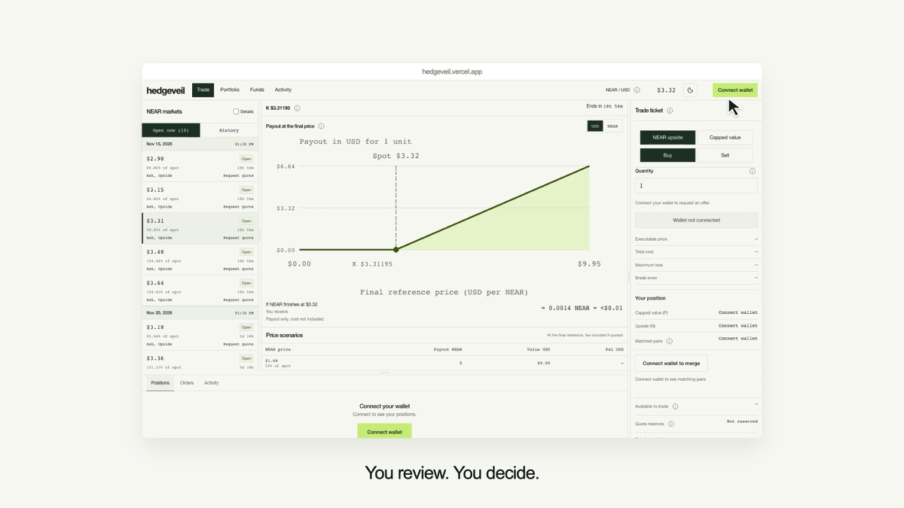
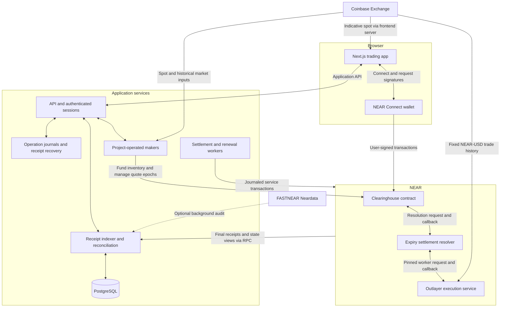
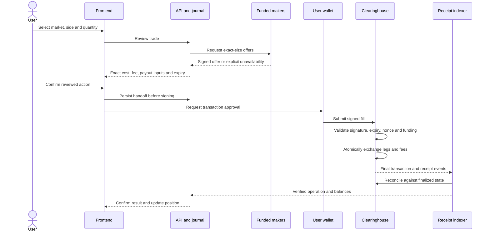
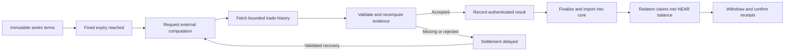

<div align="center">

# Hedgeveil



### Options on NEAR. Your exposure. Your choice.

**Trade NEAR upside. Choose capped exposure. Know your purchase cost before you sign.**

[Explore the app](https://hedgeveil.vercel.app) | [Start trading](https://hedgeveil.vercel.app/trade) | [System status](https://hedgeveil.vercel.app/status)

**NEAR** / **Rust** / **Next.js** / **Outlayer** / **PostgreSQL**

</div>

Hedgeveil is a fully collateralized options protocol built on NEAR. It turns one
NEAR into two complementary positions: **Upside**, which pays when the final
reference price exceeds a chosen set price, and **Capped value**, whose dollar
payout at that reference price follows NEAR up to a cap.

The possible payouts are backed upfront. A fully paid purchase requires no
borrowed funds, margin top-ups or price-triggered liquidation. Traders can
explore outcomes, review a funded offer, sign with their wallet and manage the
position through sale, merging or redemption.

> **Public testnet demo.** Transactions use test NEAR. Production and the
> experimental tracking vault remain disabled; independent security review is
> pending. Real market data and finalized receipts power the public flow.

[Why Hedgeveil](#why-hedgeveil) | [Product](#what-you-can-do) | [Mechanics](#one-near-two-positions) | [Architecture](#architecture) | [Flows](#from-wallet-to-position) | [Settlement](#how-settlement-works) | [Evidence](#working-flows-and-evidence) | [Development](#run-and-verify)

## Why Hedgeveil

A leveraged position can be liquidated during a temporary market move, even if
the price later recovers. Debt-backed systems also need timely prices and
liquidators to manage their obligations.

Hedgeveil starts with a different primitive: divide existing collateral into two
claims whose combined payout is already covered. The oracle determines how that
backing is distributed at settlement; it does not trigger margin liquidations.

The inspiration is Vitalik Buterin's research,
[Building index-tracking assets on top of options instead of debt](https://ethresear.ch/t/building-index-tracking-assets-on-top-of-options-instead-of-debt/25036),
also shared in [his post](https://x.com/VitalikButerin/status/2061469961416032653).
Hedgeveil implements the options foundation on NEAR. The research's higher-level
index-tracking strategy is separate work, not a shipped savings product. This is
an independent project, not an endorsement.

| Design choice | What it means for a trader |
| --- | --- |
| Full NEAR backing | Matching claims share collateral already held by the contract. |
| Fully paid purchases | No margin calls; a purchase can still lose its entire cost plus fees. |
| Reviewed, signed offers | You see exact amounts before approving an all-or-nothing trade. |
| Fixed settlement terms | Source, expiry and observation policy are bound to the series. |
| Receipt-based completion | A wallet response alone is not treated as proof that a transfer completed. |

## What you can do

| Surface | Purpose |
| --- | --- |
| **Trade** | Select a market and expiry, explore USD/NEAR payouts, buy or sell against funded offers. |
| **Portfolio** | Inspect holdings, create pairs, merge matching claims and redeem finalized positions. |
| **Funds** | Add trading collateral and withdraw available NEAR to your wallet. |
| **Activity** | Follow confirmed transactions and recover uncertain wallet outcomes. |
| **Status** | Inspect observed API, indexing, maker, settlement and renewal health. |

The trading workspace includes a persistent market list, interactive payoff
chart, price scenarios, exact-cost review, tabular positions, resizable panels
and light/dark themes. New users receive a contextual tour, with explanations
behind information buttons rather than blocks of protocol terminology.

Wallet connection uses **NEAR Connect**, with **Meteor** and **Intear**. Hosted
account verification uses a signed message; it neither transfers funds nor adds
a wallet access key. Financial actions require their own wallet approval.

## One NEAR, two positions

Creating one pair locks **1 NEAR** and issues **1 P + 1 N** for the same market.
The interface calls P **Capped value** and N **Upside**.

For set price `K` and positive final reference price `X`, the per-unit payouts are:

```text
                       NEAR payout             USD value at reference X

Capped value (P)        min(1, K / X)            min(X, K)
Upside (N)             1 - min(1, K / X)        max(X - K, 0)

Combined               1 NEAR                  X dollars
```

For example, with a **$3 set price**, one pair distributes its backing as follows.
These are illustrative payoffs, not current prices or executable offers.

| Final reference price | Capped value payout | Upside payout | Combined |
| ---: | ---: | ---: | ---: |
| $2 | 1 NEAR ($2) | 0 NEAR ($0) | 1 NEAR |
| $3 | 1 NEAR ($3) | 0 NEAR ($0) | 1 NEAR |
| $4 | 0.75 NEAR ($3) | 0.25 NEAR ($1) | 1 NEAR |
| $6 | 0.5 NEAR ($3) | 0.5 NEAR ($3) | 1 NEAR |

Payout is not profit: subtract the purchase cost and applicable fees. Actual
transfers use integer arithmetic and round down; small residual dust is accounted
for separately. NEAR amounts use `10^24` atomic units and reference prices use
`10^12` USD/NEAR units.

**Three ways to exit:**

- **Sell:** accept a funded offer while trading is permitted. A buyer is required.
- **Merge:** combine equal P and N from the same series before finalization,
  including while settlement is delayed. This returns the pair's NEAR backing
  without needing a buyer or an oracle price.
- **Redeem:** after finalization, burn either claim for its fixed NEAR payout.
  Withdraw the resulting available collateral separately.

Capped value is **not a put, principal protection or a guaranteed dollar balance**.
After settlement fixes a NEAR payout, its dollar value continues to move with NEAR.

## Architecture



### What we build and what we integrate

| Layer | Hedgeveil implementation | External dependency |
| --- | --- | --- |
| User experience | Trading workspace, payoff exploration, review dialogs, activity and status | Next.js, React, Coss/Cult-derived UI components |
| Wallet boundary | Exact transaction intents, ownership verification and recovery | NEAR Connect, Meteor, Intear |
| Collateral and claims | Rust clearinghouse, internal P/N ledger, reserve accounting and withdrawal callbacks | NEAR execution and finality |
| Pricing and execution | Maker valuation, inventory guards, signed RFQs and atomic fills | Coinbase market inputs |
| Settlement | Historical TWAP worker, evidence checks, resolver and bounded retry coordination | Coinbase history, Outlayer delivery |
| Data and operations | Receipt replay, same-block reconciliation, journals and health checks | PostgreSQL, NEAR RPC, optional FASTNEAR feed |
| Hosting | Web application and backend services | Vercel and Railway |

The application does not run a price exchange or fabricate an in-house feed.
Hedgeveil's resolver validates the configured external evidence and fixes the
settlement result. The indexer is application-owned; FASTNEAR is an additional
audit source, not a replacement for accounting reconciliation.

## From wallet to position



A successful offer request does not reserve liquidity. The contract checks
funding again at execution, and an expired, cancelled or consumed offer cannot
be filled. An unsuccessful or uncertain wallet handoff is recovered through its
journal and receipts; the app does not silently submit the transaction again.

For a first deposit, the implemented flow can include account storage and trading
collateral in one wallet approval. The review separates those amounts. Withdrawals
also remain pending until the transfer and callback establish the result.

## How settlement works

The current expiry profile uses a **30-minute NEAR/USD TWAP ending at expiry**.
TWAP means time-weighted average price. The pinned worker fetches actual Coinbase
Exchange trades and weights each price by the time it remained the latest trade.
This is not a candle average or a caller-selected spot observation.



The worker and resolver check the configured source/window, trade sequence and
coverage, freshness bounds and exact arithmetic. Raw evidence can be replayed
with independent Rust and Python implementations. The resolver records evidence
digests; the clearinghouse imports a finalized result bound to its series.

The callback authenticates the configured Outlayer path. It does **not** make
Coinbase data trustless or independently verify Outlayer's TEE hardware.
Provider behavior, code and operator control remain trust dependencies.

**If delivery fails:** settlement waits for valid external evidence. The app
shows observed progress without promising a completion time. Uncertain transfers
must be resolved from receipts before another money-moving action is attempted.

Historical series retain their original policies, including the earlier sampled
resolver. Their economics are never rewritten to match a newer deployment.

### Pricing and market renewal

Makers use external spot/history and volatility estimates to value the pair,
apply spreads and enforce inventory limits. For TWAP series, valuation models
the average-price payoff using a moment approximation; it is not an exact market
price or a guarantee of execution. Quotes stop at the observation-window start.

The listing policy targets two expiries: the next daily and Friday weekly expiry,
both at **08:00 UTC**, with five set prices at **90%, 95%, 100%, 105% and 110%** of
a fresh spot seed. Cohorts retain their original terms. Renewal depends on
capacity, funding, reconciled receipts and actual maker inventory; ten configured
markets do not imply ten continuously available offers.

## Accounting and failure handling

| Invariant | Implementation consequence |
| --- | --- |
| Collateral is not operating cash | User balances, series reserves, storage and service funding are accounted for separately. |
| No partial RFQ execution | Exact trade legs and fees settle atomically or revert. |
| Quotes cannot be replayed | Signed domains, registered keys, nonces, expiry and cancellation epochs are checked. |
| Settlement is bound to the series | Versioned policy and source pins constrain resolution; stale callbacks cannot replace a finalized price. |
| A timeout is not a failed transfer | Unknown withdrawals remain quarantined until receipt evidence establishes an outcome. |
| Indexing must agree with the chain | Receipt replay, event sequences and finalized state snapshots must reconcile before new risk is admitted. |
| Display data is not settlement data | Indicative spot and model output cannot finalize a claim. Missing live inputs never become fixture prices. |

Full backing is an accounting property, not a guarantee against implementation
bugs or operational outages. Testnet deployment/service keys remain controlled by
the project; the demo is not an immutable, independently operated production system.

## Working flows and evidence

The following are **recorded observations through 14 November 2026**, not a claim
of present service availability. Use the [status page](https://hedgeveil.vercel.app/status)
for current observed health.

| Flow | Evidence | Scope |
| --- | --- | --- |
| Buy Upside on the public app | [Transaction](https://testnet.nearblocks.io/txns/81w1373sAcoZ4VdmWjoFd3z3p5khNnjG7JFFs2PodPJ9) | Owner wallet, public Vercel frontend |
| Sell a position | [Transaction](https://testnet.nearblocks.io/txns/VmKTQNe9xzfsLxewh1f1XYjBpRUAgRu3kg8JuVBvF8B) | Owner wallet, current deployment |
| Create a pair | [Transaction](https://testnet.nearblocks.io/txns/9vtLyBG8op6vcUHj7MiL4MjjJoXo5wKtdrV7C4ysffXZ) | 0.01 NEAR split into matching claims |
| Merge the pair | [Transaction](https://testnet.nearblocks.io/txns/Fy8fhSoYEmPhx2L4gBsFRoUK4uHCTcUDY6jdHiBbpt5T) | Same pair recombined into collateral |
| Withdraw | [Transaction](https://testnet.nearblocks.io/txns/HU858PeWXoYWc59yuWybr1YahsUS9LQVNB2pXRsnuq1y) | Successful transfer and callback |
| External expiry settlement and payout | Recorded final receipts and matching Rust/Python replay | Project account; both legs redeemed and proceeds withdrawn |
| Ten-user accounting exercise | Compiled-Wasm lifecycle and accounting checks | Compiled contracts and real local receipts; test-only synthetic pricing |

### Still to validate

- Sustained public execution with ten users; local concurrency and signed-session
  read tests do not establish this.
- First-time combined deposit and new-profile redemption through an owner wallet
  on the public frontend.
- Broader settlement reliability testing; recorded success does not establish
  an availability or latency guarantee.
- Public acceptance of the recently implemented position P&L display.
- Independent contract, infrastructure and economic review before production.

The tracking vault remains disabled because no tested strategy passed its
selection gates. P/N ownership uses an internal ledger; full standard wallet-token
interfaces are not claimed.

## Run and verify

### Frontend

Prerequisites: **Node.js 22.22.2+**, npm and Git. Run from the repository root:

```sh
npm ci --prefix apps/frontend
cp -n apps/frontend/.env.example apps/frontend/.env.local
npm --prefix apps/frontend run dev
```

Open `http://127.0.0.1:3000`. The homepage and UI can start independently, but
accounts and transactions require a separately configured backend. Set
`HEDGEVEIL_BACKEND_ORIGIN` in the local frontend environment to the retained
backend you operate. Starting Next.js does not deploy contracts or seed liquidity.
Never copy wallet keys or service credentials into browser-exposed variables.

```sh
npm --prefix apps/frontend run typecheck
npm --prefix apps/frontend run build
```

### Deterministic core checks

Use Python 3 and the Rust toolchains pinned in the repository. These checks need
no paid API keys, funded wallet or live market feed:

```sh
cargo test --locked --workspace
cargo fmt --all -- --check
cargo clippy --locked --workspace --all-targets -- -D warnings

python3 -m unittest discover -s research/reference-model -v
python3 research/reference-model/generate_vectors.py --check
python3 packages/shared-schemas/build_schema.py --check
python3 packages/shared-schemas/build_expiry_schema.py --check

node --test tests/market/codec.test.mjs tests/sdk/client.test.mjs
node --test tests/oracle/delivery-retry.test.mjs
```

### Compiled contract tests

The contract workspace uses its own pinned toolchain. First use downloads the
required build dependencies and local NEAR Sandbox runtime:

```sh
rustup toolchain install 1.96.0 --profile minimal --component rustfmt,clippy --target wasm32-unknown-unknown
npm ci --prefix tests/sandbox --ignore-scripts
npm ci --prefix services/indexer --ignore-scripts
python3 scripts/build-core.py
node tests/sandbox/g3.mjs
node tests/sandbox/g5.mjs

python3 scripts/build-expiry-oracle.py
node tests/sandbox/expiry-settlement.mjs
```

Tests cover exact payoff agreement, custody conservation, signatures/replays,
callback failures, stale evidence and recovery. Synthetic prices are limited to
local test fixtures; passing a local test is not evidence of live provider delivery.
See [contract instructions](contracts/README.md), [shared schemas](packages/shared-schemas/README.md)
and [verification scope](verification/README.md) for details.

### Deployment

The frontend is hosted on **Vercel**, with application services on **Railway**.
Deployment provisioning, credentials, recovery procedures and operational runbooks
are maintained separately from this public overview.

## Repository map

```text
apps/frontend/                  Next.js application and API bridge
apps/web/                       Backend API and wallet integration
contracts/clearinghouse/        Collateral, claims, trades and withdrawals
contracts/expiry-settlement/    Current expiry-price resolver
contracts/external-settlement/  Historical sampled-price resolver
crates/payoff-math/             Checked Rust payoff arithmetic
packages/sdk/                   Exact intents, wallet boundary and receipt recovery
packages/rfq/                   Canonical signed-quote encoding
packages/shared-schemas/        Generated versioned schemas
services/maker/                 Market valuation, inventory and RFQ workers
services/market-data/           Coinbase input validation
services/expiry-worker/         Historical TWAP worker and Python replay
services/outlayer/              Delivery, evidence and retry coordination
services/indexer/               PostgreSQL projections and reconciliation
services/markets/               Listing policy
services/testnet/               Development network tooling
research/reference-model/       Rational payoff reference and vectors
research/reports/               Dated implementation and acceptance evidence
tests/                          Unit, browser, integration and Sandbox checks
verification/                   Bounded state models and SMT checks
deploy/                         Deployment tooling
```

Internal planning documents are maintained locally and are not required to run
the deterministic checks above. Older reports and maintainer release-packaging
workflows may refer to those documents. The preserved
[privacy-track archive](archive/privacy-track/README.md) is historical and excluded
from active builds.

Third-party components retain their [Cult UI](apps/frontend/components/ui/CULT-LICENSE.md),
[Coss UI](apps/frontend/components/ui/COSS-LICENSE.md) and
[wallet executor](apps/web/wallets/executors/README.md) attribution and licenses.
